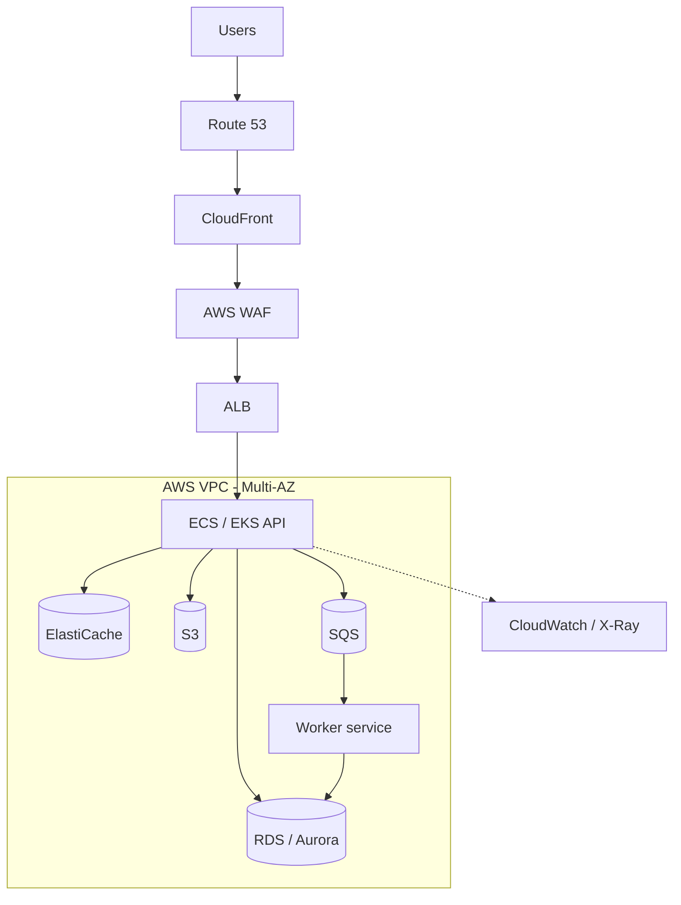
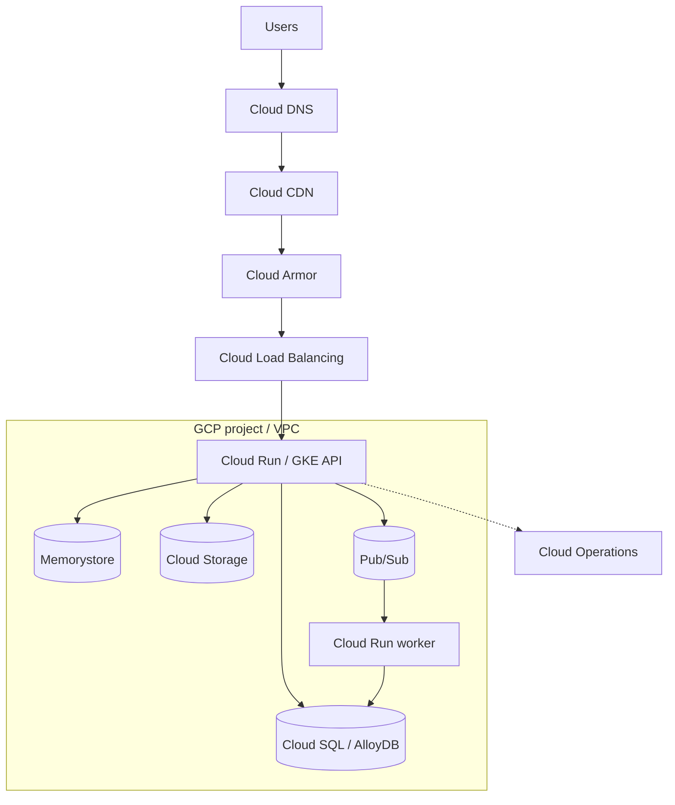
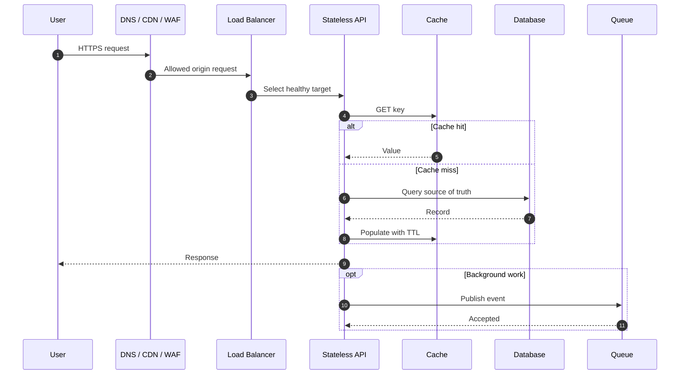

# Cloud Architecture — AWS and GCP Visual Guide

This is the visual entry point for mapping logical responsibilities to cloud services. A cloud product name is not an architecture: show request flow, network boundaries, durable state ownership, failure behavior, identity and operational visibility.

## Official provider icon libraries

- **AWS:** [AWS Architecture Icons](https://aws.amazon.com/architecture/icons/). Use the current official package. AWS documents use of the icons in architecture diagrams and related technical materials.
- **Google Cloud:** [Google Cloud product icons](https://cloud.google.com/icons). Use the current product/category SVG and PNG packages; Google refreshed the iconography in early 2025.

Keep icons unmodified, provide a text label next to each logo, and use arrows that show the actual request or data connection. The individual service logo references and component maps are in the [AWS page](aws_reference_architecture.md) and [GCP page](gcp_reference_architecture.md).

## 1. AWS logical request and async paths

## 2. GCP logical request and async paths

## 3. Connector legend

- **Solid arrows:** request, event or data movement.
- **Dashed arrows:** telemetry, identity or control-plane relationships.
- **Cylinders:** databases, queues, streams or object stores.
- **Subgraphs:** logical network, account, project or subnet boundaries.
- **Labeled arrows:** add protocol/operation where meaningful (`HTTPS`, `GET`, `SQL`, `Publish`, `ACK`).

## 4. Critical request sequence

## 5. Capability mapping, not false equivalence

| Capability | AWS | GCP | Compare |
|---|---|---|---|
| DNS | Route 53 | Cloud DNS | Routing, health checks, private zones |
| CDN | CloudFront | Cloud CDN | Cache policy, origin behavior and invalidation |
| WAF | AWS WAF + Shield | Cloud Armor | Rule model and edge integration |
| Ingress | ALB / NLB | Cloud Load Balancing | L4/L7, global/regional, target model |
| Containers | ECS / EKS | Cloud Run / GKE | Managed runtime vs Kubernetes |
| VM | EC2 | Compute Engine | Instance families and managed groups |
| Relational OLTP | RDS / Aurora | Cloud SQL / AlloyDB | Engine, extensions, HA and connection limits |
| Global relational | No direct like-for-like | Spanner | Consistency and distributed transaction model |
| Key-value / document | DynamoDB | Firestore / Bigtable | Data model, query patterns, partition behavior |
| Cache | ElastiCache | Memorystore | Engine, topology, failover and persistence |
| Object storage | S3 | Cloud Storage | Lifecycle, IAM, consistency and transfer cost |
| Queue/pub-sub | SQS / SNS | Pub/Sub | Ordering, delivery, retention and DLQ |
| Event routing | EventBridge | Eventarc | Filtering, retries and target integration |
| Secrets | Secrets Manager | Secret Manager | Rotation, IAM integration and audit |
| Observability | CloudWatch / X-Ray | Cloud Monitoring / Logging / Trace | Instrumentation and retention |

## 6. Make diagrams connectable in draw.io

1. Put users and external systems at top/left.
2. Place DNS, CDN, WAF and ingress in the edge lane.
3. Group application workloads inside a VPC/project boundary.
4. Place databases and caches inside private data boundaries.
5. Put queues/topics between producers and consumers; label ACK and retry paths.
6. Add dashed telemetry links to observability.
7. Draw identity/secret access as control-plane edges, not user request flow.
8. Use official provider logos and explicit service names.

## References

- [AWS official architecture icons](https://aws.amazon.com/architecture/icons/)
- [Google Cloud official product icons](https://cloud.google.com/icons)
- [Multi-cloud trade-offs](multi_cloud_patterns.md)
- [AWS reference](aws_reference_architecture.md)
- [GCP reference](gcp_reference_architecture.md)