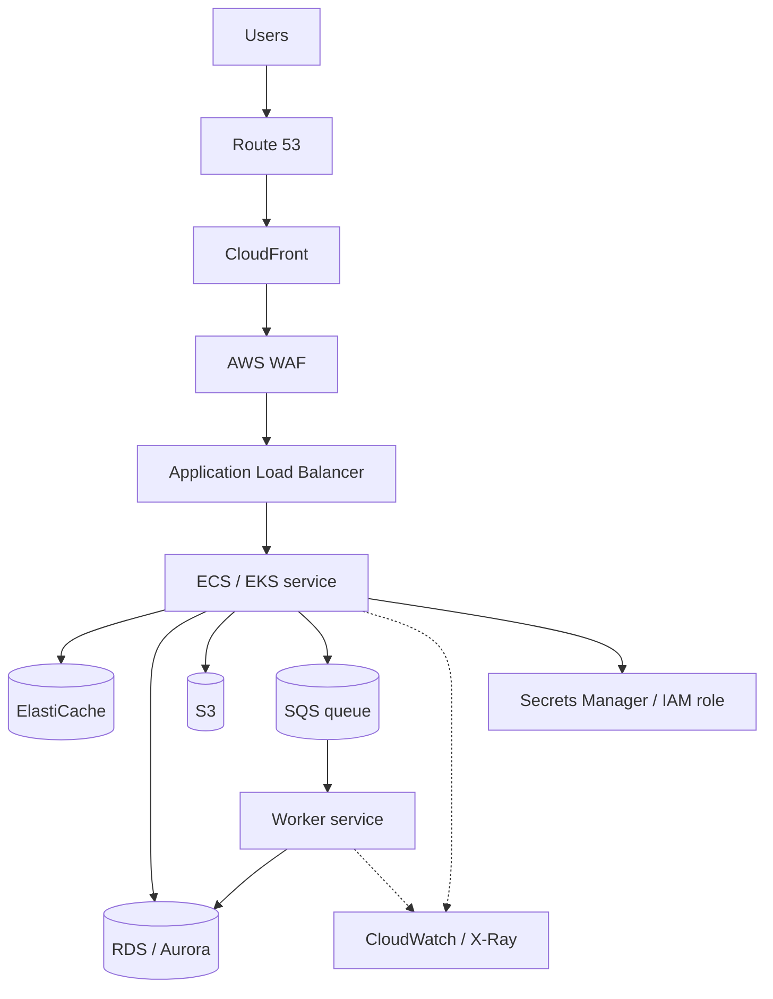
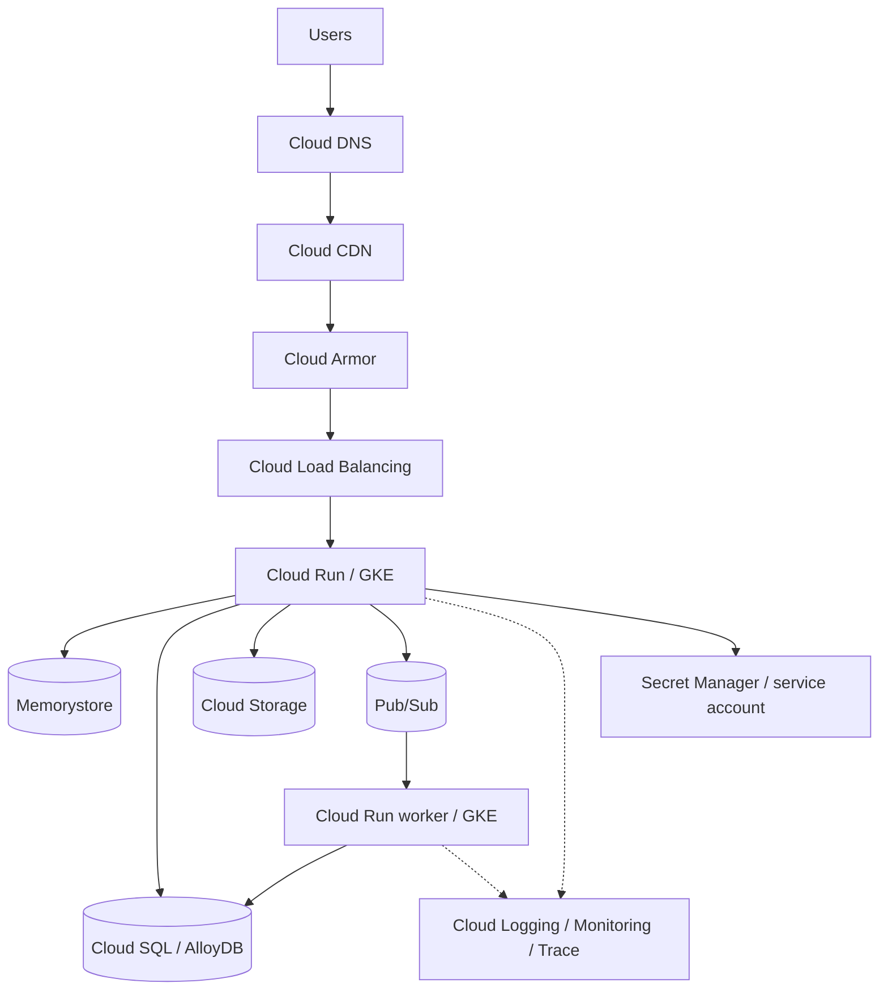
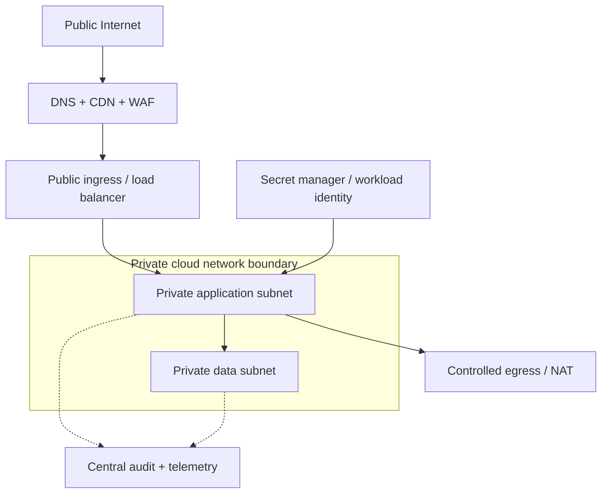
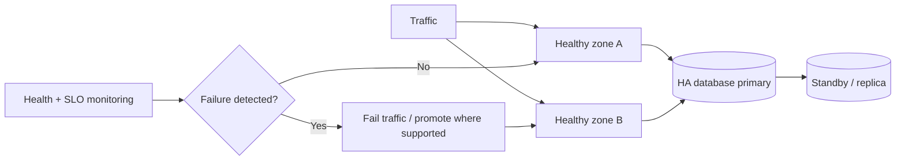

# Cloud Architecture — AWS and GCP Visual Guide

Start from logical responsibilities, then map each responsibility to a managed service. A service name is not an architecture: region layout, IAM, network boundaries, data durability, quotas, failure handling and operational ownership still need to be designed.

## 1. Typical web application — AWS

## 2. Typical web application — GCP

The diagrams show conceptual paths, not mandatory product combinations. For example, a static app may not need a container service, and a small application may not need a cache or queue.

## 3. Workload-to-service mapping

| Capability | AWS | GCP | Selection note |
|---|---|---|---|
| DNS | Route 53 | Cloud DNS | Managed authoritative DNS |
| CDN | CloudFront | Cloud CDN | Edge caching and delivery |
| WAF / edge protection | AWS WAF + Shield | Cloud Armor | Protection features and integration differ |
| L7 load balancing | Application Load Balancer | Cloud Load Balancing | Compare routing, health checks, global/regional topology |
| VM compute | EC2 | Compute Engine | Infrastructure-managed workloads |
| Containers / Kubernetes | ECS / EKS | Cloud Run / GKE | Cloud Run is managed container execution; GKE is Kubernetes |
| Serverless functions | Lambda | Cloud Run functions | Event-driven function execution; runtime semantics differ |
| Relational DB | RDS / Aurora | Cloud SQL / AlloyDB | Compare engine, HA, extensions and operational limits |
| Globally distributed SQL | No direct like-for-like match | Spanner | Aurora Global Database is not the same consistency/transaction model |
| Key-value NoSQL | DynamoDB | Firestore (document) / Bigtable (wide-column) | Choose by data model and query shape |
| In-memory cache | ElastiCache | Memorystore | Redis/Valkey capabilities vary by offering/version |
| Object storage | S3 | Cloud Storage | Durability, lifecycle, IAM and access patterns |
| Work queue / messaging | SQS / SNS | Pub/Sub | Delivery, ordering and retention are not identical |
| Event routing | EventBridge | Eventarc | Event filtering and target integrations differ |
| Stream processing | Kinesis / Managed Service for Apache Flink | Dataflow / Pub/Sub | Streaming ingestion and processing roles differ |
| Workflow orchestration | Step Functions | Workflows | Durable workflow use cases and integration differ |
| Secrets | Secrets Manager / Parameter Store | Secret Manager | Secret lifecycle and IAM |
| Container registry | ECR | Artifact Registry | Image and artifact storage |
| Metrics / logs / traces | CloudWatch / X-Ray | Cloud Monitoring / Logging / Trace | Instrumentation and retention choices matter |
| Identity and access | IAM | Cloud IAM | Design workload identity and least privilege |

## 4. Network and trust boundaries

Keep databases private by default. Use workload identity/roles rather than long-lived credentials, restrict egress, and send audit logs to a protected destination. Exact subnet and routing constructs differ by provider.

## 5. High availability and recovery

Multi-zone availability is not the same as regional disaster recovery. Define RTO/RPO, backup retention, restore testing, replication lag and failover ownership explicitly. A replica is not a backup.

## 6. Cloud design decision path

1. Define workload shape and SLOs before selecting products.
2. Choose compute based on runtime, scaling and control needs.
3. Choose data stores from invariants and access patterns.
4. Decide synchronous vs asynchronous boundaries.
5. Define identity, network segmentation, secrets and audit.
6. Design multi-zone resilience and regional recovery separately.
7. Estimate cost drivers: compute hours, requests, storage, egress, logs and managed-service capacity.
8. Validate quotas, regional availability, product limits and pricing before production decisions.

## Related study paths

- [Fundamentals](../fundamentals/README.md)
- [Distributed patterns](../patterns/README.md)
- [AWS reference](aws_reference_architecture.md)
- [GCP reference](gcp_reference_architecture.md)
- [Multi-cloud trade-offs](multi_cloud_patterns.md)
