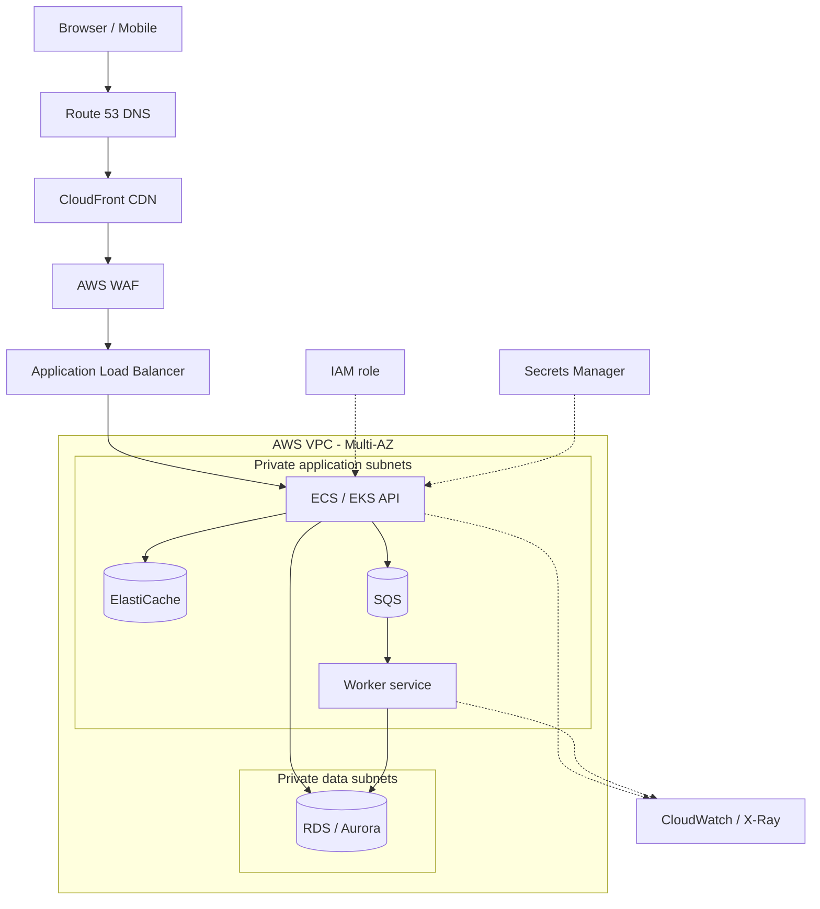
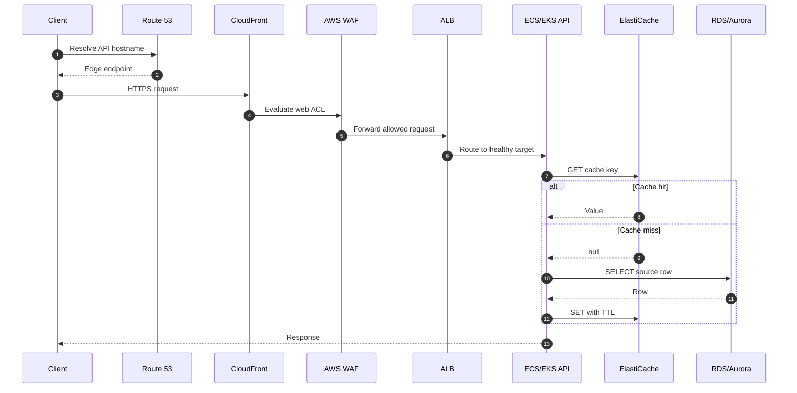
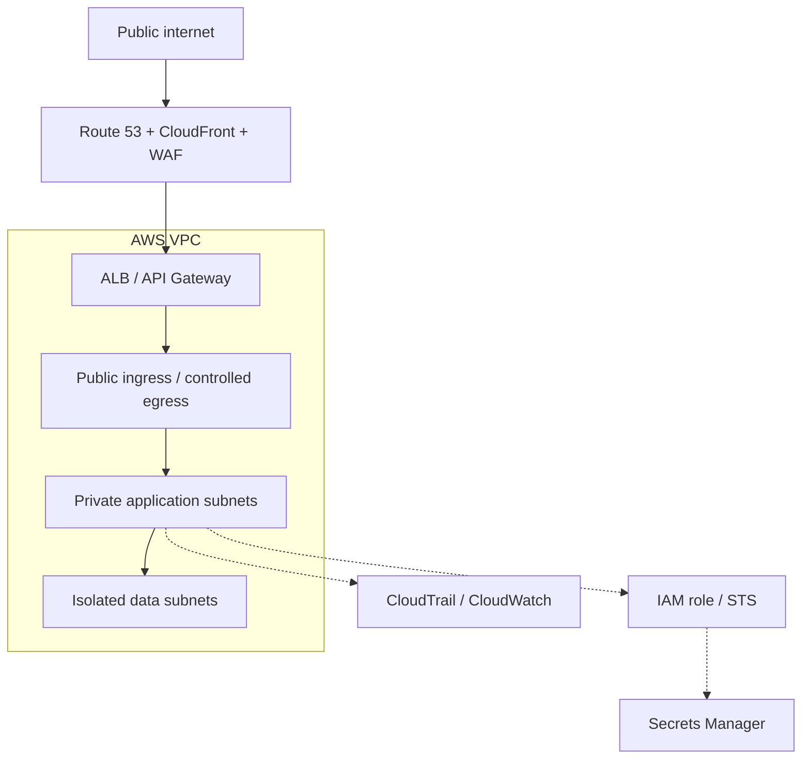
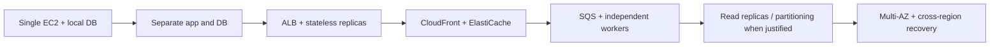

# AWS Reference Architecture

Use current official AWS architecture icons in diagrams. The service logos are in the [AWS Architecture Icons library](https://aws.amazon.com/architecture/icons/). Keep the artwork unchanged and show the full service label beside every logo.

## Component logo map

| Stage | Service icon / logo lookup | Role |
|---|---|---|
| DNS | [Route 53](https://awsfundamentals.com/aws-icons/route-53) | Resolve public/private names |
| CDN | [CloudFront](https://awsfundamentals.com/aws-icons/cloudfront) | Edge caching and static delivery |
| WAF | [AWS WAF](https://aws.amazon.com/waf/) | HTTP filtering and protection |
| Ingress | [Elastic Load Balancing](https://awsfundamentals.com/aws-icons/elastic-load-balancing) | Health checks and L7 routing |
| API | [API Gateway](https://awsfundamentals.com/aws-icons/api-gateway) | API front door, policies and quotas |
| Compute | [EC2](https://awsfundamentals.com/aws-icons/ec2), [ECS](https://awsfundamentals.com/aws-icons/ecs), [EKS](https://awsfundamentals.com/aws-icons/eks) | VM and container workloads |
| Relational data | [RDS](https://awsfundamentals.com/aws-icons/rds), [Aurora](https://awsfundamentals.com/aws-icons/aurora) | Transactions and SQL |
| Key-value | [DynamoDB](https://awsfundamentals.com/aws-icons/dynamodb) | Key-oriented NoSQL access |
| Cache | [ElastiCache](https://awsfundamentals.com/aws-icons/elasticache) | Cache, session and rate-limit state |
| Object storage | [S3](https://awsfundamentals.com/aws-icons/amazon-simple-storage-service) | Durable objects/blobs |
| Queue / pub-sub | [SQS](https://awsfundamentals.com/aws-icons/amazon-simple-queue-service), [SNS](https://awsfundamentals.com/aws-icons/amazon-simple-notification-service) | Async work and fanout |
| Events | [EventBridge](https://awsfundamentals.com/aws-icons/eventbridge) | Event routing |
| Observability | [CloudWatch](https://awsfundamentals.com/aws-icons/cloudwatch), [X-Ray](https://awsfundamentals.com/aws-icons/aws-x-ray) | Metrics, logs and traces |
| Identity / secrets | [IAM](https://aws.amazon.com/iam/), [Secrets Manager](https://awsfundamentals.com/aws-icons/secrets-manager) | Workload identity and secret lifecycle |

## 1. Connected reference architecture

## 2. Read request sequence

## 3. Network and trust boundary

Keep databases and caches private by default. Use security groups, subnet routing, scoped IAM roles, secret rotation, audit trails and controlled egress.

## 4. Scale progressively

Add a tier only when it addresses a measured constraint. Multi-region active-active adds data ownership, conflict, failover and cost decisions.

## References

- [AWS Architecture Icons](https://aws.amazon.com/architecture/icons/)
- [AWS Well-Architected Framework](https://docs.aws.amazon.com/wellarchitected/latest/framework/welcome.html)
- [AWS Prescriptive Guidance](https://docs.aws.amazon.com/prescriptive-guidance/)