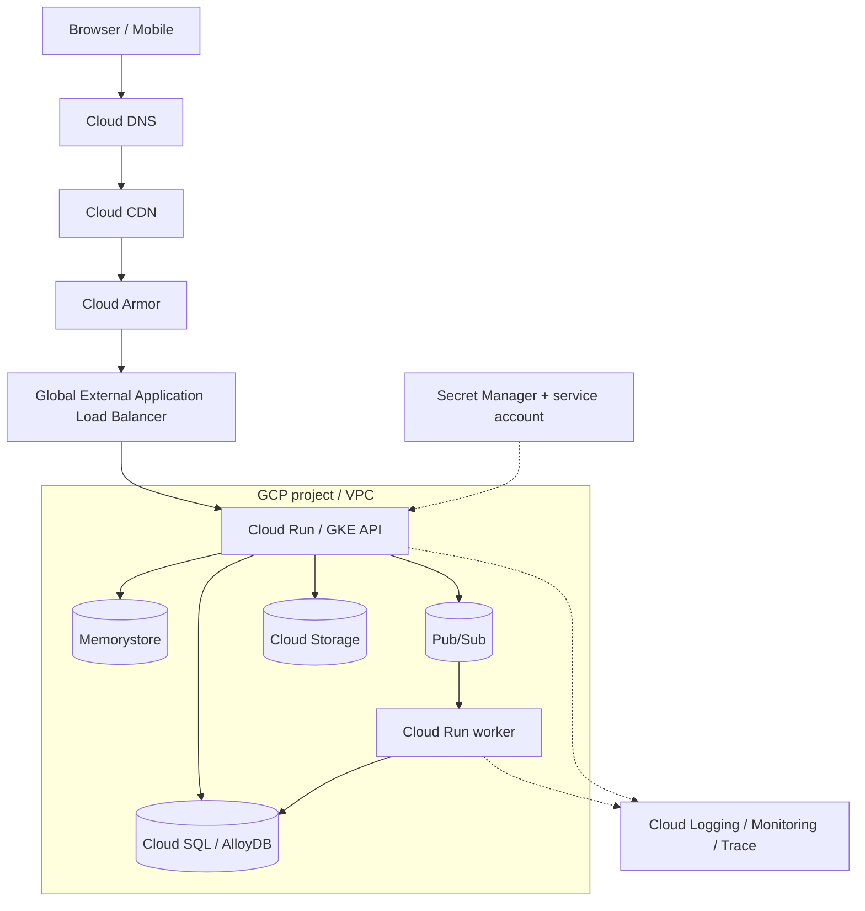
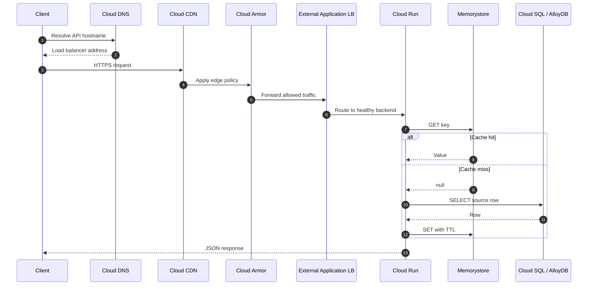
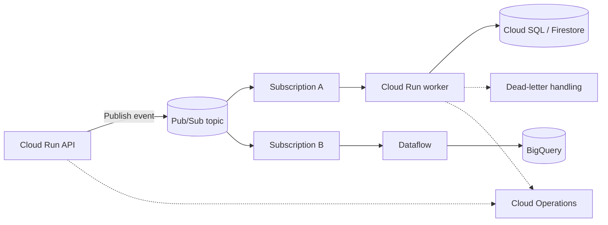
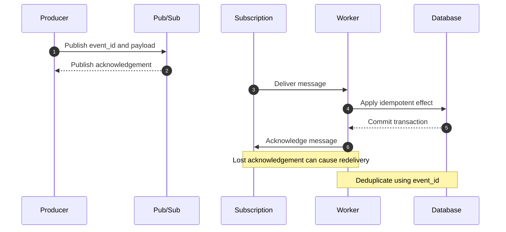
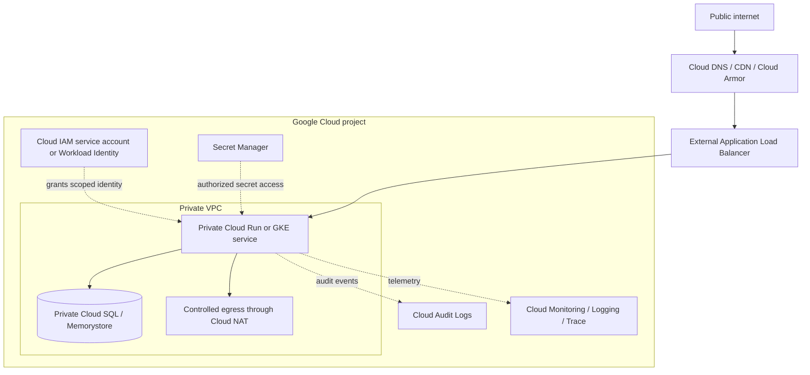
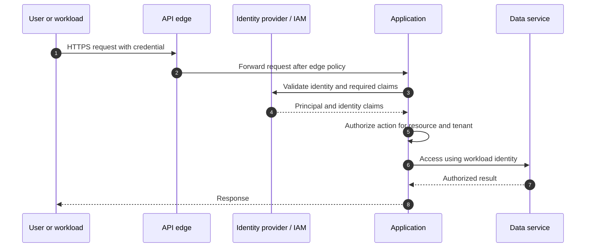
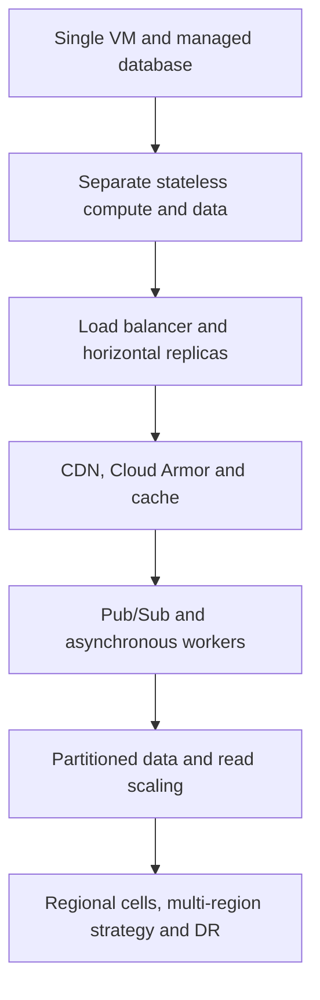

# GCP Reference Architecture

Use the current Google Cloud product icons in architecture diagrams. Download SVG/PNG from the [official Google Cloud icon library](https://cloud.google.com/icons). Keep the artwork unmodified and put the product name beside every logo. Google refreshed its iconography in early 2025; prefer the current product/category sets over legacy console graphics.

## Component logo map

| Stage | GCP service / logo lookup | Role |
|---|---|---|
| DNS | [Cloud DNS](https://cloud.google.com/icons) | Name resolution |
| CDN | [Cloud CDN](https://cloud.google.com/icons) | Edge caching and delivery |
| WAF | [Cloud Armor](https://cloud.google.com/icons) | WAF and DDoS protection |
| Ingress | [Cloud Load Balancing](https://cloud.google.com/icons) | Global/regional routing |
| API management | [Apigee](https://cloud.google.com/icons) | API lifecycle and policy |
| Serverless containers | [Cloud Run](https://cloud.google.com/icons) | Managed request-driven containers |
| Kubernetes | [GKE](https://cloud.google.com/icons) | Kubernetes workloads |
| VM compute | [Compute Engine](https://cloud.google.com/icons) | VM-based workloads |
| Relational | [Cloud SQL / AlloyDB](https://cloud.google.com/icons) | SQL OLTP |
| Global relational | [Spanner](https://cloud.google.com/icons) | Distributed relational database |
| Document | [Firestore](https://cloud.google.com/icons) | Document application data |
| Wide-column | [Bigtable](https://cloud.google.com/icons) | Large key-range workloads |
| Cache | [Memorystore](https://cloud.google.com/icons) | Managed cache |
| Object storage | [Cloud Storage](https://cloud.google.com/icons) | Durable object/blob storage |
| Messaging | [Pub/Sub](https://cloud.google.com/icons) | Async publish/subscribe |
| Event routing | [Eventarc](https://cloud.google.com/icons) | Event routing |
| Stream processing | [Dataflow](https://cloud.google.com/icons) | Batch and streaming transforms |
| Orchestration | [Workflows](https://cloud.google.com/icons) | Service orchestration |
| Secrets | [Secret Manager](https://cloud.google.com/icons) | Secret lifecycle |
| Observability | [Cloud Monitoring / Logging / Trace](https://cloud.google.com/icons) | Metrics, logs and traces |
| Identity | [Cloud IAM](https://cloud.google.com/iam) | User and workload permissions |

## 1. Connected reference architecture

## 2. Read request sequence

## 3. Event-driven path

### Event publish and delivery topology

### Delivery and acknowledgement sequence

Pub/Sub delivery is generally at-least-once for this design, so consumers must be idempotent. Persist the event ID in the same transaction as the business effect (or use an inbox/deduplication table with a unique constraint). Acknowledge only after the effect and deduplication record commit. Use bounded retries, dead-letter handling and replay procedures; do not assume that an acknowledgement or publish response means downstream processing has completed.

## 4. Identity and network boundary

### Network zones and ingress

The public edge is the only internet-facing entry point in this reference design. Keep databases, caches and worker endpoints private. Apply Cloud Armor policies and load-balancer controls before traffic reaches the application. Use IAM service accounts or Workload Identity for service-to-service identity; avoid long-lived service-account keys. Grant least-privilege roles at the narrowest practical scope, retrieve secrets through Secret Manager, and audit privileged actions.

### Identity and authorization path

Authentication establishes who is calling; authorization decides what that principal may do to a specific resource. Do not confuse network location with identity. Validate tenant/resource ownership on each operation, propagate trace and principal context, and never trust a tenant ID supplied only in an unverified request body.

## 5. Progressive scaling

### Architecture evolution

### What changes at each stage

1. **Baseline:** Start with a modular application, managed relational database, object storage and backups. Define SLOs, data ownership, tenant authorization and recovery objectives.
2. **Scale application traffic:** Put stateless application instances behind a load balancer. Add health checks, autoscaling, connection pooling and graceful shutdown.
3. **Reduce read pressure:** Add CDN for cacheable content and Memorystore for hot derived data. Define TTLs, invalidation and a source-of-truth policy.
4. **Move slow work off requests:** Publish domain events through Pub/Sub and process them with independent workers. Add idempotency, retry limits, dead-letter topics, replay and queue-age alerts.
5. **Scale data deliberately:** Add read replicas or partitioning when query plans and measured load justify them. Select a database based on consistency, query and access-pattern requirements.
6. **Improve regional resilience:** Introduce regional deployment cells, tested failover, replication and explicit RPO/RTO. Decide which operations require global consistency and which can be region-local.
7. **Optimize cost and operations:** Use autoscaling limits, retention policies, tiered storage, budgets, SLO-based alerting and capacity tests.

Do not jump to multi-region databases or sharding before measurements identify a real bottleneck. Every additional tier adds operational, consistency and failure-recovery complexity.

### Choosing the right Google Cloud data service

| Service | Best-fit problem | Important distinction |
|---|---|---|
| Cloud SQL | Managed relational OLTP with familiar SQL | Regional managed database; scale/read patterns and HA are bounded by its configuration |
| AlloyDB | PostgreSQL-compatible relational workloads requiring higher performance and advanced PostgreSQL capabilities | PostgreSQL-compatible managed database, not a general NoSQL store |
| Spanner | Horizontally scalable relational workloads needing strong consistency and SQL across regions | Distributed relational database with a different cost and schema/transaction model |
| Firestore | Document-oriented application data and real-time/mobile/web patterns | Document model and query/index constraints; not relational joins |
| Bigtable | Very high-throughput, low-latency key/range access over large datasets | Wide-column key/value access; data model and row-key design are critical |

Choose from workload evidence: consistency needs, transaction boundaries, access patterns, query shapes, data size, latency, throughput, regional requirements, operational capability and cost. These products are not interchangeable labels for “SQL” and “NoSQL.”

## References

- [Google Cloud product icons](https://cloud.google.com/icons)
- [Google Cloud Architecture Framework](https://cloud.google.com/architecture/framework)
- [Google Cloud Architecture Center](https://cloud.google.com/architecture)
- [Pub/Sub subscription delivery](https://cloud.google.com/pubsub/docs/subscriber)
- [Pub/Sub exactly-once delivery](https://cloud.google.com/pubsub/docs/exactly-once-delivery)
- [Cloud IAM overview](https://cloud.google.com/iam/docs/overview)
