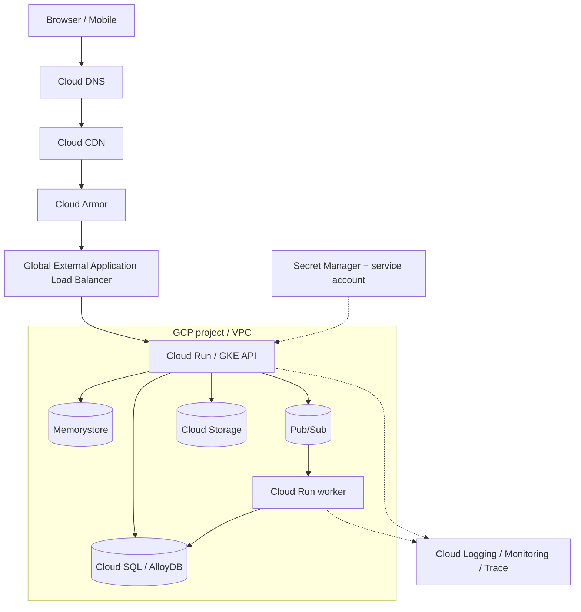
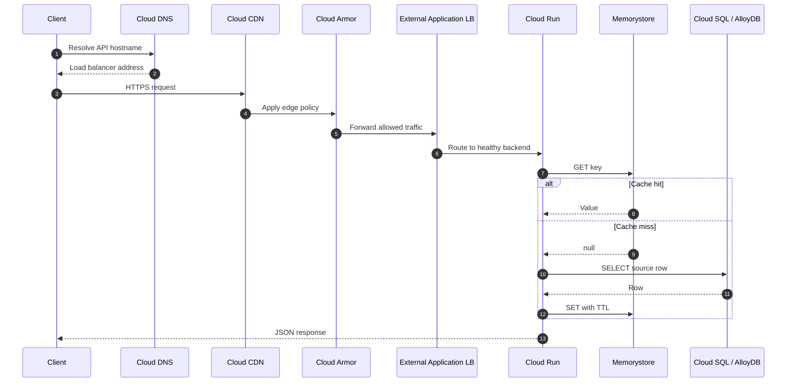
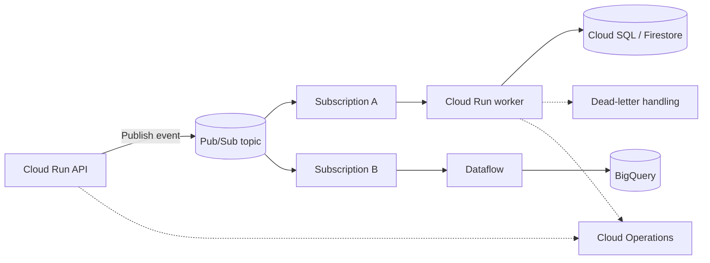
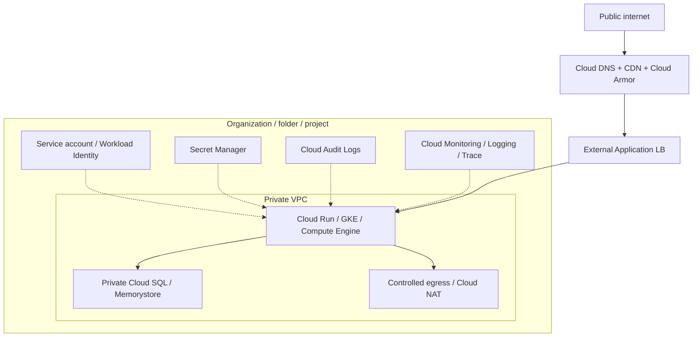
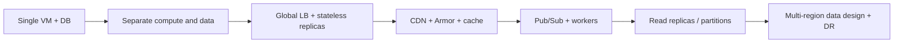

# GCP Reference Architecture

Use the current Google Cloud product icons in architecture diagrams. Download SVG/PNG from the [official Google Cloud icon library](https://cloud.google.com/icons). Keep the artwork unmodified and put the product name beside every logo. Google refreshed its iconography in early 2025; prefer the current product/category sets over legacy console graphics.

## Component logo map

| Stage | GCP service / logo lookup | Role |
|---|---|---|
| DNS | [Cloud DNS](https://cloud.google.com/icons) | Name resolution |
| CDN | [Cloud CDN](https://cloud.google.com/icons) | Edge caching and delivery |
| WAF | [Cloud Armor](https://cloud.google.com/icons) | WAF and DDoS protection |
| Ingress | [Cloud Load Balancing](https://cloud.google.com/icons) | Global/regional routing |
| API management | [Apigee](https://cloud.google.com/icons) | API lifecycle and policy |
| Serverless containers | [Cloud Run](https://cloud.google.com/icons) | Managed request-driven containers |
| Kubernetes | [GKE](https://cloud.google.com/icons) | Kubernetes workloads |
| VM compute | [Compute Engine](https://cloud.google.com/icons) | VM-based workloads |
| Relational | [Cloud SQL / AlloyDB](https://cloud.google.com/icons) | SQL OLTP |
| Global relational | [Spanner](https://cloud.google.com/icons) | Distributed relational database |
| Document | [Firestore](https://cloud.google.com/icons) | Document application data |
| Wide-column | [Bigtable](https://cloud.google.com/icons) | Large key-range workloads |
| Cache | [Memorystore](https://cloud.google.com/icons) | Managed cache |
| Object storage | [Cloud Storage](https://cloud.google.com/icons) | Durable object/blob storage |
| Messaging | [Pub/Sub](https://cloud.google.com/icons) | Async publish/subscribe |
| Event routing | [Eventarc](https://cloud.google.com/icons) | Event routing |
| Stream processing | [Dataflow](https://cloud.google.com/icons) | Batch and streaming transforms |
| Orchestration | [Workflows](https://cloud.google.com/icons) | Service orchestration |
| Secrets | [Secret Manager](https://cloud.google.com/icons) | Secret lifecycle |
| Observability | [Cloud Monitoring / Logging / Trace](https://cloud.google.com/icons) | Metrics, logs and traces |
| Identity | [Cloud IAM](https://cloud.google.com/iam) | User and workload permissions |

## 1. Connected reference architecture



## 2. Read request sequence



## 3. Event-driven path



```mermaid
sequenceDiagram
  autonumber
  participant P as Producer
  participant T as Pub/Sub
  participant S as Subscription
  participant W as Worker
  participant DB as Database
  P->>T: Publish event_id + payload
  T-->>P: Publish ack
  S->>W: Deliver message
  W->>DB: Apply idempotent effect
  DB-->>W: Commit
  W->>S: Acknowledge
  Note over S,W: A lost acknowledgement can cause redelivery; deduplicate by event_id
```

## 4. Identity and network boundary



## 5. Progressive scaling



Spanner, Bigtable, Firestore, Cloud SQL and AlloyDB solve different data problems. Do not treat them as interchangeable SQL/NoSQL boxes.

## References

- [Google Cloud product icons](https://cloud.google.com/icons)
- [Google Cloud Architecture Framework](https://cloud.google.com/architecture/framework)
- [Google Cloud Architecture Center](https://cloud.google.com/architecture)