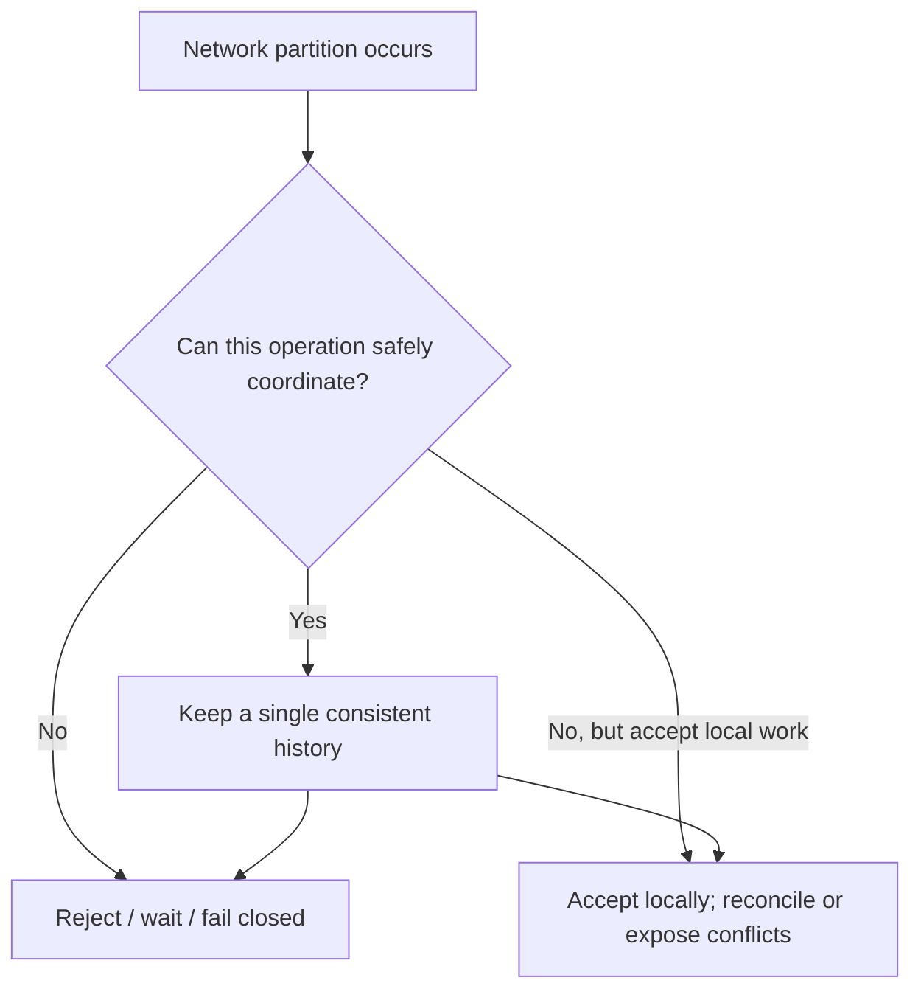
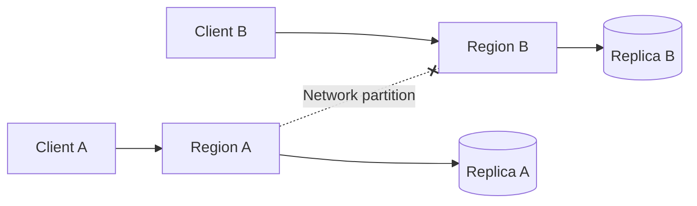
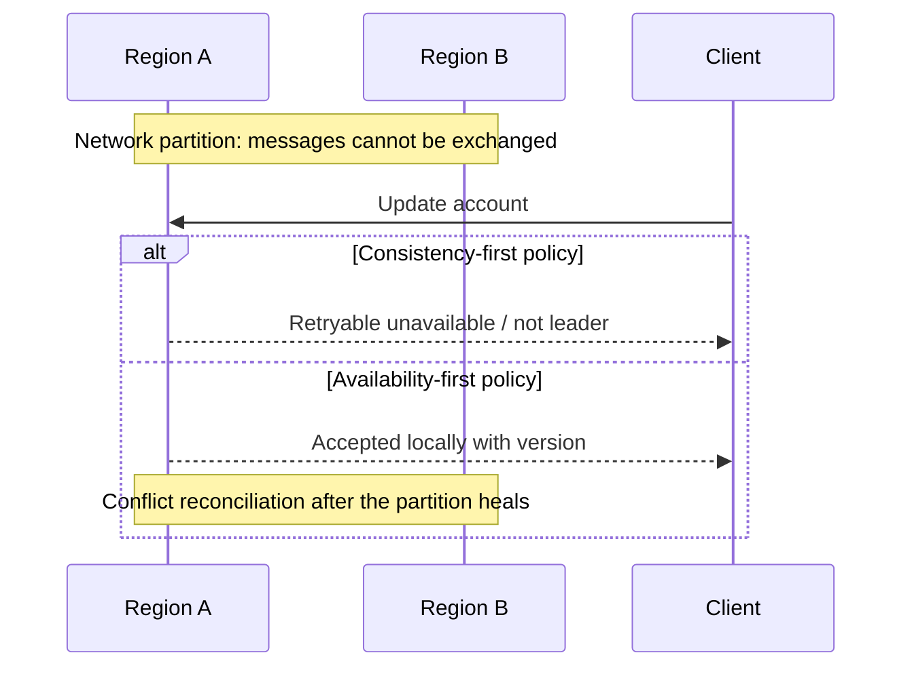

# CAP Theorem — Consistency, Availability and Partitions

CAP describes what a distributed data system can promise **when a network partition prevents nodes from coordinating**. It is not a menu where a system permanently chooses any two letters.

## Mental model

Partition tolerance is not an optional checkbox in a distributed network. The practical choice is how operations behave when coordination is unavailable.

## What each property means

| Property | Practical interpretation | Common misconception |
|---|---|---|
| Consistency (C) | Operations appear to obey a single agreed order; CAP discussions usually mean atomic/linearizable behavior | Not simply “replicas eventually match” |
| Availability (A) | Every request to a non-failing node receives a response | Does not guarantee freshest data |
| Partition tolerance (P) | System has defined behavior despite lost/delayed network communication | Does not mean partitions are harmless |

## Partition example

Two regions replicate an account balance. The link breaks while each region receives an update.

- **Consistency-first behavior:** one side may reject or block a write if it cannot safely establish authority/quorum.
- **Availability-first behavior:** both sides may accept writes, but the product needs a conflict-resolution or merge rule.

Neither decision is automatically correct. The business invariant decides.

## Request sequence: reject vs accept

## Practical decisions

| Operation | Common policy | Reason / caveat |
|---|---|---|
| Payment ledger write | Consistency-first | Avoid conflicting financial state |
| Final seat/inventory reservation | Strong coordination | Browsing may be stale; final commit must prevent oversell |
| Social feed read | Availability + bounded staleness | Slightly old feed often acceptable |
| Analytics aggregation | Eventual consistency | Delayed convergence is acceptable |
| URL redirect | Cached/available read often acceptable | Revocation and expiry may need stronger freshness |
| Feature-flag evaluation | Local cached evaluation may be available | Security kill switches need freshness/expiry strategy |

## CAP is not the whole consistency story

Also discuss linearizability, causal consistency, read-your-writes, monotonic reads, bounded staleness, quorum reads/writes, leader election and fencing tokens.

## Senior interview answer structure

1. Name the invariant (e.g. “a seat can be sold once”).
2. Identify operations that require coordination.
3. Describe partition behavior for reads and writes separately.
4. Explain leader/quorum/fencing and stale-data risk.
5. Define recovery and conflict reconciliation.
6. State cost: latency, availability, complexity and operations.

## References

- [ByteByteGo — Scale from Zero to Millions of Users](https://bytebytego.com/courses/system-design-interview/scale-from-zero-to-millions-of-users)
- [Consistency models](consistency_models.md)
- [Ticket Booking](../system_designs/ticket-booking/README.md)
- [Payment Processing](../system_designs/payment-processing/README.md)

Original diagrams and explanations; ByteByteGo link is further reading.
