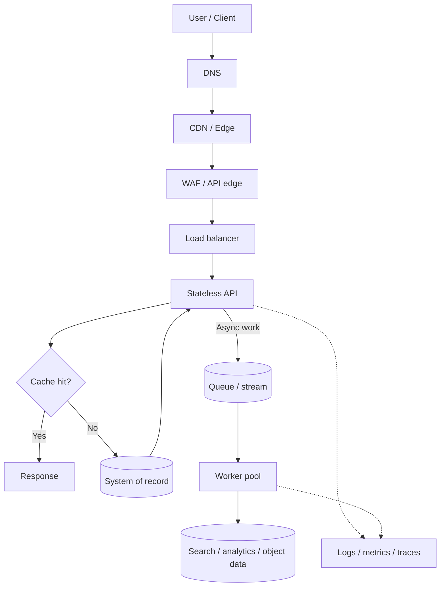
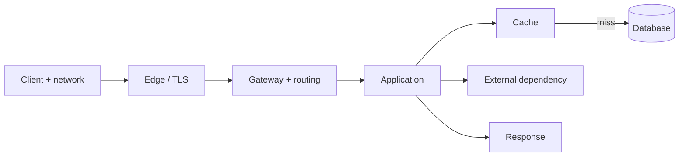
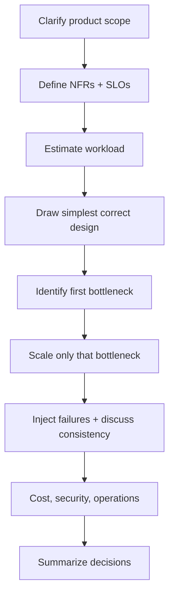

# Architecture Fundamentals — Visual Learning Path

This is the prerequisite map for HLD, LLD/OOD and GenAI system-design interviews. Start from the end-to-end request path, learn the pressure points, then practice explaining trade-offs.

## The big picture: how a request moves

**Read the flow:** edge services shape and secure requests; stateless compute runs business logic; caches accelerate reads; durable stores own state; queues separate slow work; observability spans the entire path.

## Concept map

| Topic | Question | Practical page |
|---|---|---|
| System design overview | What am I designing and which trade-offs matter? | [Overview](system_design_overview.md) |
| Interview approach | How do I structure a 45-minute interview? | [Approach](how_to_approach_system_design.md) |
| Scalability | What should scale and what is the bottleneck? | [Scalability](scalability_basics.md) |
| Latency / throughput | Where does time go and what rate can we sustain? | [Latency and throughput](latency_throughput_scaling.md) |
| Proxies / load balancing | How are requests distributed and protected? | [Load balancers and proxies](load_balancers_and_proxies.md) |
| Caching | Which reads can safely avoid the source of truth? | [Caching](caching_strategies.md) |
| Consistency | Which version of data may a client observe? | [Consistency](consistency_models.md) |
| CAP | What happens when coordination is unavailable? | [CAP](CAP_theorem.md) |
| Databases | Which data model fits the access patterns and invariants? | [Database selection](database_selection.md) |
| Queues / streams | Which work can be decoupled and replayed? | [Queues and streams](message_queues_and_streams.md) |

## A practical request budget

For a serial request, time is spent across network waits, queueing and service. Fan-out requests often wait for the slowest branch. Track p50/p95/p99, timeouts, queue wait, saturation and business success.

## Interview progression

## Further learning tracks

- [OOD interview guide](../object_oriented_design/README.md)
- [Scale from zero to millions](../system_designs/scale-from-zero-to-millions/README.md)
- [GenAI system design](../genai_system_design/README.md)
- [System design catalog](../system_designs/README.md)
- [Cloud architecture visual guide](../cloud_architecture/README.md)
- [Breakscale workload testing](../system_designs/BREAKSCALE_TESTING.md)

## Study routine

For each topic: reproduce the diagram without looking, explain one failure mode, implement a small TypeScript example where appropriate, then rehearse a five-minute answer and a deeper fifteen-minute discussion.

## References

- [ByteByteGo — Scale from Zero to Millions of Users](https://bytebytego.com/courses/system-design-interview/scale-from-zero-to-millions-of-users)
- [ByteByteGo — Object-Oriented Design Interview](https://bytebytego.com/courses/object-oriented-design-interview/what-is-an-object-oriented-design-interview)
- [ByteByteGo — GenAI System Design Interview](https://bytebytego.com/courses/genai-system-design-interview/introduction-and-overview)

These are further-reading references. The diagrams, explanations and examples in this repository are original.
