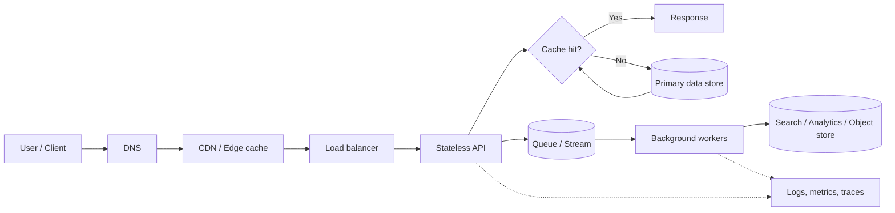
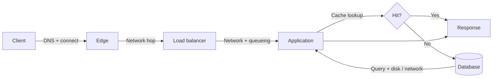
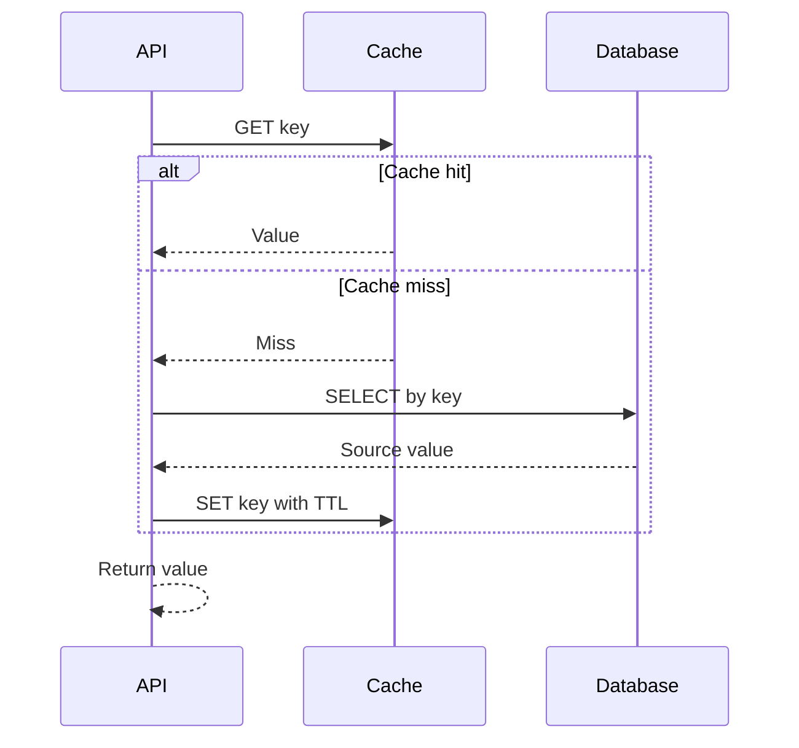
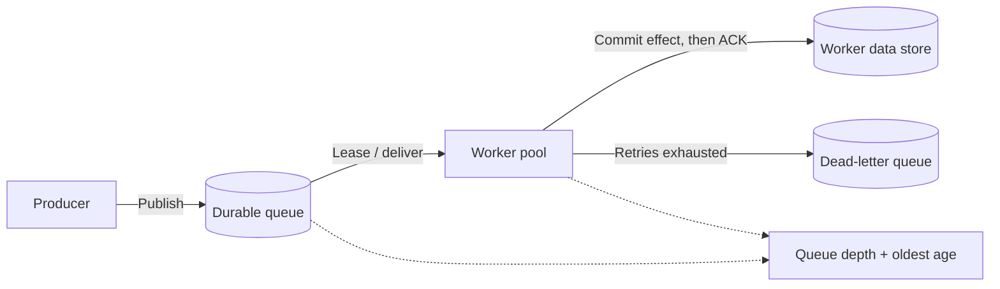
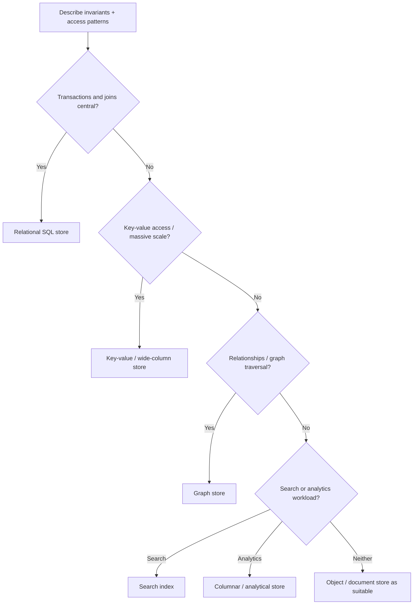

# Architecture Fundamentals — Visual Learning Path

This section explains the building blocks used in nearly every HLD. Start with the system view, then follow the links into the deeper concept notes.

## How a request moves through a typical system

**Read it this way:** the synchronous path should return the user-facing result; queues move non-interactive work out of that path. A cache is an optimization, not the source of truth. Telemetry spans every hop.

## Core concepts at a glance

| Concept | Main question | Deep dive |
|---|---|---|
| Latency & throughput | How long does one request take, and how much work can we sustain? | [Latency, throughput and scaling](latency_throughput_scaling.md) |
| Consistency | Which version of data may a reader observe? | [Consistency models](consistency_models.md) |
| Caching | Which reads can be served without hitting the source of truth? | [Caching strategies](caching_strategies.md) |
| Queues & streams | What work can happen asynchronously, and how is it recovered? | [Message queues and streams](message_queues_and_streams.md) |
| Data stores | Which access patterns and invariants should shape storage choice? | [Database selection](database_selection.md) |
| Scaling | What is the bottleneck, and when should we scale vertically or horizontally? | [Scalability basics](scalability_basics.md) |

## 1. Latency is a budget, not one number

The total response time is the sum of serial work plus the effect of parallel work, queueing and network waits. A slow dependency can dominate the whole request. Track percentiles such as p50, p95 and p99 rather than relying only on averages.

## 2. Cache-aside read flow

Cache invalidation, TTL, stampede protection and stale-read tolerance are product decisions. See [Caching strategies](caching_strategies.md).

## 3. Asynchronous work and backpressure

The consumer must be idempotent because a crash between committing the effect and acknowledging the message can cause redelivery. See [Message queues and streams](message_queues_and_streams.md).

## 4. Storage is selected from access patterns

This is a conversation starter, not an automatic database selector. Many systems use more than one store, each with a clear owner and source-of-truth rule.

## Cloud building blocks (starter mapping)

| Logical capability | AWS starting point | GCP starting point |
|---|---|---|
| DNS | Route 53 | Cloud DNS |
| CDN / edge | CloudFront | Cloud CDN |
| HTTP load balancing | Application Load Balancer | Cloud Load Balancing |
| Compute / containers | ECS or EKS; EC2 for VMs | Cloud Run or GKE; Compute Engine for VMs |
| Relational database | RDS / Aurora | Cloud SQL / AlloyDB |
| Globally distributed relational database | — (Aurora Global Database has a different model) | Spanner |
| NoSQL document / key-value | DynamoDB | Firestore / Bigtable (different data models) |
| Cache | ElastiCache | Memorystore |
| Object storage | S3 | Cloud Storage |
| Queue / pub-sub | SQS / SNS | Pub/Sub |
| Event streaming | Kinesis / MSK | Pub/Sub / Dataflow (different roles) |
| Secrets | Secrets Manager / SSM Parameter Store | Secret Manager |
| Metrics / logs / traces | CloudWatch / X-Ray | Cloud Monitoring / Logging / Trace |

See [cloud architecture](../cloud_architecture/README.md) for full diagrams and caveats.

## Study sequence

1. Explain latency vs throughput and draw a request path.
2. Explain cache hit/miss and invalidation.
3. Explain replica lag and read-after-write.
4. Explain queue acknowledgement, duplicate delivery and DLQ.
5. Choose a data store from access patterns.
6. Map the logical blocks to AWS and GCP without assuming service names imply identical semantics.
