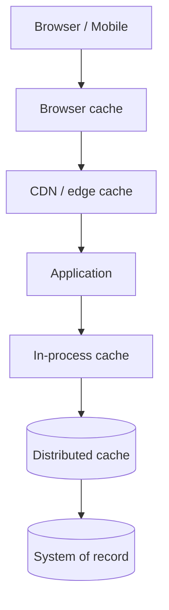
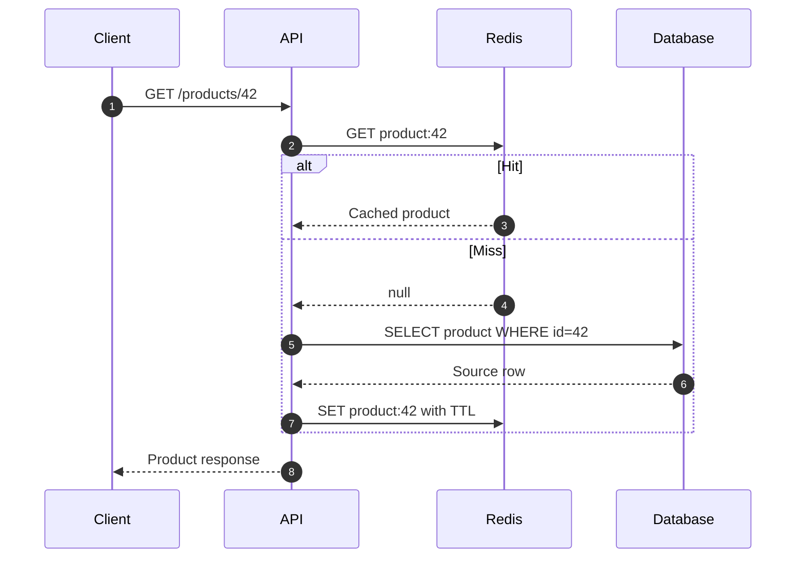
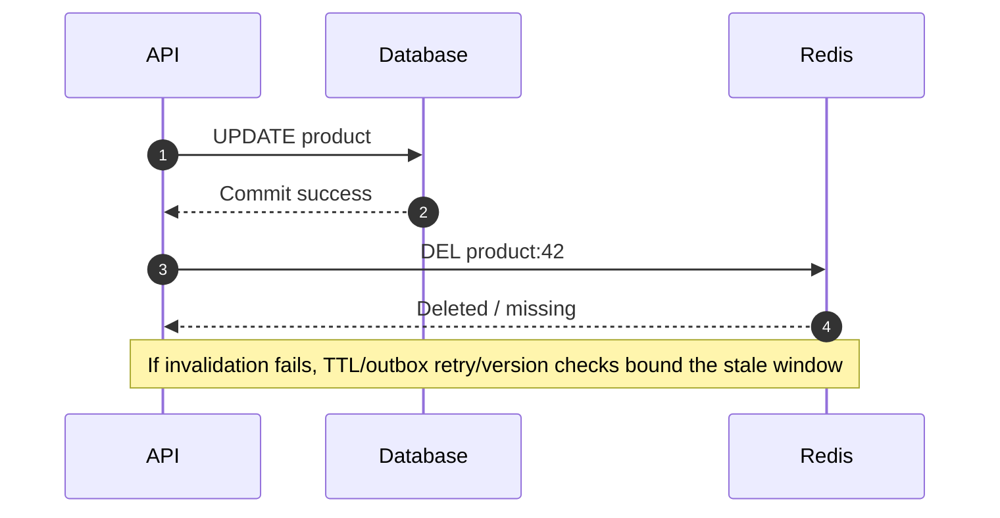

# Caching Strategies — Patterns, Invalidation and Failure Modes

Caching stores a derived copy closer to the caller. It improves latency and reduces source load only when the key, freshness and failure behavior are correct.

## Where cache layers fit

Closer caches reduce round trips but increase invalidation complexity.

## Cache-aside (lazy loading)

Use for read-heavy workloads where occasional staleness is acceptable. Decide what happens on cache failure: bypass with bounded database concurrency, serve bounded stale data, or fail closed for sensitive reads.

## Write strategies

| Strategy | Flow | Strength | Risk / fit |
|---|---|---|---|
| Cache-aside | App reads/writes DB; invalidates/fills cache | Simple; cache is optional | Stale window after DB commit |
| Read-through | Cache loads origin on miss | Centralized loading | Cache owns loader behavior |
| Write-through | Write cache and synchronously persist source | Cache stays warm | Write latency and dual-write failure |
| Write-behind | Write cache, persist asynchronously | Fast acknowledgement | Data loss risk without durable buffer |
| Refresh-ahead | Refresh hot keys before expiry | Avoids expiry miss spikes | Extra refresh work and races |

### Cache invalidation sequence

Do not invalidate before durable commit: a concurrent reader could refill the cache with the old row.

## Cache key design

Include every dimension affecting the result:
- tenant and authorization scope
- entity identifier
- locale and currency
- query parameters, sort and pagination
- schema/version
- feature flags only where they change the representation

Do not put secrets or raw PII into keys. Normalize and length-bound user-controlled key parts.

## Freshness controls

| Technique | Example | Trade-off |
|---|---|---|
| TTL | Product data valid for 60 seconds | Bounded staleness; not instant revocation |
| Explicit invalidation | Update row then delete key | Requires reliable invalidation |
| Versioned key | product:42:v7 | Old keys expire naturally; needs version ownership |
| Stale-while-revalidate | Serve recent stale value and refresh async | Faster response, bounded staleness |
| Negative caching | Cache 404 briefly | Prevents repeated misses; short TTL needed for new records |

## Failure modes and mitigations

| Failure | Symptom | Mitigation |
|---|---|---|
| Stampede | Many misses for one hot key | Single-flight/coalescing, jittered TTL, early refresh |
| Hot key | One partition/replica saturated | Replicate reads, local cache, split key, admission control |
| Avalanche | Many keys expire together | TTL jitter, staggered refresh, warm critical keys |
| Penetration | Repeated nonexistent keys | Short negative cache, rate limit, validate inputs |
| Stale overwrite | Slow loader overwrites newer value | Version compare-before-set |
| Cache outage | Database surge | Circuit breaker, bulkhead, load shedding |
| Oversized values | Memory pressure and eviction churn | Value size budget, compression policy, do not cache blobs |

## Capacity exercise

An API receives 2,000 reads/s with an 85% cache hit rate. Estimated database reads:

`2,000 × (1 - 0.85) = 300 reads/s`

This arithmetic is not a benchmark; it does not capture bursts, key popularity or miss amplification.

## Interview prompts

- What is the source of truth?
- How stale can the data be?
- What invalidates a key after a write?
- What happens if Redis is unavailable?
- How do you prevent stampede and hot-key overload?
- How do you isolate tenant cache namespaces?

## References

- [ByteByteGo guides](https://bytebytego.com/guides) — further reading on caching and scale.
- [Redis documentation](https://redis.io/docs/latest/)
- [AWS caching best practices](https://docs.aws.amazon.com/wellarchitected/latest/framework/perf_data_access_patterns_caching.html)

Original diagrams and examples in this guide.
