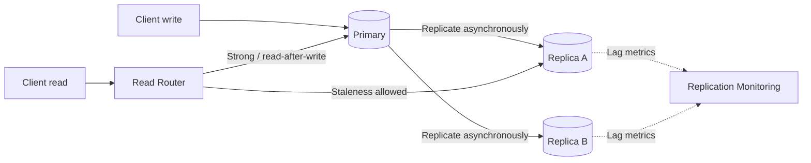
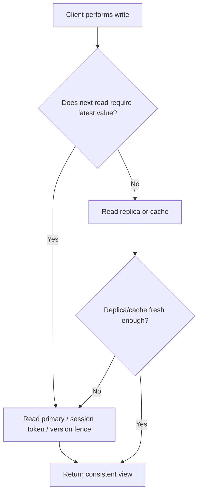

# Consistency Models

Consistency describes what values a read is allowed to observe after writes, across replicas and concurrent clients. Choose the weakest model that satisfies product correctness; stronger guarantees can increase coordination, latency and availability costs.

## 1. Common models

| Model | Intuition | Typical use |
|---|---|---|
| Strong / linearizable | Reads observe the latest completed write in one global order | Account balances, lock ownership, critical inventory |
| Sequential | All clients observe one order, but it may not match real-time order | Some replicated state |
| Causal | Causally related operations preserve order | Collaboration and messaging |
| Eventual | Replicas converge when updates stop | Caches, feeds, analytics projections |
| Read-your-writes | A client sees its own completed writes | User-facing profile/preferences |
| Monotonic reads | A client does not move backward to an older version | Session consistency |

These are conceptual guarantees. A database or distributed store may provide a particular subset and require specific configuration.

## 2. Replication and read flow

## 3. Read-after-write decision

## 4. Consistency vs availability

In a partition, replicas may be unable to coordinate. A system must decide which operations are allowed to proceed with stale or conflicting data. The right choice depends on business invariants, not on a universal slogan.

Examples:
- A URL redirect may tolerate short-lived replica lag under some product assumptions.
- URL revocation may need stronger freshness so a disabled destination stops resolving.
- Analytics counters can usually be eventually consistent.
- Payment ledger updates require durable, well-defined ordering and reconciliation.

## 5. AI / agentic implementation guidance

The model does not decide consistency semantics. Encode state transitions and invariants in deterministic services.

Require:
- explicit source of truth for each entity
- version numbers or timestamps with a stated clock assumption
- conflict-resolution policy
- idempotency for retried writes
- bounded staleness or read-your-writes path where required
- tests that inject replica lag and network partition
- explainable fallback when a consistency guarantee cannot be met

**Prompt:** “For these business invariants and read/write flows, identify which operations require linearizable, read-your-writes or eventual consistency. State the source of truth, stale-read window and conflict policy. Add tests for replica lag and retry; do not claim a guarantee unsupported by the selected storage system.”

## Interview insight

State the invariant first, then choose the consistency model. Explain what a user can observe during replication lag, concurrent writes and network partition.
