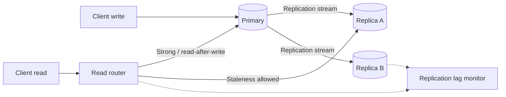
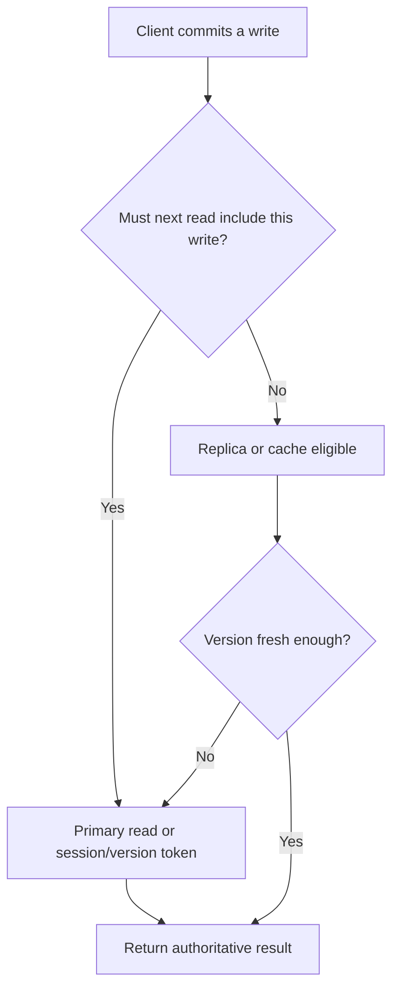
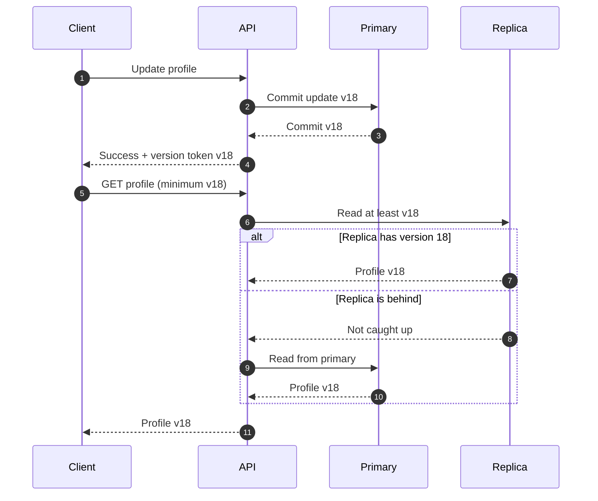

# Consistency Models — What Can a Read Observe?

Consistency describes which values a read may observe after writes and concurrent operations. Start with the business invariant and client-visible behavior, then select a model supported by the database configuration.

## Replication model

## Main guarantees

| Model | Guarantee | Example |
|---|---|---|
| Linearizable / strong | Operations appear to take effect atomically in real-time order | Lock ownership, final inventory allocation |
| Sequential | All clients see one order, not necessarily wall-clock order | Replicated sequence |
| Causal | Cause-and-effect order is preserved | Replies after the messages they answer |
| Eventual | Replicas converge when updates stop | Analytics projections |
| Read-your-writes | A client sees its own committed updates | Profile edit |
| Monotonic reads | A client does not move backward after seeing a newer version | Session reads |
| Bounded staleness | Lag remains within a specified bound | Dashboard with 10-second lag budget |

A product may only provide certain guarantees and configuration modes. Avoid claiming stronger guarantees than the selected store offers.

## Read-after-write decision

### Session consistency sequence

## Consistency by workflow

| Workflow | Typical choice | Caveat |
|---|---|---|
| Payment ledger | Strong ordering + durable commit | Idempotency and reconciliation still required |
| Seat reservation | Conditional/strong final write | Search availability can be stale |
| URL redirect | Eventual/cache can be acceptable | Revocation and expiry may need stronger freshness |
| Social feed | Eventual projection | Read-your-writes can improve user experience |
| Analytics | Eventual | Define acceptable lag and correction path |
| Collaborative editing | Causal/order-aware merge | Conflict-free merge or conflict UI |

## Conflict and recovery toolkit

- Version columns / compare-and-set for concurrent updates.
- Idempotency keys after ambiguous timeouts.
- Quorum/leader/fencing for ownership and failover.
- Deterministic conflict resolution where multi-writer behavior is required.
- Outbox/inbox for database-event consistency.
- Replica-lag monitoring and read routing for strict sessions.

## Senior interview walkthrough

1. State the business invariant.
2. Draw write ownership and replication direction.
3. Identify which clients require read-your-writes or strong reads.
4. Describe partition/failover behavior.
5. Explain conflict handling and duplicate retries.
6. State the cost in latency, availability and complexity.

## References

- [ByteByteGo — Scale from Zero to Millions of Users](https://bytebytego.com/courses/system-design-interview/scale-from-zero-to-millions-of-users)
- [CAP theorem](CAP_theorem.md)
- [Ticket Booking](../system_designs/ticket-booking/README.md)
- [Payment Processing](../system_designs/payment-processing/README.md)
