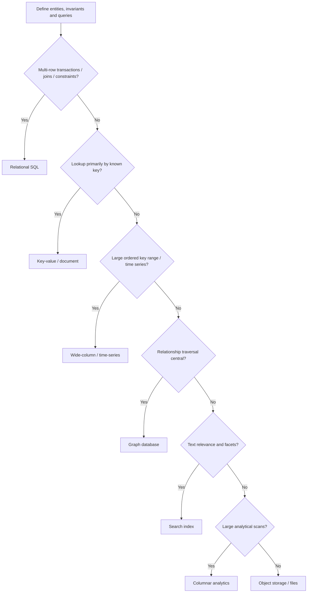
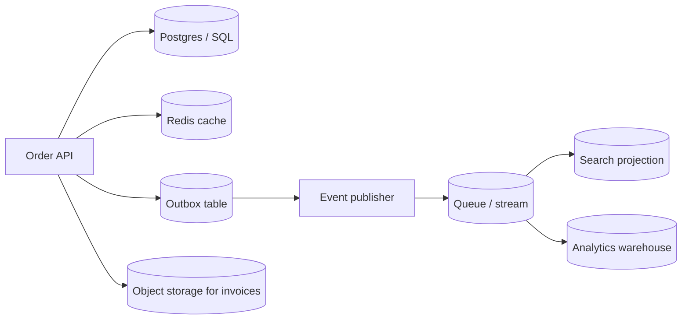

# Database Selection — Choose from Access Patterns and Invariants

A database is not selected by popularity. Choose it from the questions the application asks, the correctness rules it must enforce, and the operational shape of the data.

## Decision flow

## Data-store families

| Family | Good fit | Strengths | Costs / caveats |
|---|---|---|---|
| Relational SQL | Orders, payments, inventory | ACID, joins, constraints, query optimizer | Connections, write scaling, migration |
| Key-value | Sessions, idempotency, known-key access | Predictable latency and scale-out | Limited query flexibility |
| Document | Profile/config/content aggregates | Flexible nested records | Cross-document constraints need design |
| Wide-column | Huge write volume and key-range access | Horizontal throughput | Access-pattern-driven data model |
| Graph | Relationship traversal and paths | Native traversal | Operational expertise and query planning |
| Search index | Full-text, relevance, facets | Search-oriented indexing | Usually derived, not source of truth |
| Time-series | Metrics and temporal events | Time partitions, retention/downsampling | Cardinality and retention costs |
| Vector | Embedding similarity | Semantic nearest-neighbor search | Recall/latency/filter/index-memory trade-offs |
| Object storage | Images, exports, backups | Durable, inexpensive blobs | Not a transactional row store |

## Example: order management

SQL owns order/payment state; Redis is disposable; search/analytics are rebuildable projections; object storage owns document bytes while SQL owns metadata and access policy.

## Questions to decide before choosing

1. What is the aggregate/entity boundary?
2. Which writes must be atomic together?
3. What are the top queries, sort and filter requirements?
4. What is the read/write mix and key distribution?
5. How much data is retained and how fast does it grow?
6. What consistency does each read path require?
7. What are latency, availability, RPO and RTO targets?
8. How will schema/index changes and data migration work?
9. What backup, restore and on-call skills are required?
10. Can a derived store be rebuilt from an authoritative source?

## Avoid these stereotypes

- Relational systems can scale with replicas, partitioning and distributed SQL; trade-offs vary.
- NoSQL does not automatically mean eventual consistency or no transactions.
- Polyglot persistence is justified when stores own distinct access patterns—not because a diagram looks more complex.

## References

- [ByteByteGo guides](https://bytebytego.com/guides)
- [PostgreSQL documentation](https://www.postgresql.org/docs/)
- [DynamoDB data modeling](https://docs.aws.amazon.com/amazondynamodb/latest/developerguide/data-modeling.html)
- [Google Cloud database options](https://cloud.google.com/products/databases)
