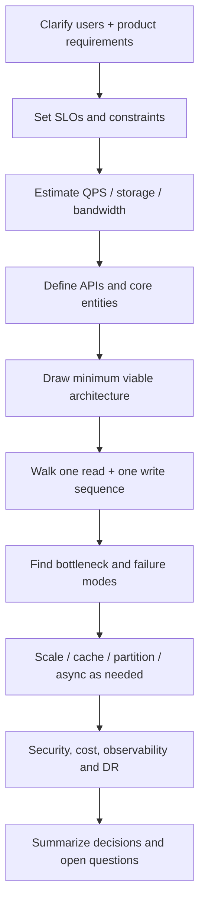
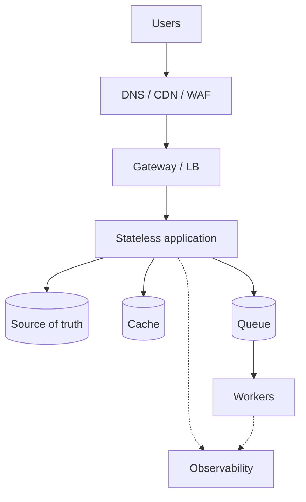

# How to Approach System Design Interviews

A senior-level answer is a guided design conversation: clarify, quantify, draw, test assumptions, then explain trade-offs. Do not start by listing microservices.

## 45-minute interview plan

| Time | Goal | Output |
|---:|---|---|
| 0–5 min | Clarify product scope and users | Functional requirements + exclusions |
| 5–9 min | Agree SLOs and constraints | Latency, availability, durability, cost |
| 9–14 min | Estimate workload | RPS, storage, bandwidth, concurrency |
| 14–22 min | Draw the simple architecture | Core request/data flows |
| 22–30 min | Deep dive one hard part | API, schema, consistency or algorithm |
| 30–38 min | Scale and failure handling | Bottleneck, partition, retry, recovery |
| 38–45 min | Trade-offs and summary | Decision record, risks and evolution |

## Structured design loop

## Ask better clarification questions

**Functional:** Who are the actors? What is the main user journey? What are the top read/write actions? What is out of scope?

**Non-functional:** DAU/MAU, peak concurrency, read/write mix, payload size, retention, p95/p99, availability, RPO/RTO, region, compliance, budget and team constraints.

## Back-of-the-envelope estimates

Write assumptions as assumptions. Example with **illustrative** 1M DAU and 10 read actions/user/day:

- Daily reads = 10M.
- Average RPS = 10M / 86,400 ≈ 116.
- At an assumed 10× peak factor, peak ≈ 1,160 RPS.
- With an assumed 20 KB average response, average response bandwidth ≈ 2.32 MB/s before overhead/cache effects.

The estimate is a conversation tool, not a forecast. Ask whether it is plausible and adjust.

## Draw in layers

Add partitioning, replication, search, ML, multi-region or workflow orchestration only when requirements demand them.

## Deep-dive checklist

- API contract, idempotency and pagination.
- Data model, indexes, constraints and retention.
- Read/write sequences with cache and DB.
- State ownership and consistency guarantees.
- Capacity limits, queues, backpressure and overload response.
- Retry policy, timeouts, circuit breaker, DLQ and recovery.
- Authentication, authorization, tenant isolation and audit.
- Observability: golden signals, business outcomes and SLO alerts.
- Deployment, migration, rollback, DR and cost.

## Communication habits that signal seniority

Narrate assumptions, explain why you are not adding a component, identify the first bottleneck and its signal, separate current design from future evolution, name failure blast radius and include migration/operability.

## References

- [ByteByteGo — Scale from Zero to Millions of Users](https://bytebytego.com/courses/system-design-interview/scale-from-zero-to-millions-of-users)
- [ByteByteGo system design guides](https://bytebytego.com/guides)
