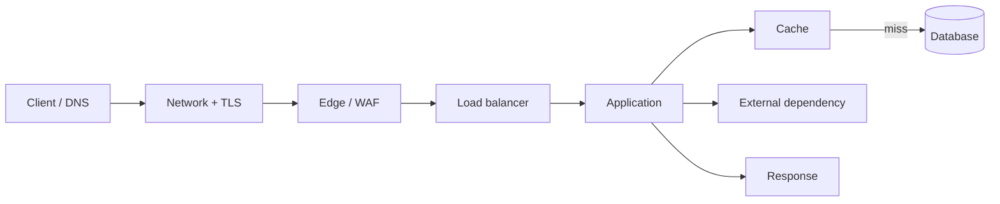
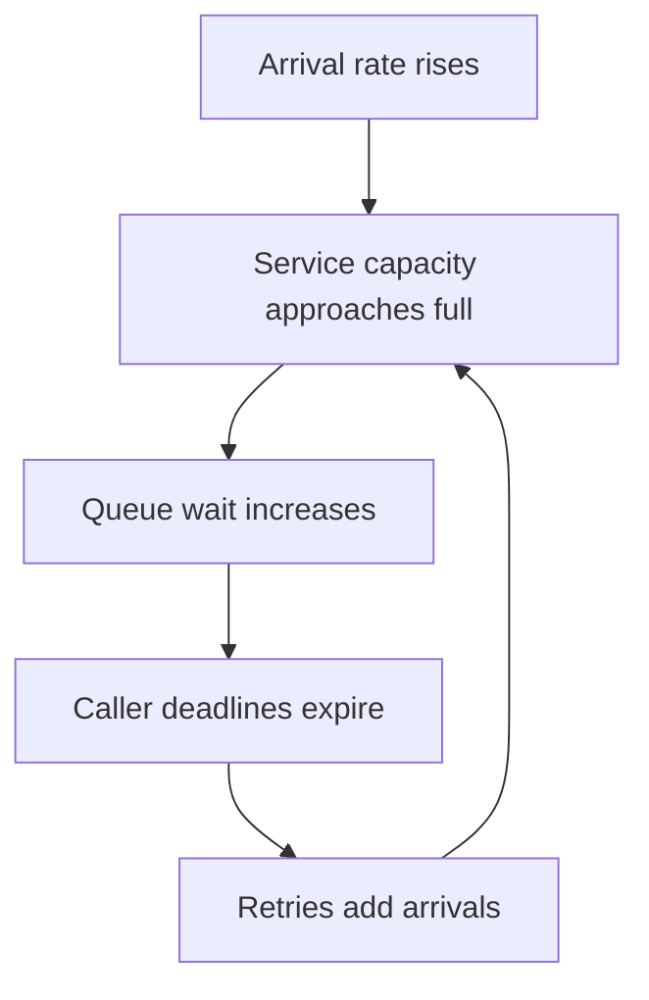
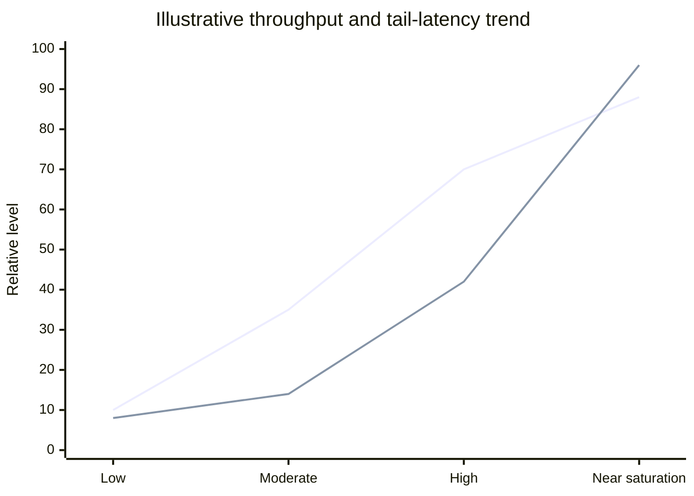

# Latency, Throughput and Scaling

Latency is how long one operation takes. Throughput is how many operations finish per unit time. Capacity is the sustainable workload a system can handle while meeting its SLOs.

## End-to-end latency budget

For serial work, latency adds. For parallel fan-out, completion often waits for the slowest branch. Queue wait can dominate service time near saturation.

## Metrics

| Metric | Definition | Why it matters |
|---|---|---|
| p50 | Median latency | Typical experience |
| p95 / p99 | Tail percentiles | Long-tail delays |
| Throughput | Completed operations / second | Useful work |
| Offered load | Incoming operations / second | Demand, including rejects |
| Goodput | Successful operations / second | Successful work |
| Concurrency | Operations in progress | Resource occupancy |
| Queue wait | Time waiting for capacity | Early overload signal |
| Utilization | Busy capacity / total capacity | Saturation risk |

## Little's Law

For a stable system:

`L = λ × W`

L is average work in system; λ is throughput; W is average time in system. Example: 200 requests/s × 0.25s implies about 50 concurrent requests. Little's Law describes a stable average, not capacity or tail latency.

## Why latency collapses near saturation

The system may remain busy doing work for callers that already abandoned it. Use timeouts, retry budgets, backoff/jitter, admission control and bulkheads.

## Throughput vs latency

Conceptual illustration only: one curve represents throughput and another tail latency. Real curves must come from measurement.

## Scaling choices

| Tactic | Best when | Trade-off |
|---|---|---|
| Optimize code/query | Inefficient work | Profile first |
| Vertical scale | One node resource bound | Ceiling and blast radius |
| Horizontal scale | Work can be distributed | Coordination and state |
| Cache | Repeated reads with acceptable freshness | Invalidation and memory |
| Queue | Slow/non-interactive work | Eventual completion/backlog |
| Partition/shard | Data/write throughput constrained | Rebalancing/cross-shard complexity |
| CDN | Public/cacheable content | Invalidation/geography |

## Practical performance loop

1. Define user-facing SLO and percentile.
2. Trace across service boundaries.
3. Load-test representative and peak/burst shapes.
4. Find first saturated resource.
5. Change one variable and rerun.
6. Test failure/overload, not only steady throughput.
7. Report hardware, topology, data size, concurrency and duration.

## References

- [ByteByteGo — Scale from Zero to Millions of Users](https://bytebytego.com/courses/system-design-interview/scale-from-zero-to-millions-of-users)
- [Google SRE — Service Level Objectives](https://sre.google/sre-book/service-level-objectives/)
- [Little's Law](https://en.wikipedia.org/wiki/Little%27s_law)
