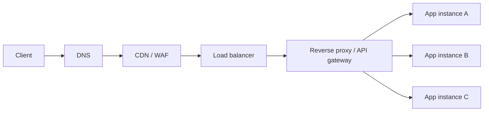
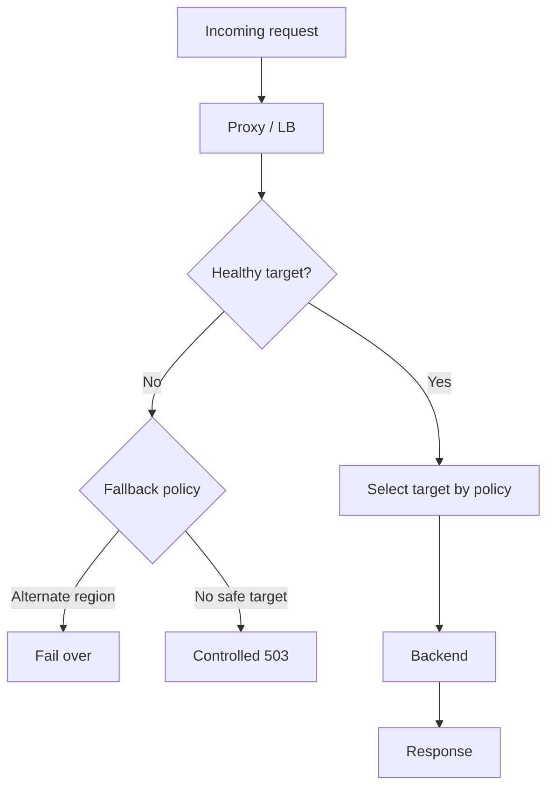
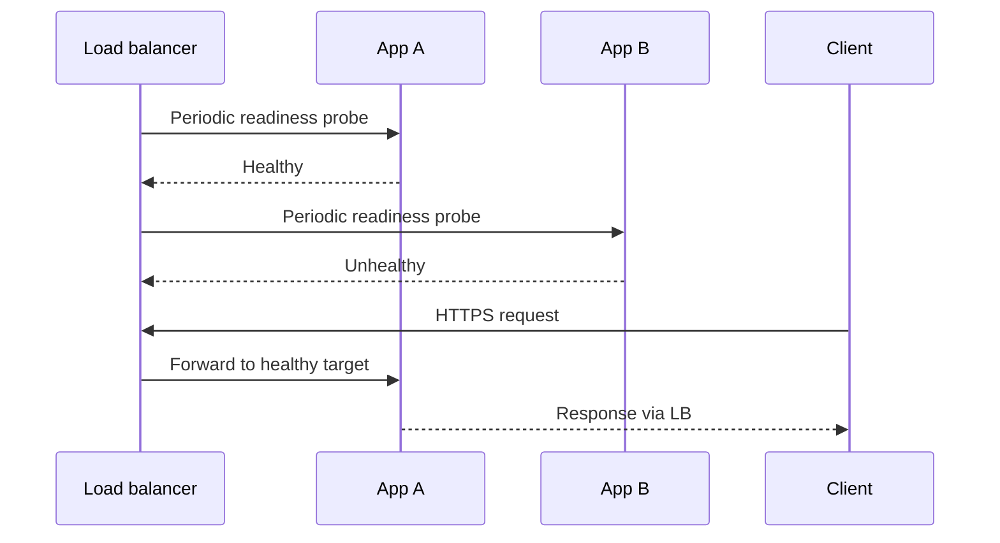

# Load Balancers and Proxies

A load balancer chooses a healthy backend. A reverse proxy receives requests on behalf of servers and can terminate TLS, route, authenticate, compress, apply policy or transform traffic.

## Placement in the request path

In practice, LB and reverse proxy can be the same managed service or separate layers.

## Layer 4 vs Layer 7

| Type | Decision information | Use cases | Trade-off |
|---|---|---|---|
| L4 | IP, TCP/UDP, port | High-throughput transport routing | Limited application awareness |
| L7 | HTTP host/path/header/cookie | API routing, canary, auth integration | More protocol processing |
| Forward proxy | Represents clients to upstreams | Egress control, corporate access | Client/network configuration |
| Reverse proxy | Represents services to clients | Ingress, TLS, routing, caching | Adds a critical policy boundary |

## Algorithms

- Round robin: similar-cost requests.
- Weighted round robin: allocate capacity proportionally.
- Least connections: varying connection lifetimes.
- Consistent hashing: affinity for cache/state partitioning; hotspots remain possible.
- Random two choices: balances without global coordination.
- Latency-aware: route away from slow targets; noisy measurements can oscillate.

Session affinity should not replace externalized session state.

## Health checks and failover

### Health-check sequence

## Responsibilities and anti-patterns

| Responsibility | Design concern |
|---|---|
| TLS termination | Certificate lifecycle, mTLS boundary |
| Routing | Host/path/version routing and safe defaults |
| Authentication | Token validation vs authorization |
| Rate limiting | Distributed counters, key identity and outage policy |
| Retries | Only where safe/idempotent; bounded retry budget |
| Circuit breaking | Stop repeated calls to unhealthy dependencies |
| Observability | Preserve trace context and request IDs |
| Headers | Prevent spoofing of trusted forwarding headers |

Avoid infinite proxy chains, hidden retry multiplication, treating liveness as readiness and trusting client-supplied identity headers.

## References

- [ByteByteGo guides](https://bytebytego.com/guides)
- [Envoy documentation](https://www.envoyproxy.io/docs/envoy/latest/)
- [NGINX documentation](https://docs.nginx.com/)
