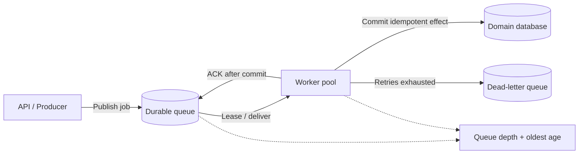
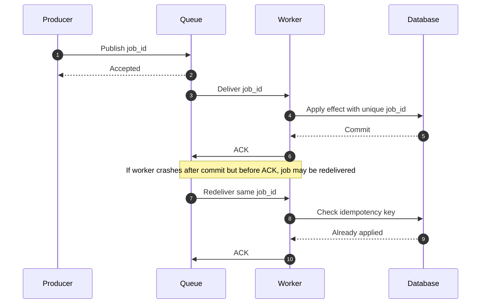
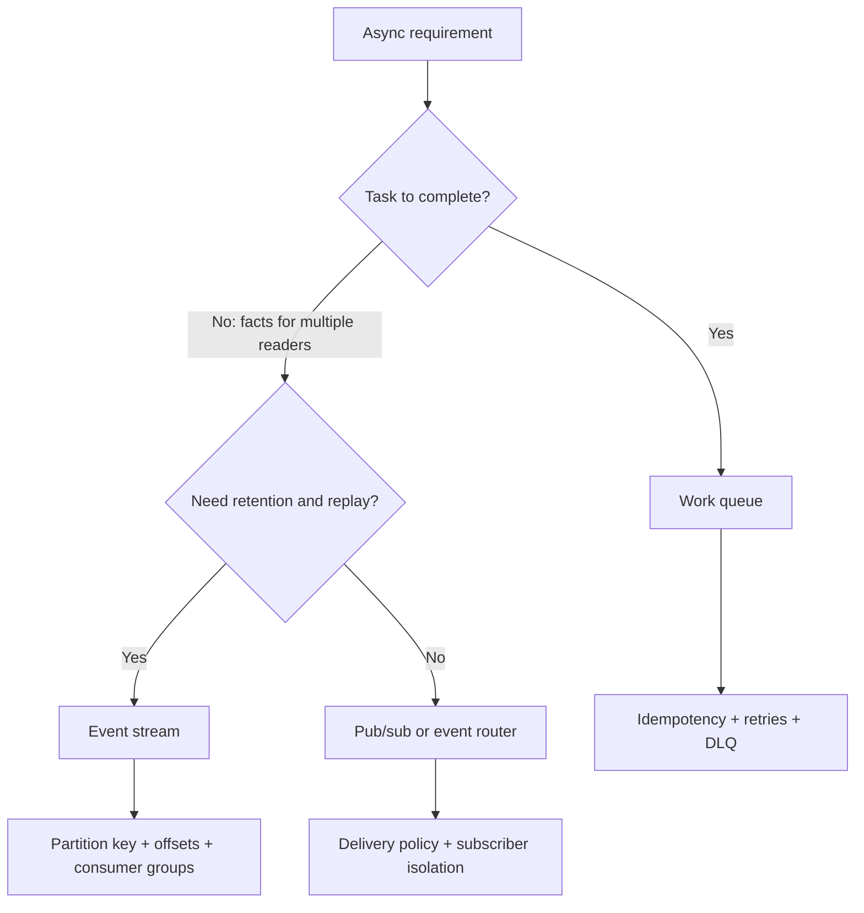

# Message Queues and Streams

Queues decouple producers and consumers and buffer bursts. Streams retain ordered event logs for independent consumers, replay and derived projections. Neither automatically guarantees exactly-once business effects.

## Queue vs stream

| Dimension | Work queue | Event stream |
|---|---|---|
| Consumer model | Competing workers | Consumer groups / independent subscribers |
| Intent | Complete a task | Retain facts for multiple readers |
| Retention | Until ack/expiry | Configured time/size |
| Replay | Retry / DLQ | Offset reset / replay |
| Ordering | Depends on product/partition | Often per partition/key |
| Examples | SQS, RabbitMQ queue | Kafka, Kinesis, Pub/Sub semantics |

Check each provider's exact guarantees; product labels are not interchangeable.

## Async job flow

### Delivery sequence and duplicate window

## Reliability patterns

- At-least-once delivery + idempotent consumer.
- Transactional outbox for DB write + event publication.
- Inbox/dedupe table at consumer.
- Retry with exponential backoff and jitter.
- DLQ after bounded attempts; alert and provide replay tooling.
- Visibility/ack deadline should exceed normal processing or be extended.
- Poison messages need quarantine; do not hot-loop.
- Schema versioning and compatibility.

## Backpressure and sizing

Watch oldest message age, arrival rate vs completion rate, retry/DLQ rate, concurrency/saturation, per-tenant fairness and backlog drain time. Queue depth alone is not enough.

If backlog B remains after arrivals fall below worker capacity, and excess drain capacity is D messages/s, idealized drain time is B/D. This is a planning approximation, not a full queueing model.

## Queue or stream decision

## References

- [ByteByteGo — Scale from Zero to Millions of Users](https://bytebytego.com/courses/system-design-interview/scale-from-zero-to-millions-of-users)
- [Kafka documentation](https://kafka.apache.org/documentation/)
- [Amazon SQS developer guide](https://docs.aws.amazon.com/AWSSimpleQueueService/latest/SQSDeveloperGuide/welcome.html)
- [Google Cloud Pub/Sub docs](https://cloud.google.com/pubsub/docs)
