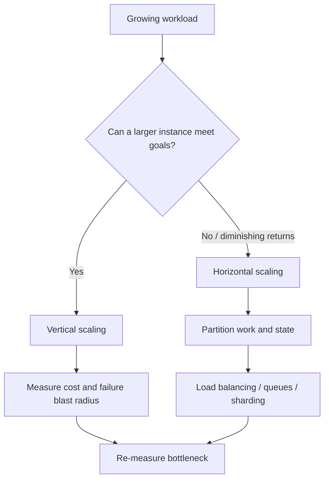
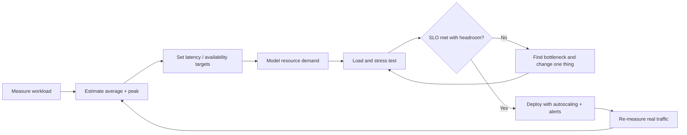
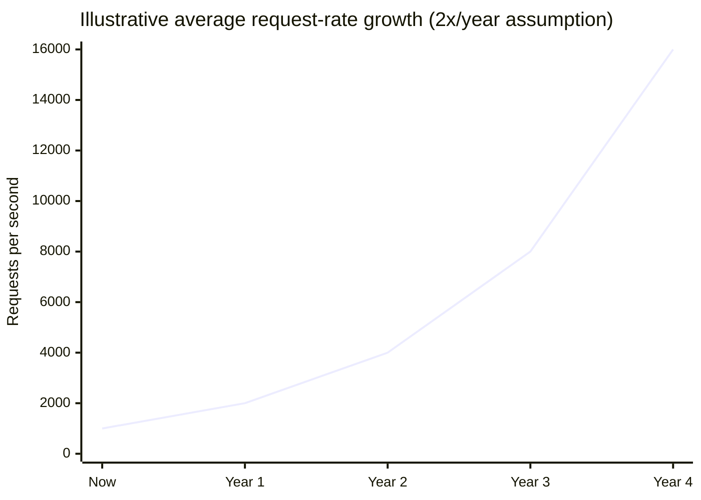

# Scalability Basics

Scalability is the ability to handle increased demand while meeting latency, availability, correctness and cost goals. Begin with workload measurements and bottlenecks; do not scale components just because a reference diagram includes them.

## 1. Scale up vs scale out

- Vertical scaling: increase CPU, memory, IOPS or network on a node. Simple, but has practical limits and may increase single-node blast radius.
- Horizontal scaling: add nodes and distribute work. Requires statelessness or partitioned state, routing, coordination and operational automation.

## 2. Little's Law

For a stable system: average concurrency (L = lambda W), where (lambda) is throughput and (W) is average time in the system. It helps relate concurrency, throughput and latency; it does not by itself predict capacity limits.

## 3. Common bottlenecks

| Bottleneck | Signals | Typical response |
|---|---|---|
| CPU | High utilization, rising queue time | Profile, optimize, scale compute |
| Memory | GC pressure, swapping, OOM | Bound caches/requests, optimize allocations |
| Database | Lock waits, IOPS, connections | Index, query tuning, pooling, read replicas |
| Network | Saturation, retransmits | Reduce payload, compress, regional placement |
| Downstream API | 429/timeouts | Quotas, bulkheads, async queue, caching |
| Hot key/partition | Skewed per-key load | Repartition, replicate reads, coalesce requests |

## 4. Capacity planning loop

## 5. Illustrative request growth chart

This is a teaching illustration, not a benchmark. A system receiving 1,000 average requests/s today and growing 2× per year would have the following average rate under that assumption:

Real planning must include peak-to-average ratio, geographic skew, burstiness, payload size and downstream limits.

## 6. AI / agentic implementation guidance

AI workloads add variable token sizes, inference latency, provider quotas, tool fan-out and potentially long-running tasks.

Design for:
- token and request budgets per tenant
- concurrency limits and provider quotas
- model gateway and explicit timeout/fallback policy
- asynchronous job orchestration for long tasks
- caching with tenant-aware keys and freshness rules
- retrieval limits and bounded context
- backpressure and cancellation
- cost per completed workflow, not only cost per token

**Prompt:** “Estimate capacity for this model-assisted workflow. Include requests/day, peak QPS, input/output token distributions, concurrent sessions, tool calls per task, provider quota, latency budget and cost assumptions. Mark all unknowns; do not fabricate model throughput or provider pricing.”

## Interview insight

Start with workload, estimate, bottleneck and SLO. Then explain the simplest scaling mechanism that addresses that bottleneck and how you will know when it stops being sufficient.
