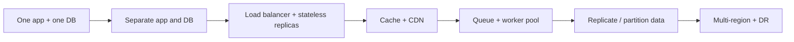
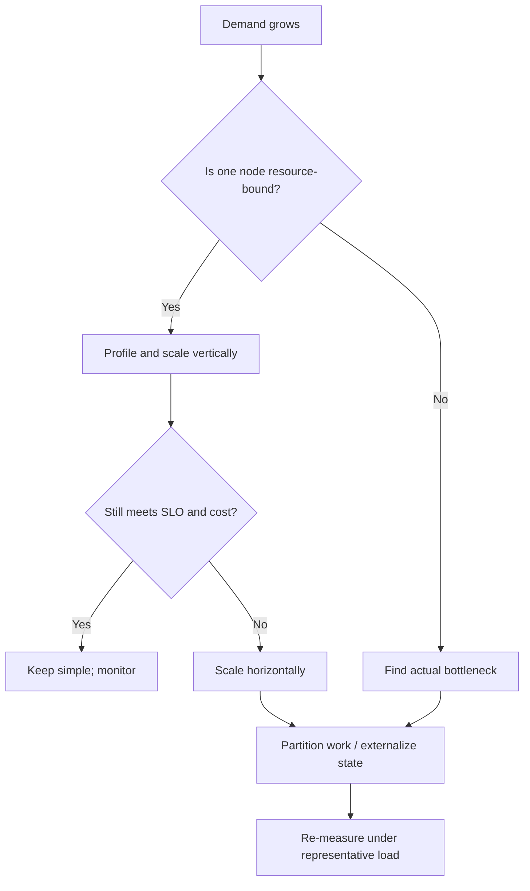
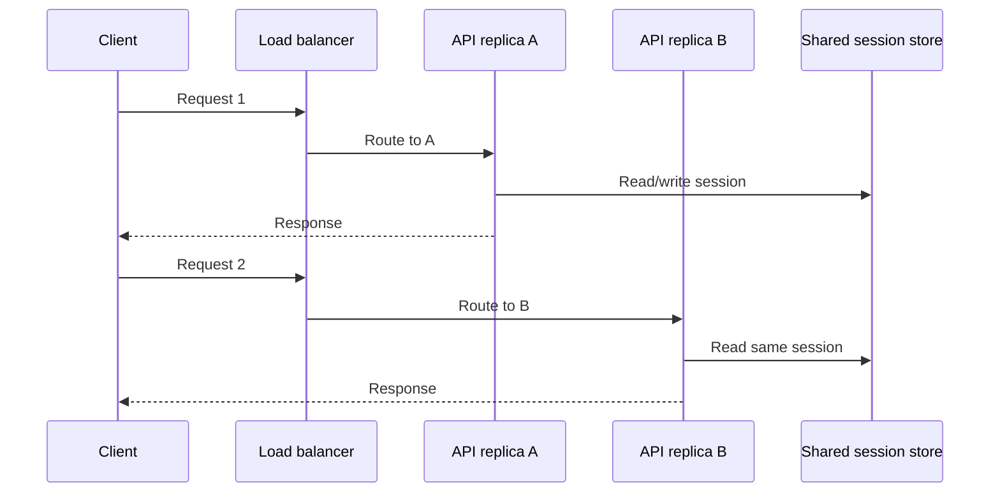

# Scalability Basics

Scalability means increasing workload while preserving latency, availability, correctness and cost goals. Begin with workload and bottleneck evidence; do not add distributed components just because a diagram includes them.

## From zero to scale: progressive evolution

Each step should answer a measured constraint and adds operational complexity.

## Vertical vs horizontal

| Scale up | Scale out |
|---|---|
| Bigger CPU/RAM/IOPS/network on one node | More nodes share workload |
| Lower coordination complexity | More potential availability/fault isolation |
| Hardware ceiling | Requires routing and distributed state |
| Can increase single-node blast radius | Can increase network/consistency complexity |

## Stateless web tier

Move authoritative session state out of app memory so any healthy instance can process the next request.

## Capacity model

Little's Law for a stable system:

`Average concurrency = throughput × average latency`

A theoretical concurrent-slot ceiling may be approximated from instances × slots/instance. Actual throughput depends on service time, dependencies, contention, queue limits, CPU, memory and network.

## Bottleneck signals

| Tier | Signals | Candidate actions |
|---|---|---|
| Edge | Cache miss, origin bandwidth | CDN policy, compression |
| API | CPU, event-loop lag, request queue | Profile, concurrency, horizontal scale |
| DB | Lock waits, slow queries, connection pool | Index/query tuning, pooler, replica, partition |
| Cache | Eviction, hit ratio, hot key | Key design, local coalescing |
| Queue | Oldest age, lag, retry spike | Scale workers, partition, cap producer |
| External API | 429, timeout, cost | Quota, cache, bulkhead, fallback |

## Scale safely

Keep redundancy at critical tiers; use autoscaling signals that reflect demand and queueing; add headroom and warm-up; control retries and admission; partition only after examining key distribution; test regional failover and restore; track cost per successful business operation.

## Breakscale exercise

Use the [Breakscale workload guide](../system_designs/BREAKSCALE_TESTING.md). Increase offered load and observe goodput, p99, queue depth, cache-origin traffic and component utilization. These are simulated outputs, not production benchmarks.

## References

- [ByteByteGo — Scale from Zero to Millions of Users](https://bytebytego.com/courses/system-design-interview/scale-from-zero-to-millions-of-users)
- [Google SRE Book](https://sre.google/sre-book/table-of-contents/)
