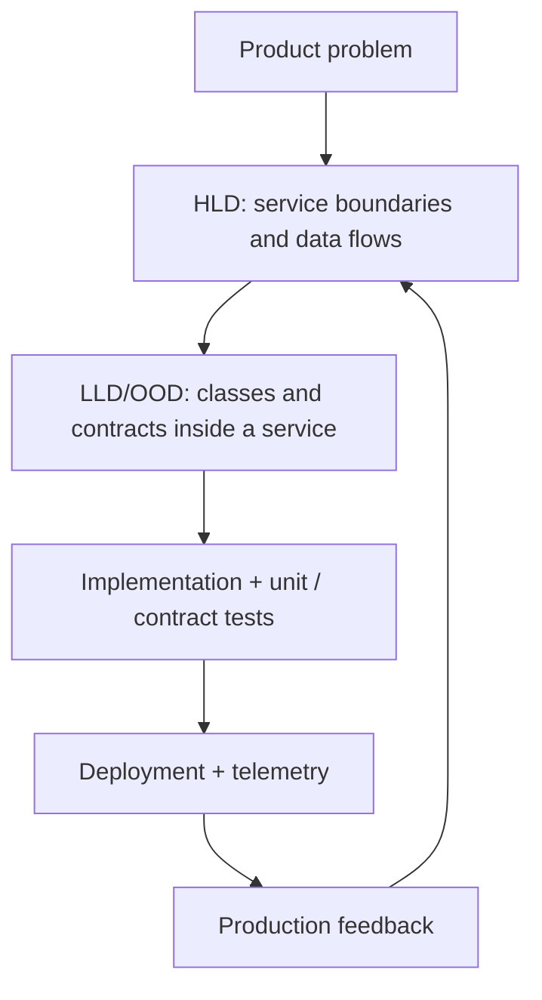
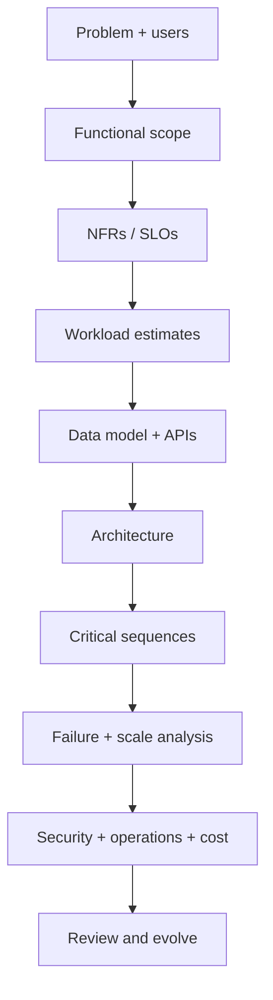

# System Design Overview

System design defines how components collaborate, how data is owned and how the system behaves under growth, failure, security threats and change. It is not primarily about choosing a framework.

## Two complementary design levels

| HLD — High-level design | LLD / OOD — Low-level design |
|---|---|
| Services, boundaries, stores, queues, regions | Classes, interfaces, methods, object collaborations |
| Availability, scalability, consistency, cost | Encapsulation, SOLID, patterns, testability |
| Request/event/data flows | State transitions and object behavior |
| Example: payment service + ledger + queue | Example: Payment, PaymentMethod, LedgerEntry, Policy |
| Output: architecture + trade-offs | Output: class model + executable code/tests |

## Functional vs non-functional requirements

Functional requirements say what the system does (create an order, reserve a seat, send a message). Non-functional requirements say how well and under which constraints it does so (p95 latency, availability, durability, cost, security, RPO/RTO).

## Core design vocabulary

- Workload: QPS, concurrency, payload, read/write mix and growth.
- SLO: measurable target and time window.
- Source of truth: system that owns authoritative state.
- Cache: derived, disposable data.
- Queue: buffer for asynchronous work.
- Partition/shard: subset of data/work owned by a node.
- Replication: copies and their lag/consistency behavior.
- Idempotency: same logical request can be retried safely.
- Backpressure: control producers before consumers collapse.
- Blast radius: scope of a failure.
- Observability: traces, metrics, logs and business outcomes.

## Design lifecycle

## Senior engineer mindset

Optimize for the invariant, not the newest technology. Keep the simplest design that meets known constraints. Separate strong guarantees from eventual projections. Make failure behavior explicit. Keep state ownership/API contracts clear. Include migrations, runbooks, observability and on-call impact.

## Learning paths

- [Fundamentals index](README.md)
- [OOD interview guide](../object_oriented_design/README.md)
- [Scale-from-zero case study](../system_designs/scale-from-zero-to-millions/README.md)
- [GenAI system design](../genai_system_design/README.md)
- [Cloud architecture](../cloud_architecture/README.md)

## References

- [ByteByteGo — Object-Oriented Design Interview](https://bytebytego.com/courses/object-oriented-design-interview/what-is-an-object-oriented-design-interview)
- [ByteByteGo — Scale from Zero to Millions of Users](https://bytebytego.com/courses/system-design-interview/scale-from-zero-to-millions-of-users)
- [ByteByteGo — GenAI System Design Interview](https://bytebytego.com/courses/genai-system-design-interview/introduction-and-overview)

The diagrams and explanations here are independently authored; these course pages are further reading.
