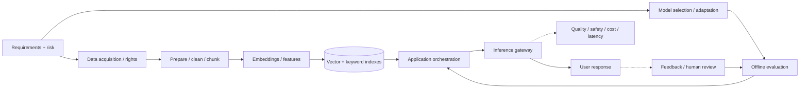
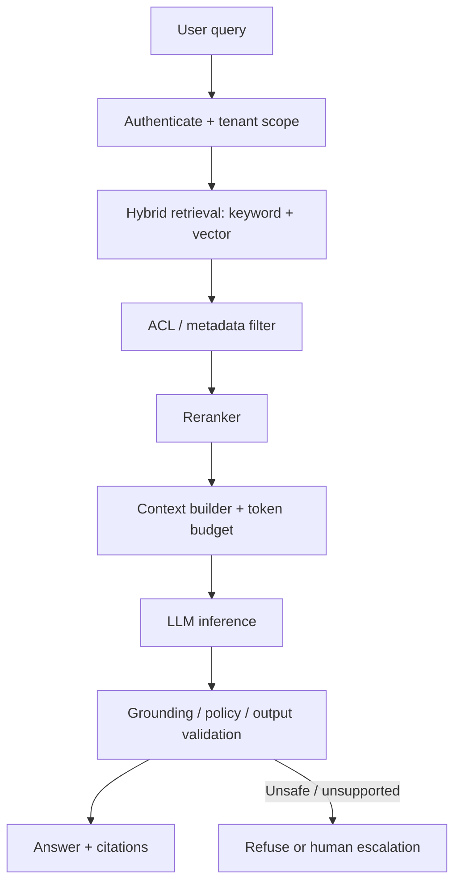
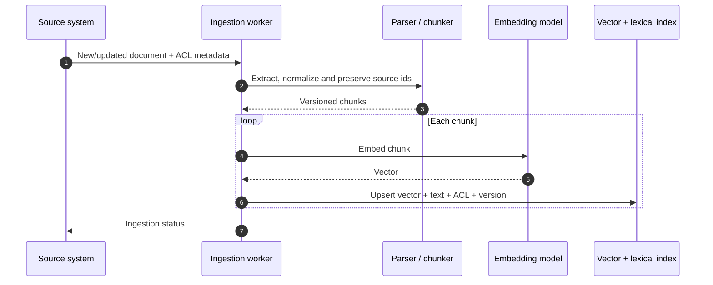
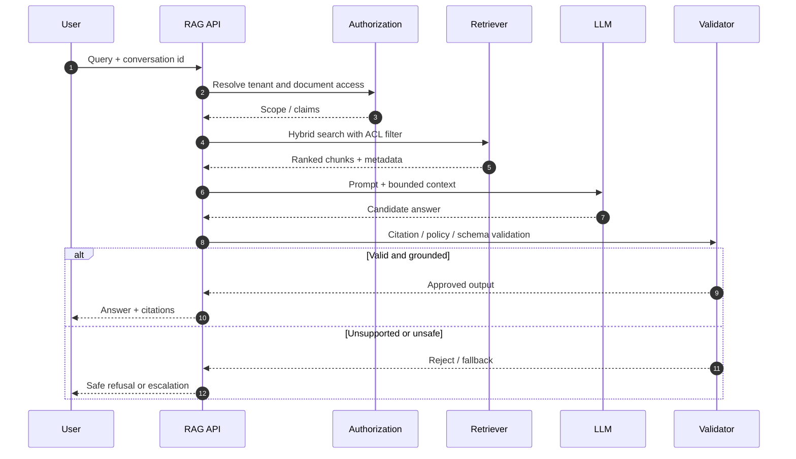
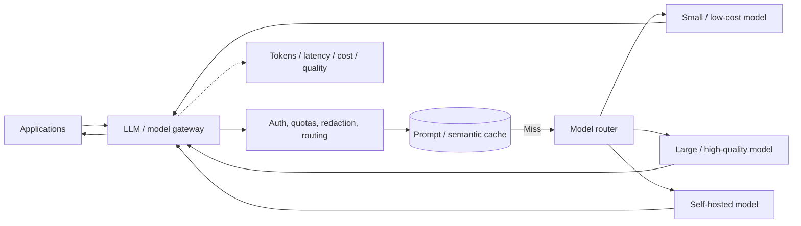

# GenAI System Design Interview Guide

GenAI architecture adds data preparation, retrieval, model quality, inference capacity, safety and evaluation to distributed-systems concerns. Start by framing the task—not by selecting an LLM.

## Product case studies

See the [GenAI case-study catalog](../system_designs/genai/README.md) for ten worked HLDs, including [Gmail Smart Compose](../system_designs/genai/gmail-smart-compose/README.md), [Google Translate](../system_designs/genai/google-translate/README.md), [personal assistant chatbot](../system_designs/genai/personal-assistant-chatbot/README.md), [image captioning](../system_designs/genai/image-captioning/README.md), [RAG](../system_designs/genai/retrieval-augmented-generation/README.md), and image/video generation systems.

## End-to-end GenAI lifecycle

## Clarify the task

| Product type | Core task | Key quality metric |
|---|---|---|
| Customer support assistant | Answer authorized questions and take governed actions | Correct resolution, escalation, unauthorized action rate |
| Enterprise RAG | Retrieve grounded evidence and generate cited responses | Recall@k, faithfulness, citation correctness |
| Code assistant | Generate/modify code and explain changes | Test pass rate, patch correctness, security |
| Image generation | Map prompt/controls to model output | Human preference, safety, latency, cost |
| Voice assistant | Streaming speech input/output and turn management | End-to-end delay, WER, interruption handling |
| Agent workflow | Plan/tool-use over multiple steps | Task completion, tool success, policy violations |

## RAG request flow

### Ingestion sequence

### Query sequence

## Model and serving architecture

A cache key must account for tenant scope, model/version, system prompt, generation parameters and data freshness. Model routing should be policy-driven and measurable.

## Design decisions

| Area | Questions |
|---|---|
| Data | Who owns it? Is processing permitted? How are deletion and ACL changes propagated? |
| Retrieval | Vector, lexical or hybrid? Chunking, reranking, freshness? |
| Model | Hosted vs self-hosted? Quality/cost/latency? Context window? |
| Prompt | Versioning, injection boundary, structured output and token budget? |
| Tools / agents | Which actions are read-only? Which require approval? Is policy separate from model? |
| Evaluation | Golden set, retrieval recall, faithfulness, task success, adversarial tests? |
| Safety | PII handling, tenant isolation, jailbreak, prompt injection and output policy? |
| Operations | Token/cost budgets, concurrency, quotas, timeouts, fallbacks and model outage? |

## Evaluation pyramid

- Retrieval: recall@k, precision@k, freshness and ACL correctness.
- Generation: faithfulness, relevance, citation precision, refusal quality.
- Task: task completion, tool argument validity, tool failure recovery.
- Safety: injection resistance, data exfiltration, unsafe-action prevention, PII leakage.
- Production: latency percentiles, tokens/request, cost/task, fallback rate and feedback.

Use human evaluation for ambiguous quality and automated golden sets for regression. Do not use a single LLM-as-judge score as the only gate.

## Failure modes

| Failure | Mitigation |
|---|---|
| Retrieval misses source | Hybrid search, recall evaluation, query rewrite |
| Stale/deleted document indexed | Versioned index, tombstones, deletion propagation |
| Cross-tenant retrieval | Enforce ACL filters server-side before model context |
| Prompt injection in retrieved content | Treat retrieval as untrusted; tools enforce separate policy |
| Hallucinated citation | Citation-to-span validation and abstention |
| Provider quota/outage | Bounded retries, fallback model, queueing |
| Token-cost explosion | Context caps, summarization, caching, per-tenant budget |
| Duplicate tool side effect | Idempotency key and action ledger |
| Evaluation drift | Versioned test set, canary, human feedback |

## Senior interview walkthrough

1. Define product job, input/output, latency and user scope.
2. Identify data rights, quality and freshness.
3. Choose retrieval/model approach; explain when deterministic search is enough.
4. Draw ingestion and query sequences separately.
5. Define ACL, prompt-injection and tool authorization boundaries.
6. Explain offline evaluation, online monitoring and human escalation.
7. Estimate tokens, throughput, model concurrency, cost and fallback.

## Portfolio builds

1. RAG knowledge assistant: Markdown/PDF ingestion, hybrid search, citations, tenant ACL and eval harness.
2. LLM gateway: provider abstraction, token budgets, routing, prompt cache, retries and telemetry.
3. Tool-using support agent: MCP tools, read/write scopes, approval gate, idempotency and audit.
4. Document pipeline: async ingestion, parser boundary, embeddings, versioning and deletion.

Use [Breakscale](../system_designs/BREAKSCALE_TESTING.md) for API/cache/queue/worker capacity. Actual model throughput must be benchmarked against the chosen model and runtime.

## References

- [ByteByteGo — GenAI System Design Interview: Introduction and Overview](https://bytebytego.com/courses/genai-system-design-interview/introduction-and-overview)
- [Attention Is All You Need](https://arxiv.org/abs/1706.03762)
- [Retrieval-Augmented Generation](https://arxiv.org/abs/2005.11401)
- [OWASP Top 10 for LLM Applications](https://owasp.org/www-project-top-10-for-large-language-model-applications/)
- [NIST AI Risk Management Framework](https://www.nist.gov/itl/ai-risk-management-framework)

This guide is original; course links are further reading and no proprietary course figures are reproduced.
