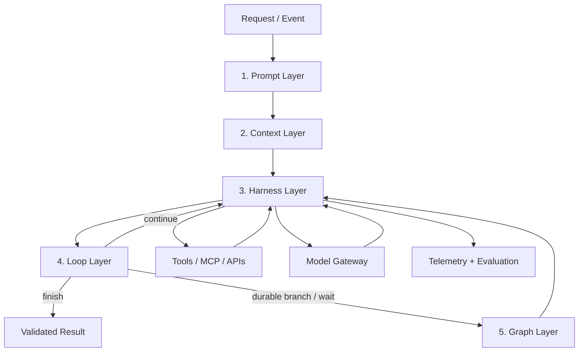
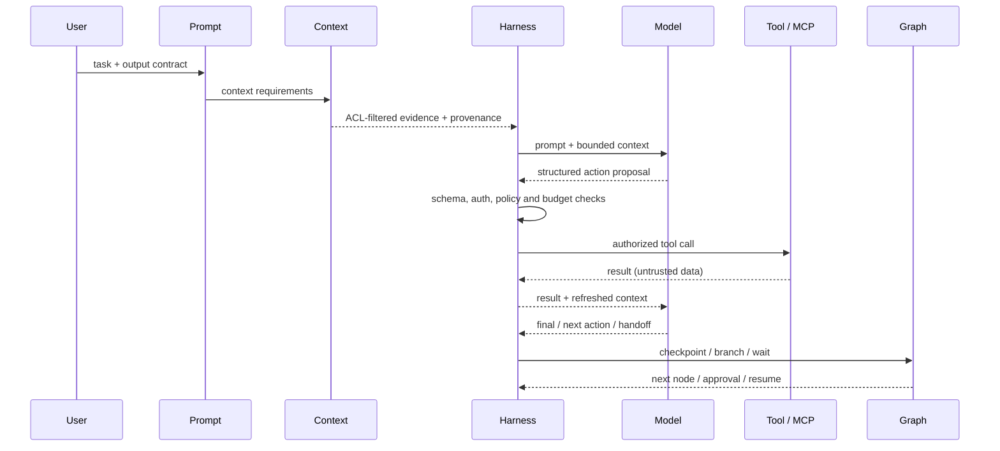

# Five-Layer AI Runtime Architecture

A practical decomposition for agentic apps and MCP-enabled systems. Separate task intent, authorized context, runtime controls, iterative execution and durable orchestration so each can be tested independently.

## Architecture overview

## 1. Prompt layer — intent and response contract
Owns trusted task instructions, constraints, decomposition hints, output schemas, examples and prompt versioning. Keep secrets, authorization and durable workflow state outside this layer. Separate trusted instructions from untrusted content; regression-test injection, ambiguity and refusal behavior.

## 2. Context layer — relevant, authorized information
Owns conversation window, user/tenant profile, retrieval, memory, provenance, summaries and token budgets. ACL-filter before content reaches the model; attach source IDs/timestamps; handle freshness and deletion; measure retrieval quality and token cost.

## 3. Harness layer — runtime boundary and capabilities
Owns model adapters, MCP transport, tool registry, schema validation, authorization, policy, secrets access, timeouts, quotas, budgets, tracing and audit. Allowlist tools, validate arguments/results, bind operations to caller identity, use least privilege and require approval for high-impact writes.

## 4. Loop layer — bounded agent cycle
Owns observe → decide → act through harness → inspect result → continue or stop. Set max steps, deadline, token/cost and retry budgets, deduplication, idempotency, cancellation and explicit terminal states. Re-check policy on every tool call.

## 5. Graph layer — explicit multi-step workflow
Owns typed state, nodes, conditional edges, parallel branches, checkpoints, durable waits, human handoffs, replay and compensation. Use transition guards, persistent checkpoints, idempotent nodes, schema versioning and bounded fan-out.

## Cross-layer contract
| Concern | Layer | Contract |
|---|---|---|
| Intent/output format | Prompt | Harness validates schema |
| Search and memory | Context | Harness enforces identity, ACL and provenance |
| MCP/API calls | Harness | Loop requests actions; graph may schedule them |
| Iterative action | Loop | Harness executes; context refreshes evidence |
| Branches, waits, approvals | Graph | Harness enforces capability policy |
| Evaluation and tracing | Harness instrumentation | Correlated versioned events across layers |

## Request lifecycle

## Choose the smallest useful composition
| Work shape | Composition |
|---|---|
| Deterministic CRUD/calculation | Ordinary code; no agent |
| Single-turn generation over known facts | Prompt + Context + Harness |
| Bounded tool use | Prompt + Context + Harness + Loop |
| Long-running, branching, parallel or human-approved workflow | All five layers |

## MCP task automator example
1. Prompt translates request into typed task specification.
2. Context loads permitted task history/project context with ACL checks.
3. Harness exposes scoped schedule/status/action MCP tools with schemas and idempotency.
4. Loop retries transient reads, verifies results and stops at success or budget exhaustion.
5. Graph persists waits, approvals, retry branches and compensation.

## Operational checklist
- [ ] Prompt versions and output schemas are pinned and regression-tested.
- [ ] Context retrieval is permission-filtered, provenance-aware and deletion-aware.
- [ ] Tool registry has allowlists, scopes, schemas, deadlines and audit trails.
- [ ] Model output cannot bypass server-side authorization or validation.
- [ ] Loops have step, time, cost, retry and cancellation limits.
- [ ] Mutations are idempotent; dangerous writes require approval.
- [ ] Graph state is versioned, checkpointed and replay-safe.
- [ ] Tool output and retrieved content are treated as untrusted data.
- [ ] Evaluations cover success, groundedness, policy, injection and cost.
- [ ] Traces correlate request, prompt/context versions, model and tool calls.
