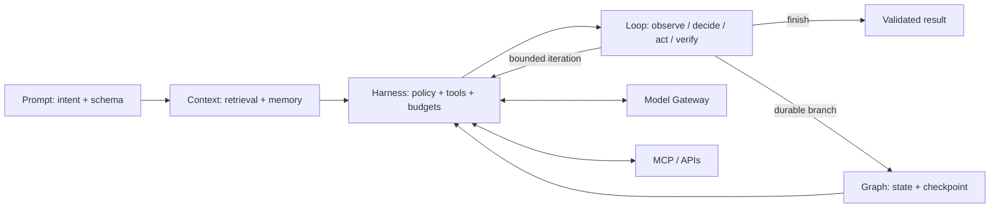
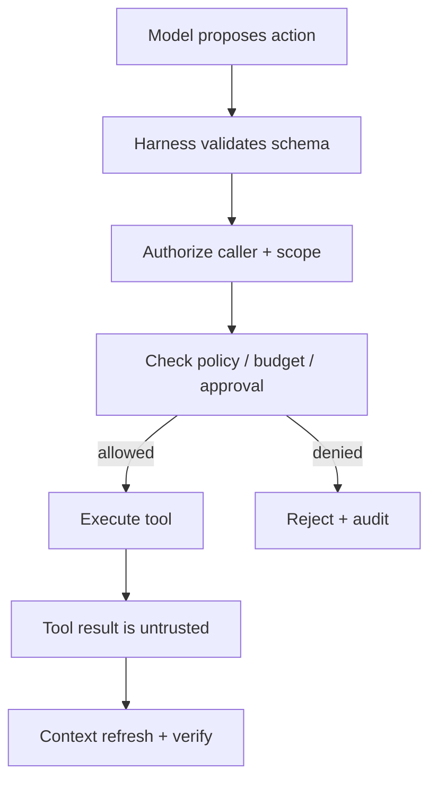

# AI Runtime Layers — Visual Explainer

Prompt defines intent; Context supplies authorized evidence; Harness controls capabilities; Loop bounds iterative action; Graph coordinates durable branches and human handoffs.

## Layer flow

## Responsibility boundaries
| Layer | Owns | Does not own |
|---|---|---|
| Prompt | Task wording, constraints, output schema | Permissions, secrets, durable state |
| Context | Authorized evidence, memory, provenance | Tool execution |
| Harness | Policy, tool schemas, auth, budgets, telemetry | Business workflow state |
| Loop | Iteration, verification, stop conditions | Unbounded retries |
| Graph | Nodes, branching, checkpoints, approvals | Bypassing harness policy |

## Safety boundary

Do not add an agent to deterministic work without measurable benefit. Treat retrieved text and tool output as untrusted input. See [README](README.md) for the full architecture, sequence and checklist.
