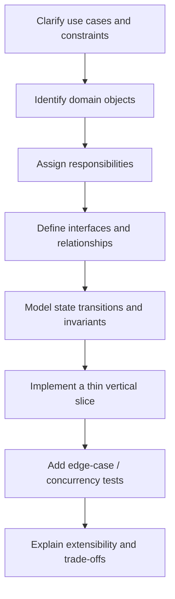
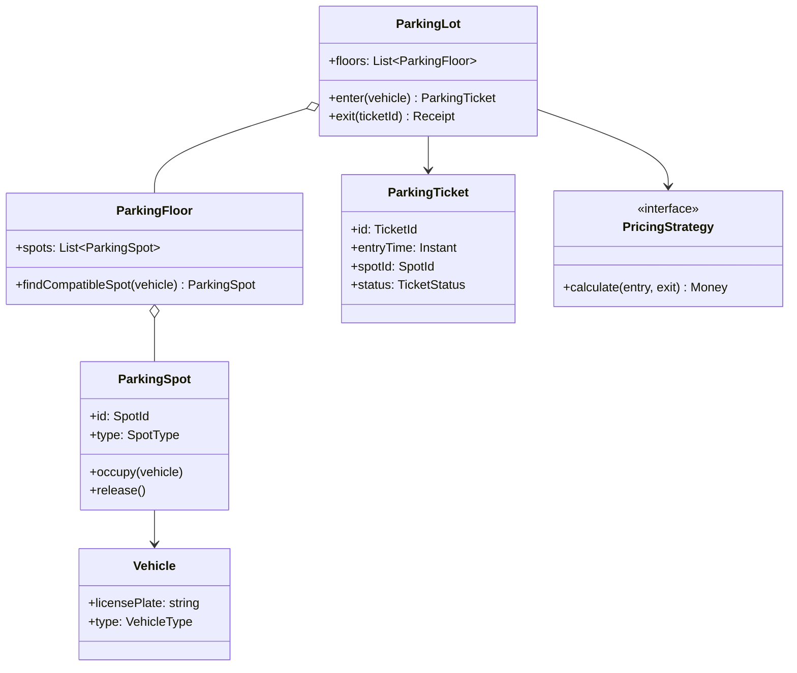
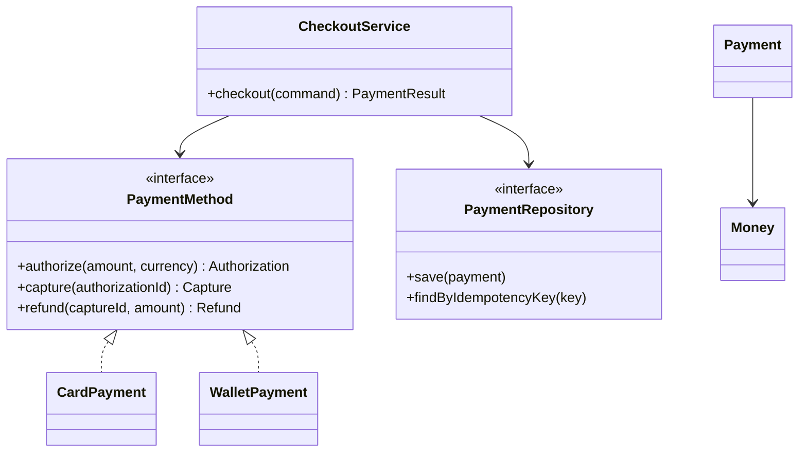
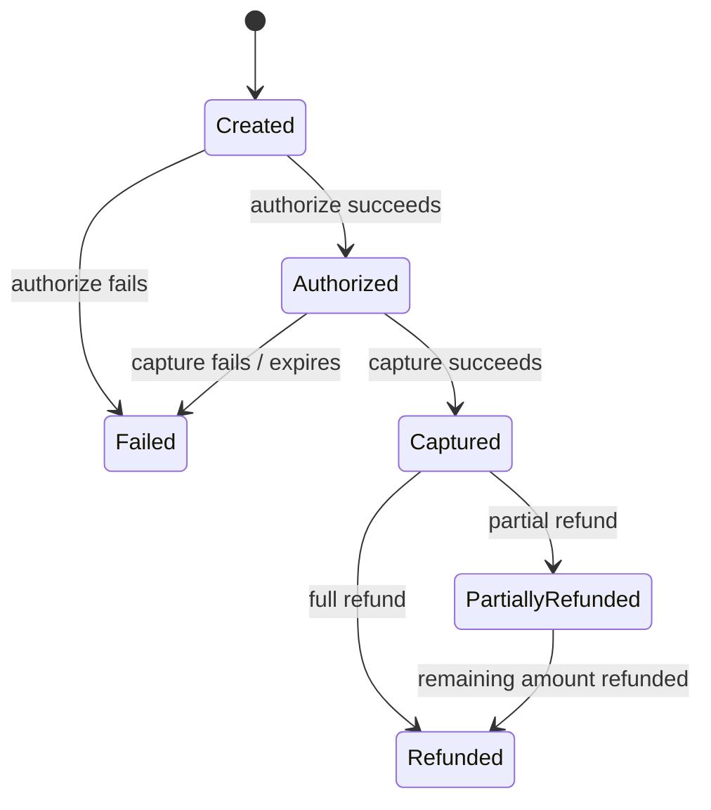

# Object-Oriented Design Interview — Practical Guide

OOD interviews test how you turn requirements into maintainable, executable object collaborations. The output should be readable code and tests—not a collection of patterns.

## OOD interview loop

## OOD vs algorithm interview

| Algorithm round | OOD round |
|---|---|
| Optimize algorithm under time/space constraints | Build maintainable domain behavior |
| Input → function → output | Collaborating objects with state and contracts |
| Correctness + complexity | Correctness + extensibility + testability |
| Often one main algorithm | Several interacting entities and policies |

## SOLID as design questions

| Principle | Ask yourself | Practical signal |
|---|---|---|
| SRP | Does this class have one reason to change? | Separate pricing, persistence and orchestration |
| OCP | Can a new behavior be added without rewriting stable code? | Strategy/policy interface |
| LSP | Can an implementation substitute without breaking callers? | Contract tests |
| ISP | Are clients forced to depend on unused methods? | Small focused interfaces |
| DIP | Does business logic depend on abstractions? | Inject repositories, clock and payment gateway |

Prefer composition when behavior varies independently. Use inheritance only for genuine substitutability.

## Example: parking lot object model

Allocation must be atomic: two gates cannot assign one spot simultaneously. A repository lock/transaction or reservation state protects the invariant.

## Example: checkout/payment OOD

Model legal state transitions explicitly. Do not let a controller call a provider and independently update several tables.

## Payment state machine

## Patterns: use only when they clarify a real variation

| Pattern | Good use | Avoid when |
|---|---|---|
| Strategy | Pricing, routing, retry policy | One stable behavior |
| Factory | Select provider by configuration | Constructor is enough |
| State | Behavior varies by lifecycle state | Enum condition is clearer |
| Observer / Pub-Sub | Independent reactions to events | Synchronous transactional result is required |
| Repository | Domain needs persistence abstraction | It wraps every SQL statement generically |
| Adapter | External SDK contract differs | You control both sides |
| Decorator | Add logging/metrics/policy around interface | Layering hides control flow |
| Command | Queue/replay/audit an action | Function call is enough |

## Testing checklist

- Unit tests for domain rules and state transitions.
- Contract tests for interfaces and provider adapters.
- Concurrency tests for allocation and idempotency.
- Property tests for invariants, such as no spot having two active tickets.
- Failure tests for timeout, retry and duplicate delivery.
- Integration tests for transaction boundaries.

## Practice problems

See [Parking Lot](../system_designs/parking-lot/README.md), [Elevator System](../system_designs/elevator-system/README.md), [Ticket Booking](../system_designs/ticket-booking/README.md), [Payment Processing](../system_designs/payment-processing/README.md) and [Notification System](../system_designs/notification-system/README.md).

For implementation drills, use [LLD_patterns](https://github.com/luckyhegde6/LLD_patterns). Suggested order: Parking Lot → Logger → Rate Limiter → Cache → Notification → Elevator → Ticket Booking → Payment.

## References

- [ByteByteGo — What is an Object-Oriented Design Interview?](https://bytebytego.com/courses/object-oriented-design-interview/what-is-an-object-oriented-design-interview)
- [ByteByteGo OOD companion code](https://github.com/ByteByteGoHq/ood-interview)

The guide and diagrams above are original; links are further reading.
