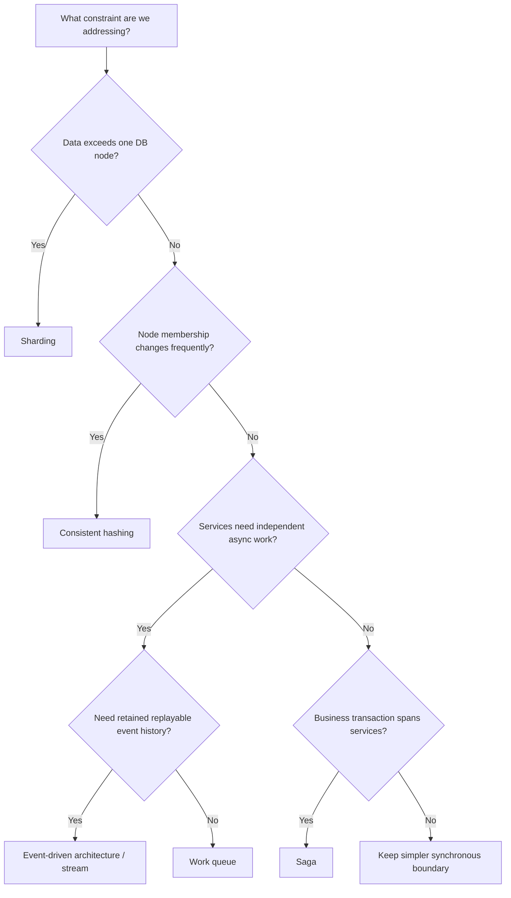
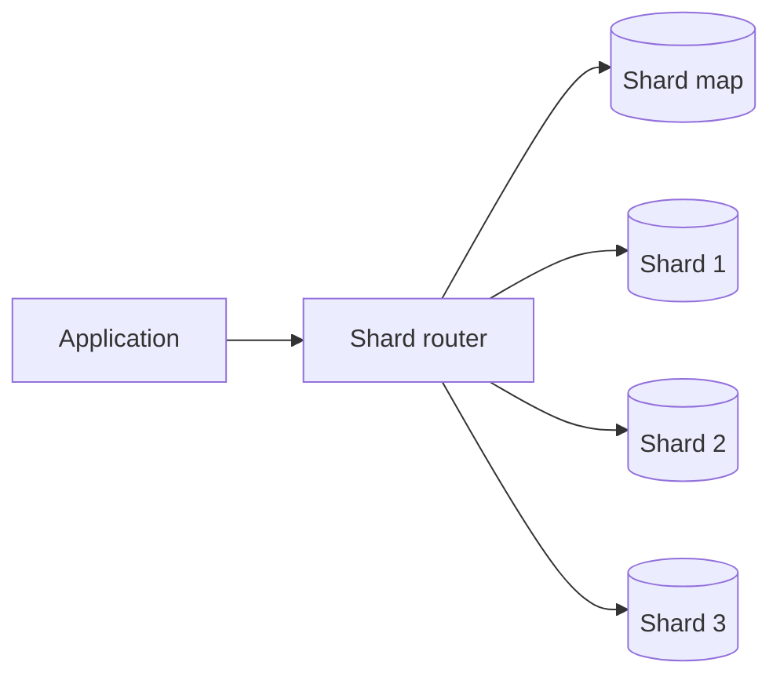
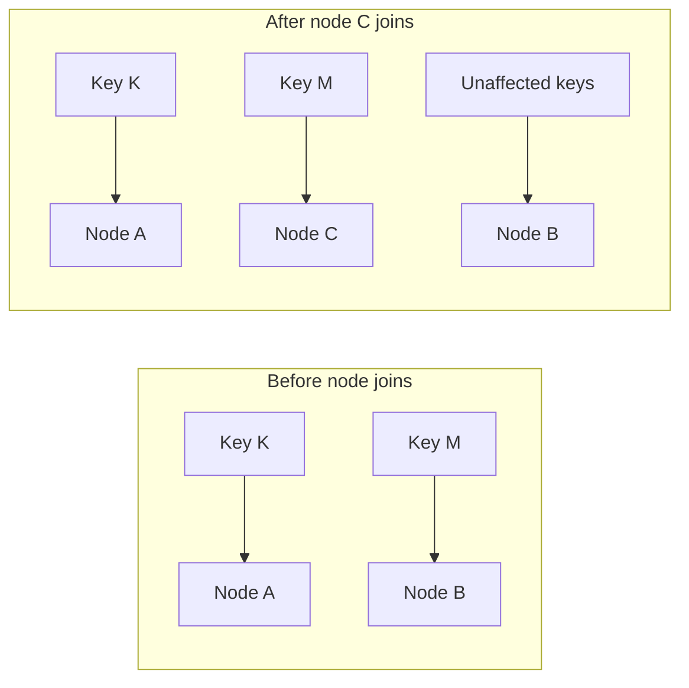
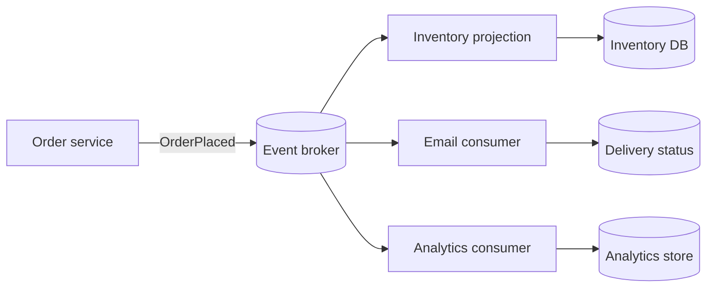
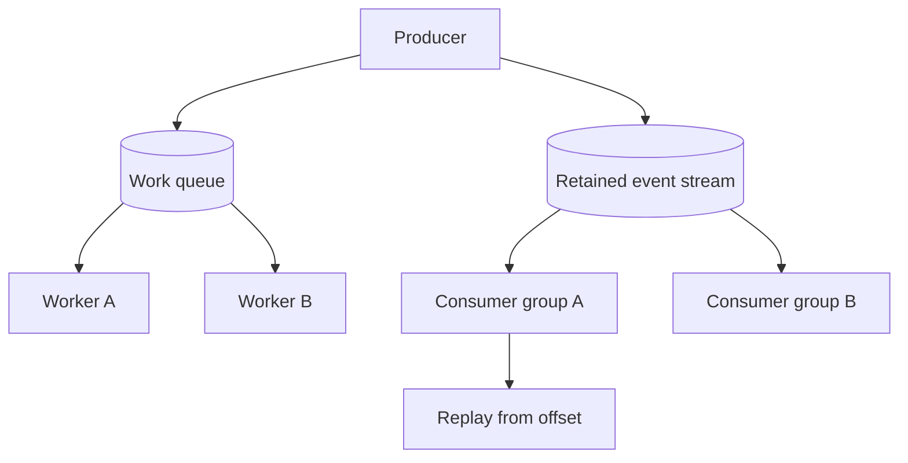
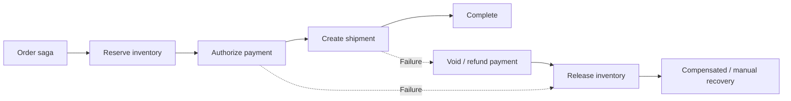

# Distributed Systems Patterns — Visual Learning Path

Patterns solve recurring distributed-systems problems. They are not goals by themselves: choose one only when its benefit addresses a measured requirement or failure mode.

## Pattern selection map

## 1. Sharding — split a large logical dataset

Use when one database's capacity or write throughput is a demonstrated limit. Choose a shard key from access patterns and distribution, then plan hot-key handling and safe migration. [Deep dive: sharding](sharding.md).

## 2. Consistent hashing — reduce remapping on membership changes

The diagram is illustrative: only keys in affected token ranges move, unlike naive modulo hashing where changing N can remap most keys. Consistent hashing does not eliminate hot keys or data migration. [Deep dive: consistent hashing](consistent_hashing.md).

## 3. Event-driven architecture — publish facts, let consumers react

Use events to decouple independent reactions. Use an outbox to bridge database commit and event publication; expect duplicate delivery and make consumers idempotent. [Deep dive: EDA](event_driven_architecture.md).

## 4. Queue vs stream

A work queue dispatches tasks to workers. A stream retains ordered records for independent consumer groups and replay. Real products differ; compare delivery, ordering, retention, replay and scaling semantics. [Deep dive: queues](message_queues.md).

## 5. Saga — coordinate local transactions

Use when a business workflow spans services and partial completion must be managed. A compensation is a new action and can fail; persist saga state and support manual recovery. [Deep dive: saga](saga_pattern.md).

## AWS and GCP building blocks

| Pattern capability | AWS services commonly considered | GCP services commonly considered |
|---|---|---|
| Sharded relational data | Multiple RDS/Aurora clusters; DynamoDB partitioning for key-value workloads | Multiple Cloud SQL/AlloyDB instances; Spanner or Bigtable for suitable access patterns |
| Partition / key routing | Application router; DynamoDB partition key; ElastiCache cluster mode | Application router; Bigtable row keys; Memorystore cluster options |
| Event bus / pub-sub | EventBridge; SNS | Eventarc; Pub/Sub |
| Work queue | SQS | Pub/Sub push/pull subscription (not identical queue semantics) |
| Event stream | Kinesis Data Streams; MSK | Pub/Sub; Dataflow for stream processing |
| Workflow / saga orchestration | Step Functions | Workflows; Cloud Composer for orchestration use cases |
| Retry / dead-letter handling | SQS redrive policy; EventBridge DLQ; Step Functions retry/catch | Pub/Sub dead-letter topics; Workflows retry; service-specific retry policies |

**Important:** These are starting points, not one-to-one equivalents. Validate ordering, retention, throughput, delivery guarantees, transaction boundary, retry model and regional scope against current product documentation before committing to a design.

## Interview checklist

For any selected pattern, explain: the triggering requirement, simpler alternative, data ownership, failure path, operational cost, migration/rollback, and the signal that would justify removing or replacing the pattern.
