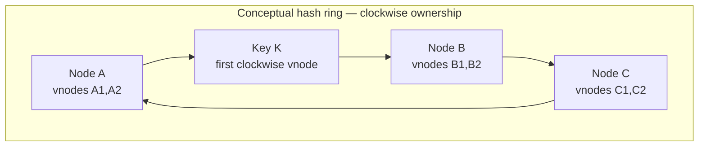
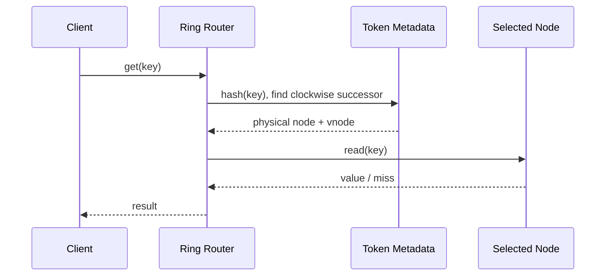
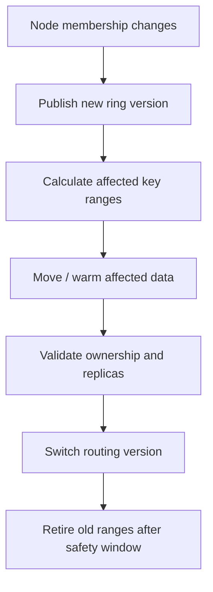

# Consistent Hashing

Consistent hashing distributes keys across nodes while limiting key remapping when nodes are added or removed. It is used in distributed caches, partition routing and some load-balancing designs.

## 1. Problem with modulo hashing

With `hash(key) % N`, changing the node count changes many key assignments. A cache cluster scale-out can therefore trigger a large cache miss wave.

## 2. Ring model

A key is mapped to a position on the same hash space as the node tokens. Ownership is the first node token clockwise from the key position. Virtual nodes give each physical node multiple positions to improve distribution.

## 3. Lookup sequence

## 4. Node membership change

The exact migration protocol is implementation-specific. A routing change without data movement or replica availability can produce misses or data loss for stores that are not disposable caches.

## 5. Trade-offs

| Benefit | Cost / risk |
|---|---|
| Less remapping than modulo hashing | Ring metadata and routing logic |
| Incremental node changes | Rebalancing and migration process |
| Vnodes improve distribution | Token count and operational tuning |
| Useful for cache partitioning | Hot keys are not automatically solved |

## 6. AI / agentic implementation guidance

AI is useful for generating a simulator, visualizing token movement and producing migration test cases. It should not control production ring membership directly.

Require:
- deterministic hash function and versioned ring metadata
- property tests for stable ownership when no topology change occurs
- distribution tests over representative keys (statistical, not exact balance guarantees)
- migration / rollback simulation
- explicit handling for node unavailable and stale ring versions
- a human-approved topology change workflow

**Prompt:** “Implement a consistent-hash ring simulator. First define hash stability, vnode ownership and ring-version contracts. Add tests that measure key movement when adding/removing a node, validate deterministic lookup and exercise stale metadata. Do not implement production data migration or automatic cluster changes.”

## Interview insight

Consistent hashing reduces remapping; it does not guarantee uniform request load, solve hot keys or remove the need for replication and migration planning. Ask: how many nodes, how often does topology change, how skewed are keys, and is this a cache or durable data store?
