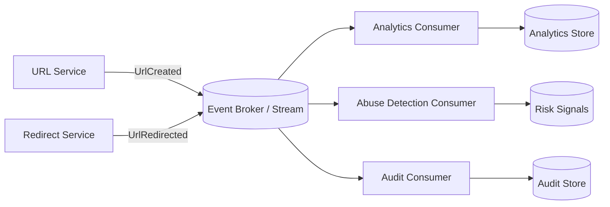
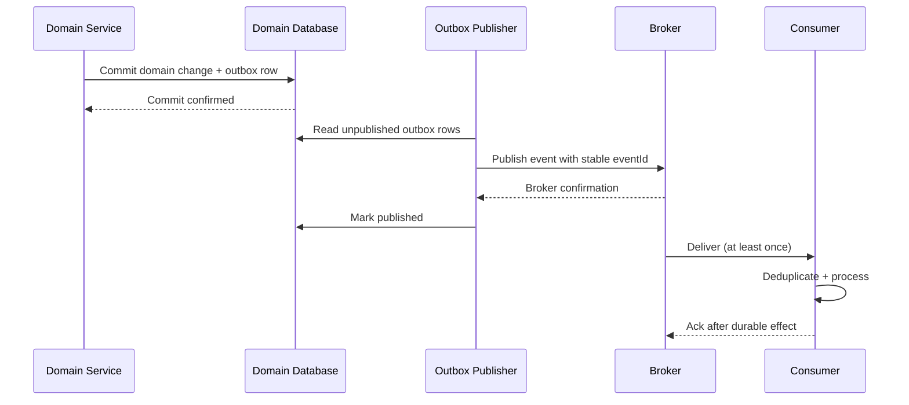
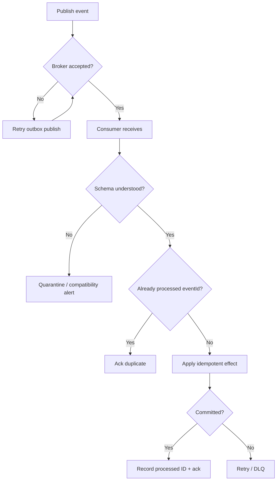

# Event-Driven Architecture (EDA)

Event-driven architecture allows services to communicate through events. Events represent facts that happened, not commands asking another service to do something.

## 1. Core architecture

Producers should not depend on the implementation details of each consumer. Consumers evolve independently but must handle schema evolution, duplicate delivery and replay.

## 2. Event publication sequence

The transactional outbox closes the gap between a domain commit and event publication. Publisher retries can still produce duplicates, so consumers need idempotency.

## 3. Event envelope

A useful baseline envelope includes:
- `eventId` (globally unique)
- `eventType`
- `schemaVersion`
- `occurredAt`
- `producer`
- `tenantId` or security scope where appropriate
- `correlationId` / `causationId`
- `payload`

Avoid putting secrets or large mutable documents in events. Prefer identifiers and immutable facts.

## 4. Stream vs queue

| Stream | Work queue |
|---|---|
| Retained log and replay | Work item is usually removed/acknowledged |
| Multiple independent consumer groups | Competing workers for a task |
| Offset-based progress | Ack/visibility/lease semantics |
| Useful for analytics and event history | Useful for dispatching background jobs |

Products differ; inspect actual broker semantics rather than assuming these terms mean the same thing everywhere.

## 5. Failure and evolution flow

## 6. AI / agentic implementation guidance

EDA can decouple agent workflow state transitions, evaluation events, human approvals and audit. Do not stream hidden reasoning or sensitive prompt data indiscriminately.

Require:
- event contracts and schema registry/version policy
- explicit PII/security classification
- idempotent state handlers
- replay policy and retention
- correlation across model, tool, workflow and downstream request
- redaction before logs/streams
- consumer authorization and tenant isolation
- backfill and reprocessing plan

**Prompt:** “Model this workflow as domain events. Separate facts from commands, define event envelope/versioning, outbox, idempotent consumers and replay semantics. Add sequence and failure diagrams. Do not claim exactly-once external side effects.”

## Interview insight

EDA shifts complexity from direct control flow to event contracts, ordering, retries and observability. Explain how consumers evolve independently and recover from replay.
