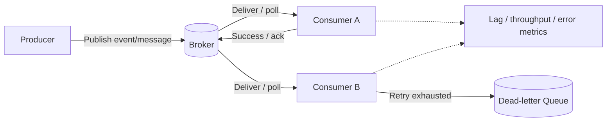
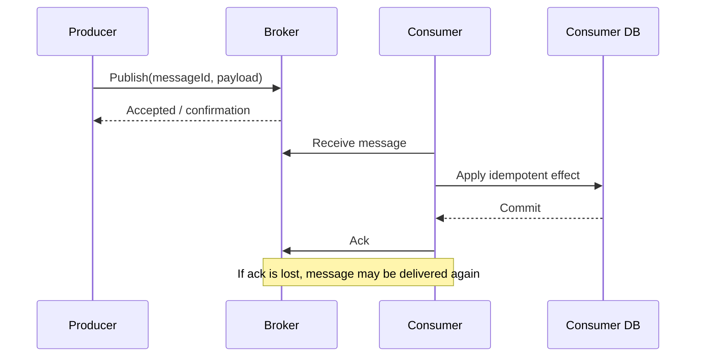
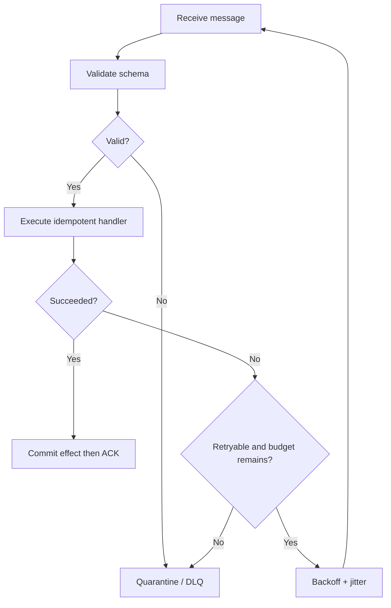

# Message Queues

Message queues enable asynchronous communication between services. They decouple producers from consumers and absorb bursts, but they introduce delivery, ordering, retry and operational semantics that must be designed explicitly.

## 1. Core architecture

## 2. Message lifecycle

Ack after the business effect commits. If the process crashes after commit but before ack, redelivery can happen; idempotency is mandatory.

## 3. Retry and DLQ flow

## 4. Delivery semantics

- At-most-once: message may be lost, but is not redelivered.
- At-least-once: redelivery is possible; idempotent consumers required.
- “Exactly once” is generally scoped to a broker/transaction boundary and does not automatically guarantee exactly-once external side effects.

## 5. Backpressure and scaling

- Monitor queue depth, oldest-message age and consumer lag.
- Scale workers against backlog while respecting downstream quotas.
- Bound concurrency and batch size.
- Use partition keys only when ordering is required; a hot partition limits parallelism.
- Apply producer backpressure or load shedding during sustained overload.

## 6. AI / agentic implementation guidance

Queues are useful for long-running AI workflows, batch inference, tool jobs and human approval tasks. Avoid keeping a model request open while a workflow waits hours for user approval.

Require:
- durable workflow/task ID and correlation ID
- payload schema and version
- idempotency key and deduplication window
- retry budget by error class
- poison-message handling and manual replay
- visibility timeout / lease renewal design
- tenant fairness and per-provider quotas
- prompt, model and tool versions captured in audit metadata (without storing secrets)
- safe cancellation and compensation semantics

**Prompt:** “Design an at-least-once queue workflow for AI task execution. Define message schema/version, dedupe key, state machine, retryable errors, DLQ replay, tenant fairness and observability. Test crash after side effect before ack, duplicate delivery, poison payload and downstream throttling.”

## Interview insight

Know who owns the message, when it is acknowledged, what happens after a crash, how duplicates are handled, and how a lagging consumer recovers.
