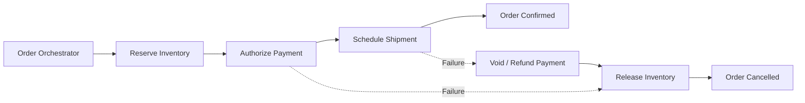
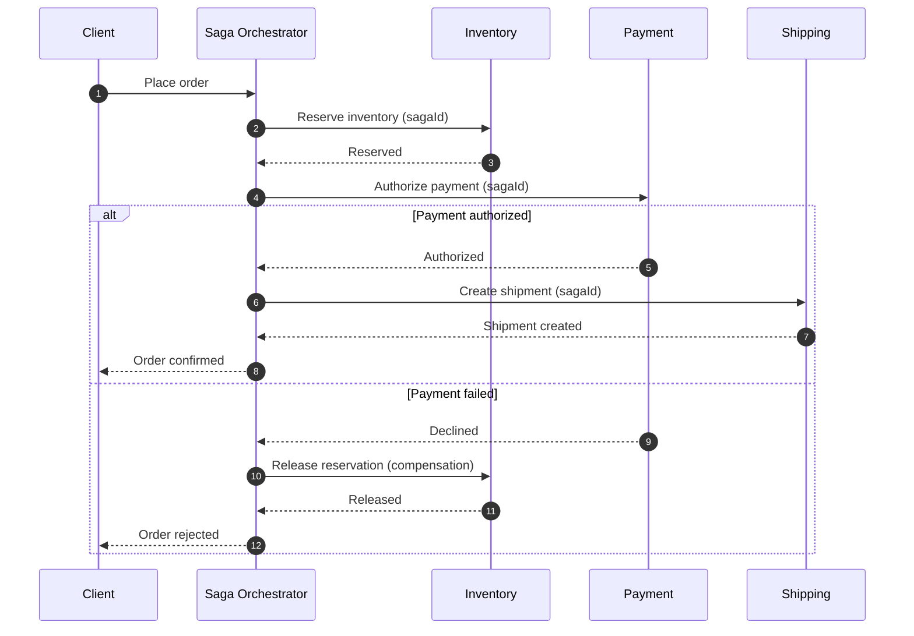
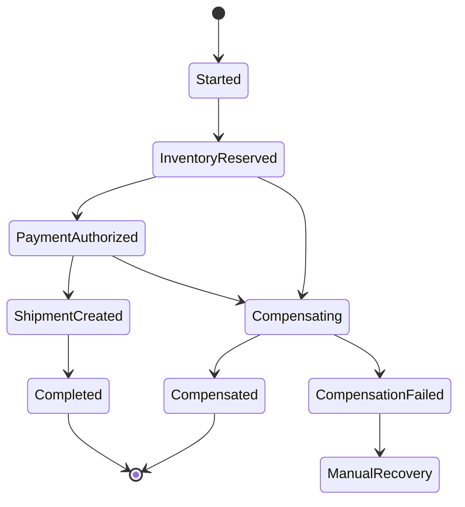

# Saga Pattern

A Saga coordinates a business transaction across multiple services using a sequence of local transactions and compensating actions. It provides a way to manage partial completion without a distributed ACID transaction.

## 1. Orchestration view

Compensation is a new business action, not a literal rollback. A refund, for example, can fail or have external latency.

## 2. Orchestration sequence

## 3. Saga state machine

Persist every step and compensation status. On process restart, resume from durable state rather than asking a model to reconstruct the transaction.

## 4. Choreography vs orchestration

| Choreography | Orchestration |
|---|---|
| Services react to events | Coordinator controls progression |
| Looser central coupling | Explicit workflow state and visibility |
| Harder to trace long flows | Coordinator is a dependency |
| Good for simple event reactions | Good for complex business transactions |

## 5. AI / agentic implementation guidance

An agent may propose a saga plan or summarize a failed workflow. It must not invent compensation actions or decide to refund/cancel without trusted business policy.

Require:
- state machine persisted durably
- idempotency key on every local command and compensation
- explicit timeout and retry semantics
- compensation operations tested for failure
- human escalation for irreversible or ambiguous outcomes
- actor and approval audit for high-impact transitions
- deterministic recovery after restart
- no dependence on chat history as the workflow database

**Prompt:** “Design an orchestrated saga for this business process. Enumerate forward steps, persisted states, idempotency keys, timeouts and compensations. Include compensation failure and manual-recovery paths. The AI may explain status but cannot choose unapproved financial or irreversible actions.”

## Interview insight

Expect questions about partial failure, duplicate commands, compensation failure, long-running workflows, idempotency and manual recovery.