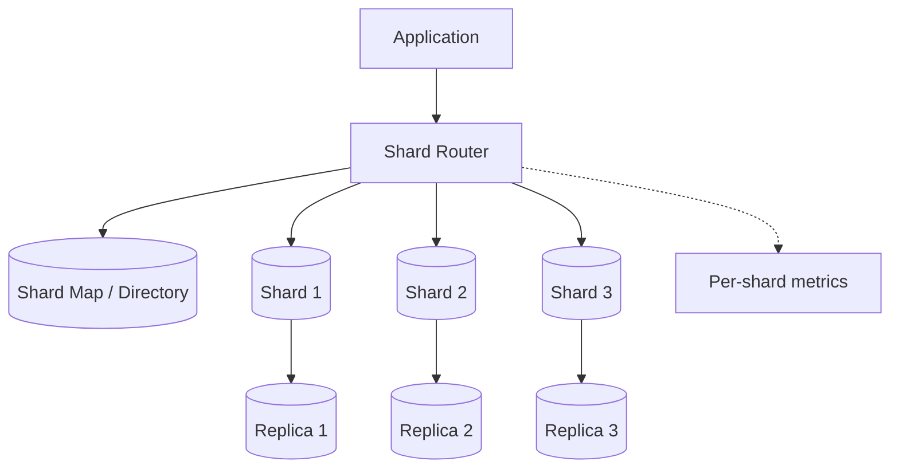
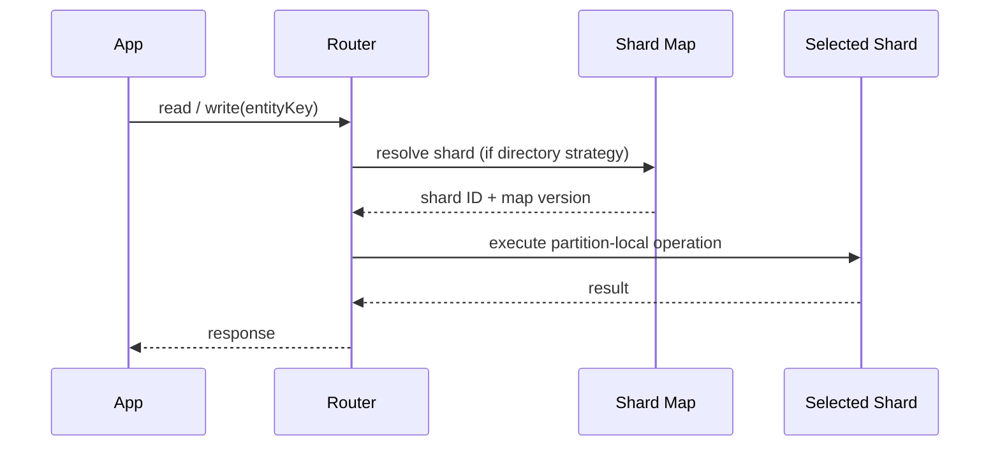
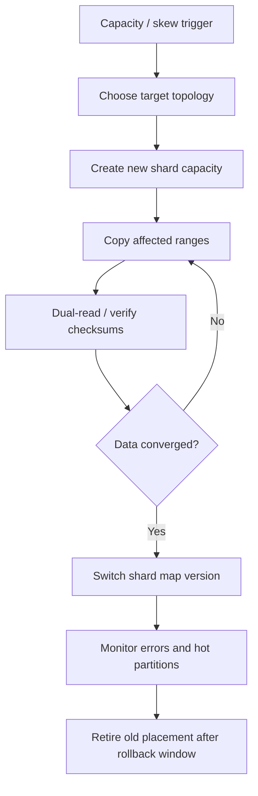

# Sharding

Sharding splits data across multiple independent database partitions. Its primary purpose is to scale storage and write throughput beyond one database instance. It trades simpler operations for routing, migration and cross-shard complexity.

## 1. Common strategies

| Strategy | Routing | Advantage | Risk |
|---|---|---|---|
| Hash-based | `hash(key) % N` | Uniform distribution for good keys | Resharding remaps many keys |
| Range-based | Key ranges | Range scans can be local | Hot ranges / uneven distribution |
| Directory-based | Lookup key → shard | Flexible placement | Directory availability and latency |

## 2. Logical architecture

For hash sharding, the router derives the shard from the key. For directory sharding, it consults a placement map. The diagram is conceptual; replication topology depends on the database technology.

## 3. Request routing sequence

## 4. Resharding flow

A real migration also needs write ordering, dual-write/outbox strategy or change-data capture, conflict resolution, rollback and backfill monitoring. Do not imply that copying then switching is safe without controlling concurrent writes.

## 5. Choosing a shard key

A good key:
- supports the dominant access patterns
- distributes writes and storage
- avoids monotonically increasing hot partitions unless range locality is needed
- keeps transactions and joins within a shard where possible
- supports tenant isolation and data residency where required

## 6. Operational trade-offs

- Cross-shard joins and transactions become harder.
- Global uniqueness and secondary indexes need explicit design.
- Rebalancing consumes network, disk and operational capacity.
- Hot tenants or keys need isolation, quotas or dedicated partitions.
- Backups and restore must preserve shard topology and metadata.

## 7. AI / agentic implementation guidance

Use AI to generate shard-key candidate analyses, synthetic workload generators, routing simulations, migration runbooks and query-pattern inventories. Do not let an agent execute production migrations autonomously.

Require:
- query workload and skew distribution as input
- tenant-aware authorization and data residency requirements
- deterministic routing version
- idempotent copy/backfill jobs
- checksum and row-count reconciliation
- dual-write consistency strategy (or write freeze)
- pause, resume and rollback procedure
- chaos tests for shard outage and stale routing map

**Prompt:** “Given these query patterns and data distribution, compare hash, range and directory sharding. Quantify assumptions, call out hot-key/tenant risk, identify transactions crossing partitions, and propose a safe resharding migration with invariants and rollback. Do not invent throughput limits or execute migrations.”

## Interview insight

Sharding should be a response to a demonstrated bottleneck. Explain what single-node limit is exceeded, why this shard key matches access patterns, and how you will migrate without losing writes.
