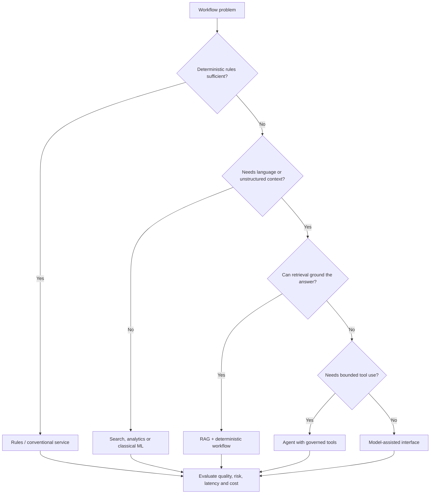
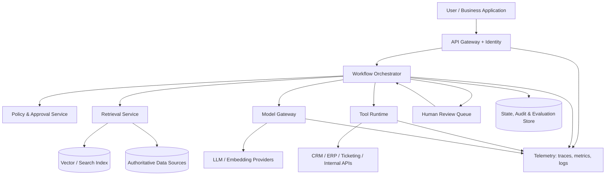
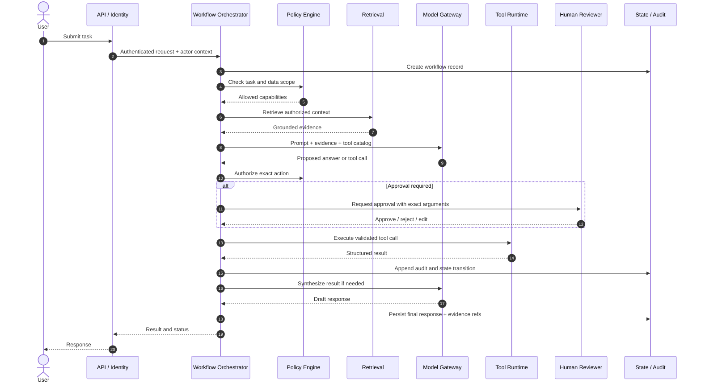
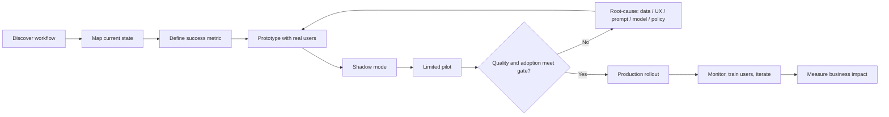

# AI Architect / Forward Deployed Engineer (FDE) Playbook

This playbook adds an applied AI and customer-workflow lens to HLD interviews and project delivery. An AI Architect designs the reusable platform and its quality/security boundaries. An FDE works close to users to discover a real workflow, integrate with existing systems, deliver a reliable solution and measure adoption. Many roles combine both.

## 1. Start from the workflow, not the model

A strong discovery conversation establishes:
- User persona and job-to-be-done
- Current workflow, tools, handoffs and pain points
- Frequency, volume, cycle time and error/rework rate
- Source systems and data permissions
- What can be automated, assisted or must remain human-owned
- Cost of a false positive, false negative or delayed response
- Success metric and baseline

Deliverable: a one-page workflow map and a measurable problem statement. “Use an LLM to automate support” is not a requirement.

## 2. AI solution fit decision

Prefer deterministic software for calculations, permissions, state transitions and money movement. Use models where language, ambiguity or synthesis creates material value. Use agents only when the task genuinely needs dynamic selection among bounded tools.

## 3. Reference enterprise AI architecture

Important boundaries:
- API gateway authenticates the caller; policy service authorizes actions.
- Retrieval filters by user/tenant permissions before context reaches a model.
- Model gateway centralizes provider selection, quotas, timeouts and data handling.
- Tool runtime validates schemas and authorization, then executes bounded operations.
- Workflow state and audit records are durable and separate from model context.
- Human review is a first-class state, not a chat message that the model can ignore.

## 4. Agent execution sequence

## 5. Architecture patterns for AI workloads

| Need | Preferred design | Guardrail |
|---|---|---|
| Ground responses in company knowledge | RAG with ACL-aware retrieval | Enforce ACL before context enters model |
| Long-running work | Durable workflow / state machine | Persist checkpoints; resume idempotently |
| External actions | Governed tool runtime | Server-side policy and approval |
| Multi-agent collaboration | Start with one orchestrator and bounded specialist tools | Add agents only when independent context/ownership justifies it |
| Model/provider resilience | Model gateway + fallback policy | Evaluate quality parity; don't silently downgrade for critical tasks |
| High-volume inference | Async queue + bounded workers | Backpressure, quotas, dead-letter handling |
| Repeated outputs | Cache only with tenant-aware keys and freshness policy | Never cross-contaminate tenants |
| Quality improvement | Evaluation harness + curated feedback | Separate evaluation data from training data |

## 6. FDE delivery lifecycle

FDE quality bar:
- Integrate with actual identity, data and operational workflows.
- Make failure and escalation understandable to the end user.
- Keep humans in control where business risk is high.
- Provide an operational owner, runbook and rollback.
- Track adoption and business outcome, not just model benchmark scores.

## 7. Evaluation pyramid

1. Unit tests for schemas, policies, transformations and deterministic functions.
2. Contract tests for model gateway and tools.
3. Golden datasets for retrieval and answer quality.
4. Scenario tests for end-to-end workflows, including adversarial and failure cases.
5. Shadow evaluation on production-like traffic with no side effects.
6. Human review and business outcome measurement after a limited rollout.

A demo that works once is not an evaluation strategy.

## 8. Interview narrative (2 minutes)

“I start with the workflow and measurable business problem, not the model choice. I determine which parts are deterministic and which benefit from language understanding or synthesis. I build a secure architecture with identity-aware retrieval, a model gateway, durable orchestration, and a governed tool runtime. Risky actions require explicit human approval. Before rollout I define golden evaluations, shadow mode and pilot gates. As an FDE I work with users to integrate into their real workflow and measure cycle-time, quality and adoption. As an AI Architect I make those controls reusable, observable and scalable.”

## 9. FDE / AI Architect system design questions

- What is the actual business workflow and who owns each step?
- Why is an LLM needed instead of rules, search or a conventional service?
- What data can this user retrieve? How do ACLs propagate?
- How are tool permissions derived and enforced?
- Which side effects require human approval?
- How do you recover after the model times out after a tool has succeeded?
- How do you prevent duplicate actions on retry?
- How do you measure hallucinations, retrieval misses and task completion?
- How do you estimate inference, storage, retrieval and operational costs?
- What is the fallback when the provider, vector store or downstream API fails?
- How do you deploy to one customer without leaking their data or building an unmaintainable fork?
- What evidence justifies moving from pilot to production?

## Principle

**FDE is not “prompt engineering at the customer.” It is disciplined product engineering at the workflow boundary: discovery, integration, evaluation, adoption and operational ownership.**
