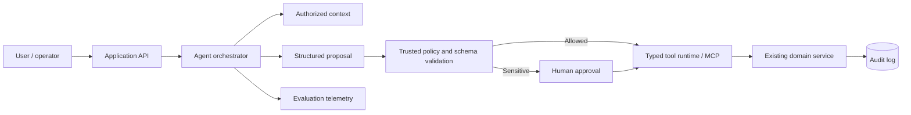

# AI / Agentic Implementation — API Gateway

## AI fit and safety boundary

Gateway is a policy boundary, not a business-logic dumping ground.

Do not introduce an LLM merely because the system can expose tools. Identify a measurable workflow bottleneck first. Keep inference out of deterministic correctness-critical paths.

## Safe extension architecture

## Controls

- Identity and tenant scope come from verified server-side context.
- Use narrow typed tools with strict schemas, timeouts, allowlists and side-effect documentation.
- Authorize every call in trusted runtime code; MCP discovery is not permission.
- Use idempotency, bounded retries and structured error categories.
- Require approval for destructive, financial, external or privilege-changing actions.
- Bind approval to exact canonical arguments, actor, scope, expiry and policy version.
- Treat retrieved documents and tool output as untrusted prompt-injection content.
- Redact sensitive data and trace model, retrieval, tool and downstream calls.

## Delivery slices

1. Instrument deterministic baseline and collect representative cases.
2. Add read-only authorized retrieval and evidence-linked suggestions.
3. Add structured proposals and offline evaluation.
4. Integrate one low-risk typed tool with authorization and idempotency.
5. Add human approval and audit/reconciliation.
6. Shadow deploy, compare outcomes, canary and preserve rollback.

## Evaluation

Measure task correctness, unsupported claims, unauthorized action rate (zero tolerance), tool selection/argument validity, human correction, p95 latency, cost and provider/tool failure rate.

## Coding prompt

> Read this HLD and the repository's AI/agentic guidelines. Inspect code and baseline checks. Propose interfaces, data ownership, sequences, authorization and failure behavior before edits. Implement one vertical slice with tests for normal, invalid, denied, duplicate, timeout and partial-failure cases. Enforce permissions outside the model. Report actual commands/results and update diagrams.