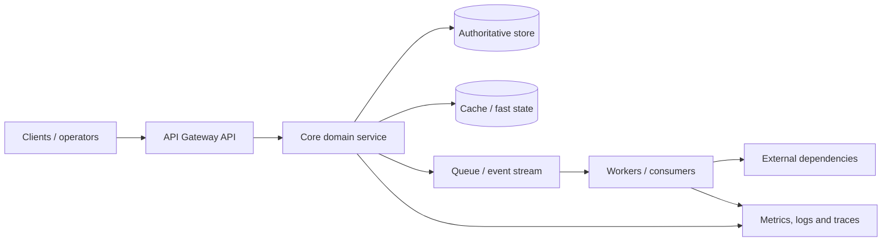
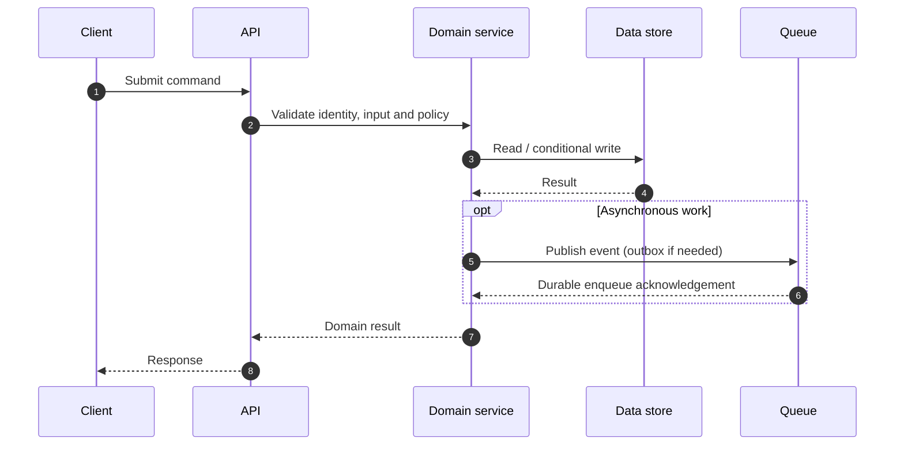
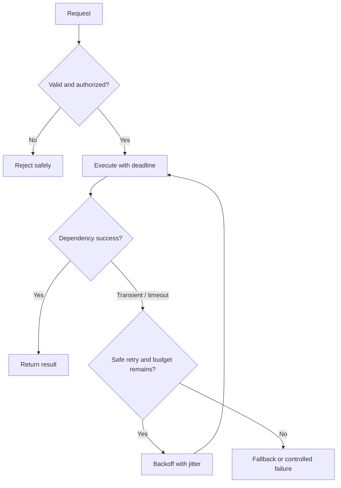
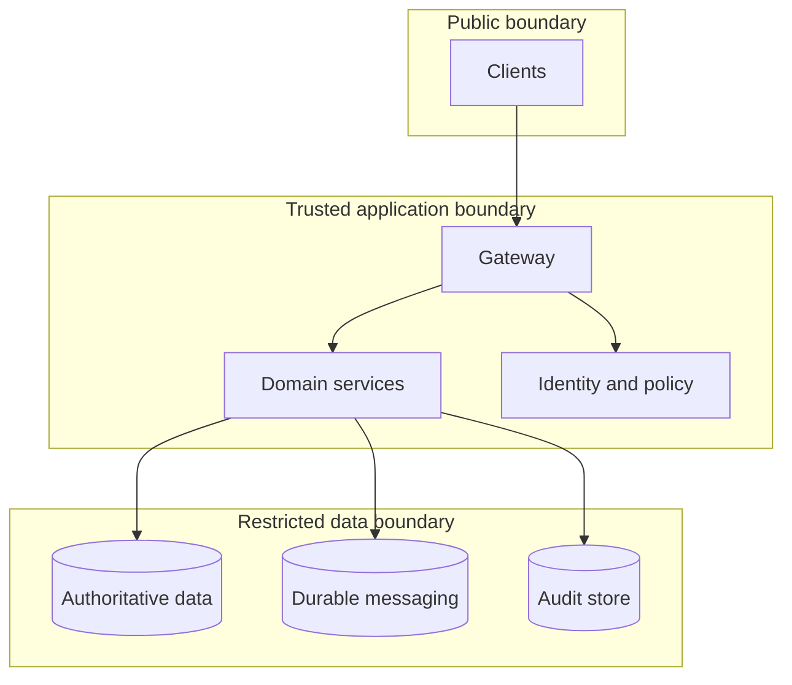

# Architecture and Diagrams — API Gateway

## Component architecture

clients, API gateway, identity provider, service registry, backend services

## Critical request sequence

## Failure and recovery decision

## Deployment boundary

## Operational signals

| Signal | Why it matters |
|---|---|
| Request rate, errors, p95/p99 | User-visible performance |
| Dependency latency/error rate | Downstream degradation |
| Queue age / consumer lag | Async capacity mismatch |
| Retry / timeout / duplicate rate | Amplification and idempotency defects |
| CPU, memory and connection saturation | Capacity exhaustion |
| Business success/failure | Actual system outcomes |

## Visual explainer

See [the enhanced visual architecture, critical sequence, failure/recovery flow, AWS/GCP starter mapping and interview walkthrough](visual_explainer.md). Editable Archify source: [archify/api-gateway.architecture.json](archify/api-gateway.architecture.json).
