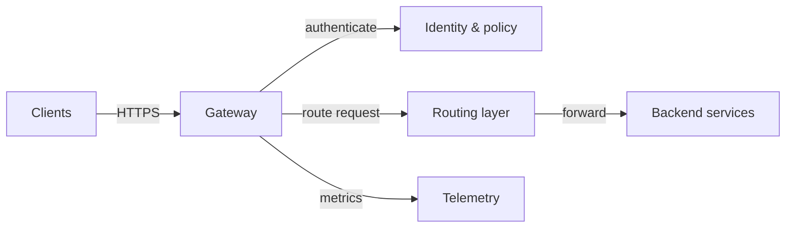
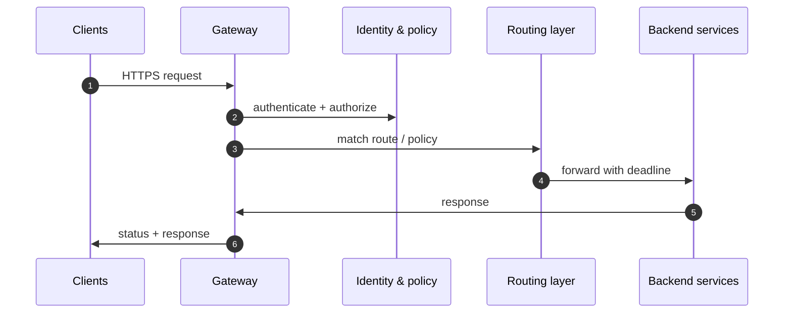
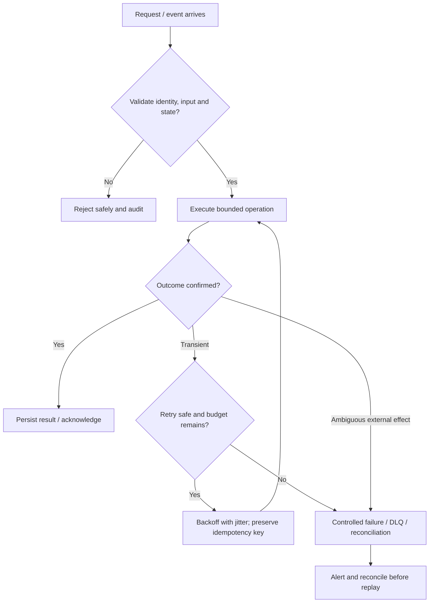

# API Gateway — Visual Architecture Explainer

> Conceptual HLD based on this repository's design notes. Confirm workload assumptions, service semantics and deployment choices before implementation.

## 1. System architecture

Follow the primary request path first. Storage, policy, queue and telemetry are supporting boundaries; they are not interchangeable.

## 2. Critical interaction

## 3. Failure and recovery

## 4. Core invariants

- Gateway never bypasses backend authorization for resource-level checks.
- Every request has a deadline and bounded retry budget.
- Route/config changes are versioned, auditable and rollbackable.

## 5. Architecture decisions to defend

- Frame it as the stable edge boundary for authentication, routing, quotas, TLS, request shaping and observability—not business logic.
- Define route matching, authN/authZ, per-route limits, timeout budget, payload limits, versioning and backward compatibility.
- Walk one request: edge accepts → identity/policy check → route lookup → backend call with deadline → response normalization and telemetry.

| Concern | AWS starting point | GCP starting point |
|---|---|---|
| Compute / API | API Gateway + ECS/Lambda as appropriate | API Gateway / Cloud Load Balancing + Cloud Run/GKE |
| Durable state | RDS/Aurora or DynamoDB based on access pattern | Cloud SQL/Spanner/Firestore based on access pattern |
| Async work | SQS/SNS/EventBridge/Kinesis as needed | Pub/Sub/Eventarc as needed |
| Operations | CloudWatch, X-Ray, IAM, Secrets Manager | Cloud Logging/Monitoring/Trace, Cloud IAM, Secret Manager |

These are starter mappings, not exact equivalents. Choose services from required consistency, ordering, retention, latency, regional scope and operational constraints.

## 6. Senior interview walkthrough (10 minutes)

### 0:00–1:00 — Frame the problem
Frame it as the stable edge boundary for authentication, routing, quotas, TLS, request shaping and observability—not business logic.

### 1:00–2:00 — Requirements and invariants
Define route matching, authN/authZ, per-route limits, timeout budget, payload limits, versioning and backward compatibility.

### 2:00–4:00 — Draw and narrate the architecture
Walk one request: edge accepts → identity/policy check → route lookup → backend call with deadline → response normalization and telemetry.

### 4:00–6:00 — Walk the critical path
Keep route/config control plane separate from the data plane; use versioned config, safe rollout and last-known-good behavior.

### 6:00–8:00 — Failure, recovery and operations
Failure cases: backend timeout, gateway saturation, stale route config, auth provider outage, retry amplification and partial region failure.

### 8:00–9:00 — Trade-offs and alternatives
Trade-offs: managed gateway vs self-hosted proxy; centralized policy consistency vs latency; retries vs duplicate side effects.

### 9:00–10:00 — Close with measurable signals
Name the SLOs and operational signals that demonstrate correctness and capacity: user-visible latency/error rate, saturation, queue age/lag where applicable, retry/duplicate rate, and domain success metrics. State what would trigger a redesign rather than claiming unlimited scale.

## 7. Follow-up questions to rehearse

- Where do you put service-level authorization?
- How do you prevent retry storms?
- How do you roll out a bad route safely?
- What becomes the gateway bottleneck?

## Archify source

Editable Archify diagram IR: archify/api-gateway.architecture.json. Generate the interactive HTML with the Archify skill/CLI from the repository root. The Mermaid diagrams above render directly on GitHub.
