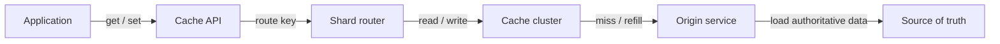
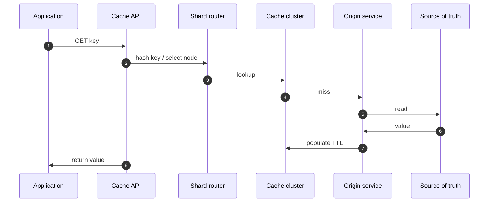
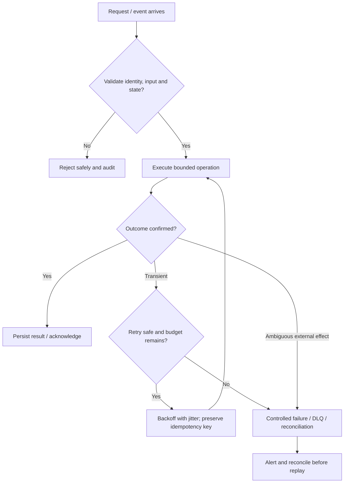

# Distributed Cache — Visual Architecture Explainer

> Conceptual HLD based on this repository's design notes. Confirm workload assumptions, service semantics and deployment choices before implementation.

## 1. System architecture

Follow the primary request path first. Storage, policy, queue and telemetry are supporting boundaries; they are not interchangeable.

## 2. Critical interaction

## 3. Failure and recovery

## 4. Core invariants

- Cache is not the source of truth unless the product explicitly chooses it.
- Invalidation and TTL behavior are defined for every mutable key.
- Origin traffic is bounded during cache degradation.

## 5. Architecture decisions to defend

- Start with workload: read/write ratio, hot-key skew, freshness requirement and acceptable stale window.
- Choose cache-aside as the baseline; define key design, TTL, serialization, eviction, negative caching and invalidation ownership.
- Explain cache miss path, stampede protection (single-flight/locks/jitter), and origin protection under a cold cache.

| Concern | AWS starting point | GCP starting point |
|---|---|---|
| Compute / API | API Gateway + ECS/Lambda as appropriate | API Gateway / Cloud Load Balancing + Cloud Run/GKE |
| Durable state | RDS/Aurora or DynamoDB based on access pattern | Cloud SQL/Spanner/Firestore based on access pattern |
| Async work | SQS/SNS/EventBridge/Kinesis as needed | Pub/Sub/Eventarc as needed |
| Operations | CloudWatch, X-Ray, IAM, Secrets Manager | Cloud Logging/Monitoring/Trace, Cloud IAM, Secret Manager |

These are starter mappings, not exact equivalents. Choose services from required consistency, ordering, retention, latency, regional scope and operational constraints.

## 6. Senior interview walkthrough (10 minutes)

### 0:00–1:00 — Frame the problem
Start with workload: read/write ratio, hot-key skew, freshness requirement and acceptable stale window.

### 1:00–2:00 — Requirements and invariants
Choose cache-aside as the baseline; define key design, TTL, serialization, eviction, negative caching and invalidation ownership.

### 2:00–4:00 — Draw and narrate the architecture
Explain cache miss path, stampede protection (single-flight/locks/jitter), and origin protection under a cold cache.

### 4:00–6:00 — Walk the critical path
Discuss partitioning, replication, consistent hashing, hot-key mitigation and rebalancing.

### 6:00–8:00 — Failure, recovery and operations
Failure cases: cache outage, stale data, eviction storm, hot key, thundering herd and network partition.

### 8:00–9:00 — Trade-offs and alternatives
Trade-offs: cache hit ratio vs staleness; local vs distributed cache; write-through vs cache-aside; memory cost vs origin load.

### 9:00–10:00 — Close with measurable signals
Name the SLOs and operational signals that demonstrate correctness and capacity: user-visible latency/error rate, saturation, queue age/lag where applicable, retry/duplicate rate, and domain success metrics. State what would trigger a redesign rather than claiming unlimited scale.

## 7. Follow-up questions to rehearse

- How do you invalidate after writes?
- What happens when Redis is unavailable?
- How do you handle hot keys?
- How do you prevent stampedes?

## Archify source

Editable Archify diagram IR: archify/cache-system.architecture.json. Generate the interactive HTML with the Archify skill/CLI from the repository root. The Mermaid diagrams above render directly on GitHub.
