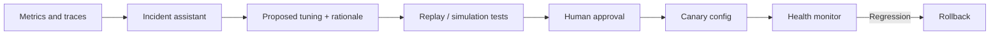

# AI / FDE Implementation — Circuit Breaker

AI can summarize incident telemetry and propose threshold changes. It must not autonomously disable protection or mutate production policy.

Use typed read-only observability tools; require approval, bounded rollout and rollback for writes. Evaluate false opens, missed failures, rejected calls and recovery time.
