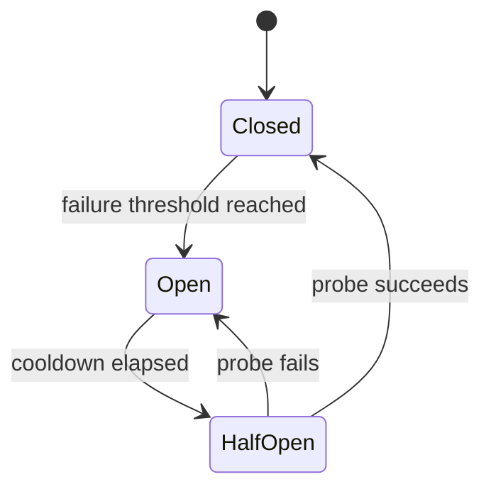

# Data Model — Circuit Breaker

A breaker is usually local runtime state, with configuration centrally managed and telemetry emitted asynchronously.

Config fields: dependency key, rolling window, minimum calls, failure/slow-call threshold, open duration, half-open probe count and fallback policy. Metrics include state transitions and rejected calls. Avoid a central synchronous state store on every request unless cross-node coordination is a demonstrated requirement.
