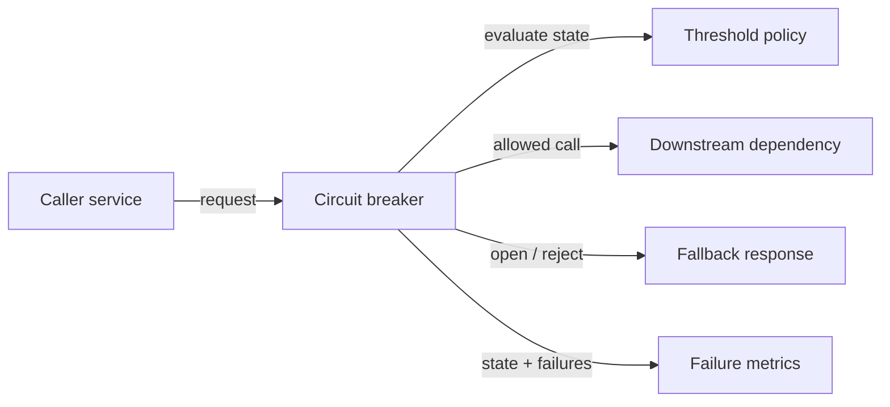
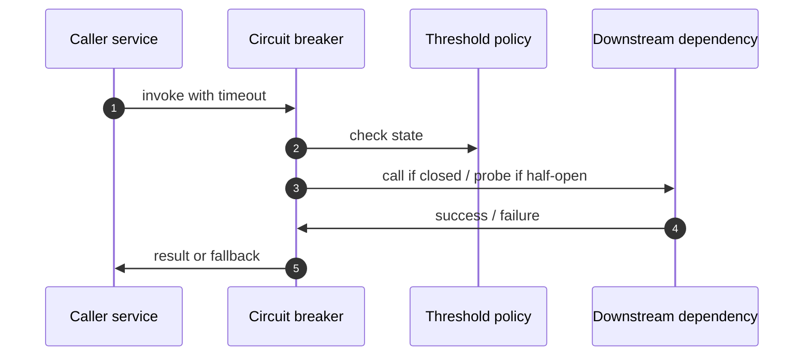
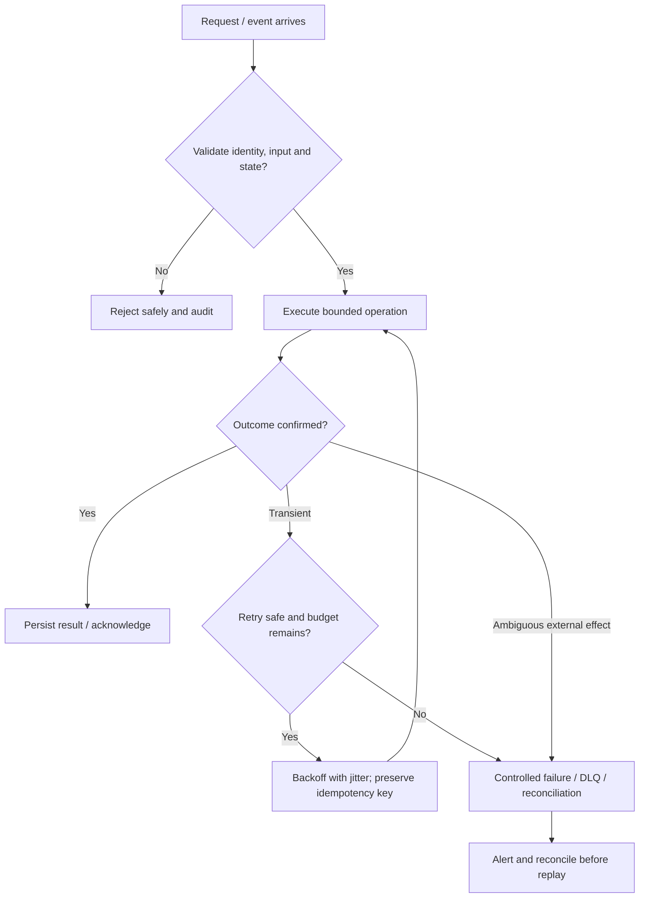

# Circuit Breaker — Visual Architecture Explainer

> Conceptual HLD based on this repository's design notes. Confirm workload assumptions, service semantics and deployment choices before implementation.

## 1. System architecture

Follow the primary request path first. Storage, policy, queue and telemetry are supporting boundaries; they are not interchangeable.

## 2. Critical interaction

## 3. Failure and recovery

## 4. Core invariants

- Only dependency failures count toward breaker health; business errors are classified separately.
- Half-open probes are bounded.
- Fallback behavior is explicit and safe for the domain.

## 5. Architecture decisions to defend

- Explain the goal: stop cascading failure and protect callers/dependencies, not guarantee recovery.
- Define failure classification, rolling window, minimum sample count, open duration, half-open probe limit and reset behavior.
- Walk closed → open → half-open → closed, separating timeout, business rejection and caller cancellation.

| Concern | AWS starting point | GCP starting point |
|---|---|---|
| Compute / API | API Gateway + ECS/Lambda as appropriate | API Gateway / Cloud Load Balancing + Cloud Run/GKE |
| Durable state | RDS/Aurora or DynamoDB based on access pattern | Cloud SQL/Spanner/Firestore based on access pattern |
| Async work | SQS/SNS/EventBridge/Kinesis as needed | Pub/Sub/Eventarc as needed |
| Operations | CloudWatch, X-Ray, IAM, Secrets Manager | Cloud Logging/Monitoring/Trace, Cloud IAM, Secret Manager |

These are starter mappings, not exact equivalents. Choose services from required consistency, ordering, retention, latency, regional scope and operational constraints.

## 6. Senior interview walkthrough (10 minutes)

### 0:00–1:00 — Frame the problem
Explain the goal: stop cascading failure and protect callers/dependencies, not guarantee recovery.

### 1:00–2:00 — Requirements and invariants
Define failure classification, rolling window, minimum sample count, open duration, half-open probe limit and reset behavior.

### 2:00–4:00 — Draw and narrate the architecture
Walk closed → open → half-open → closed, separating timeout, business rejection and caller cancellation.

### 4:00–6:00 — Walk the critical path
Place breaker per dependency/operation; combine with bulkheads, deadlines and retry budgets.

### 6:00–8:00 — Failure, recovery and operations
Failure cases: low traffic, synchronized probes, breaker flapping, fallback failure and distributed fleet disagreement.

### 8:00–9:00 — Trade-offs and alternatives
Trade-offs: local breaker state vs shared state; aggressive thresholds vs false opens; fallback freshness vs correctness.

### 9:00–10:00 — Close with measurable signals
Name the SLOs and operational signals that demonstrate correctness and capacity: user-visible latency/error rate, saturation, queue age/lag where applicable, retry/duplicate rate, and domain success metrics. State what would trigger a redesign rather than claiming unlimited scale.

## 7. Follow-up questions to rehearse

- How do you tune for low traffic?
- Do all instances share breaker state?
- How does it interact with retries?
- What if fallback is stale?

## Archify source

Editable Archify diagram IR: archify/circuit-breaker.architecture.json. Generate the interactive HTML with the Archify skill/CLI from the repository root. The Mermaid diagrams above render directly on GitHub.
