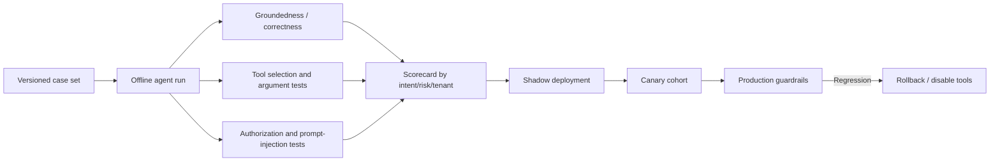

# AI / FDE Implementation — Customer Support AI Agent

## Build in vertical slices
1. Read-only copilot: authenticated intake, scoped retrieval, evidence-linked draft; no side effects.
2. Ticket drafting: create draft/internal note; require approval before write.
3. Governed routine tools: allowlisted low-risk updates with typed schemas and idempotency.
4. Approval workflow: exact-action approval UI, expiry, rejection, replay protection and audit.
5. Evaluation loop: golden set, shadow mode, gradual rollout and rollback.

## Tool contract and governance
- Derive customer and tenant identity from verified session claims.
- Tool schemas are narrow, versioned and explicit about side effects.
- Runtime validates tenant, subject, role, purpose, arguments, risk, quota and policy version.
- MCP supports discovery/invocation; it does not replace authorization.
- Read tools return source references, access labels and freshness metadata.
- Write tools use idempotency keys and structured result states.
- Sensitive actions require human approval bound to canonical payload hash, approver, expiry and policy version.

## Retrieval and prompt safety
- Apply document/row ACLs before retrieval results enter model context.
- Treat customer text, attachments, retrieved docs and tool output as untrusted data.
- Separate system policy from retrieved content; do not follow embedded instructions.
- Redact secrets and minimize PII in prompts, logs and evaluation artifacts.

## Evaluation plan
Measure:
- **Resolution accuracy:** correct resolved outcomes / adjudicated resolved cases.
- **Handling time:** intake-to-resolution and active human time separately; report p50/p95.
- **Escalation rate:** escalated eligible cases / eligible cases, segmented by reason.
- Supporting guardrails: unauthorized retrieval/action (zero tolerance), unsupported claims, tool argument validity, approval rejection, reopen rate, CSAT, cost/case and tool failure rate.

## Enterprise operating model
- Define owners for support policy, knowledge sources, tools, approvals and evaluation labels.
- Keep model, prompt, retrieval index and policy versions in each run trace.
- Review failure clusters and human corrections weekly; update golden cases before prompt/model changes.
- Maintain a kill switch that disables writes while preserving read-only support.
- Run access-control, tenant-isolation and prompt-injection tests before each release.

## FDE discovery checklist
- Which channels, CRM and ticketing systems are in scope?
- Which records may each customer/agent persona access?
- Which actions are sensitive, reversible or regulated?
- What does “resolved” mean, and who adjudicates it?
- What is approval SLA and escalation ownership?
- What are language, region, retention and data residency constraints?
- What baseline metrics and pilot cohort are available?

## Implementation prompt
> Build this as a secure enterprise workflow, not an autonomous chatbot. Start with read-only authorized retrieval and an evaluation baseline. Enforce identity, tenant scope and tool permissions in trusted server-side code. Use typed, versioned tools with idempotency and audit. Require human approval for sensitive actions, bound to exact arguments and expiry. Test normal, denied, duplicate, timeout, ambiguous outcome and prompt-injection cases. Report actual checks and measured resolution accuracy, handling time and escalation rate.
