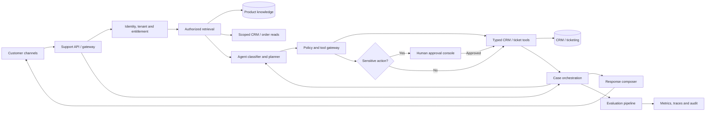
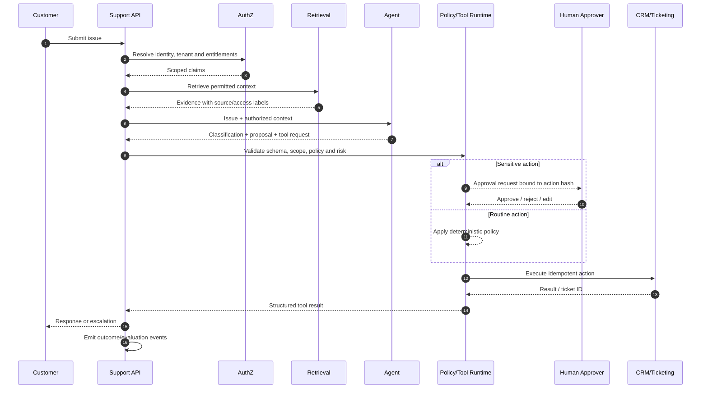
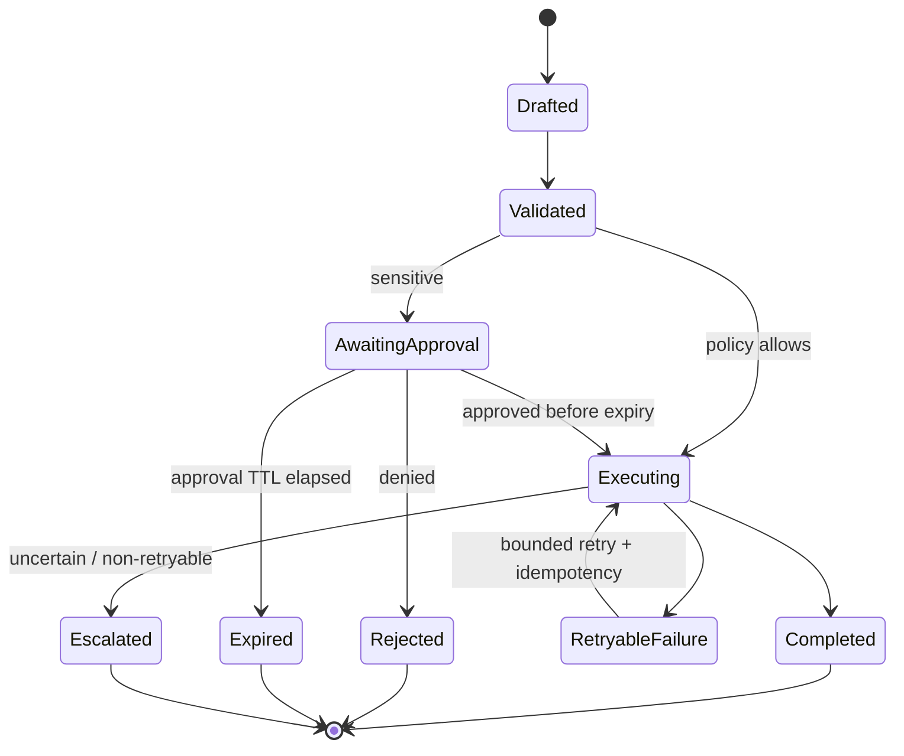
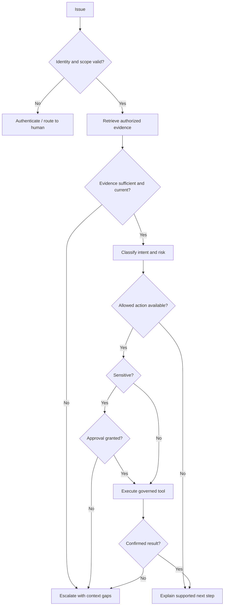

# Architecture and Diagrams — Customer Support AI Agent

## Component architecture

## Customer issue sequence

## Approval state machine

## Safe fallback flow

## Trust boundaries
- Identity and tenant scope come from verified server-side claims, never model arguments.
- Retrieval enforces authorization before prompt assembly and labels evidence provenance.
- Retrieved text and attachments are untrusted prompt-injection input.
- Tool runtime validates permissions, schema, scope, risk, quotas and idempotency on every call.
- Audit records capture actor, action, approval, policy version and outcome without unnecessary sensitive prompt data.