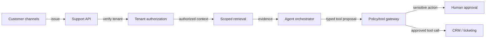
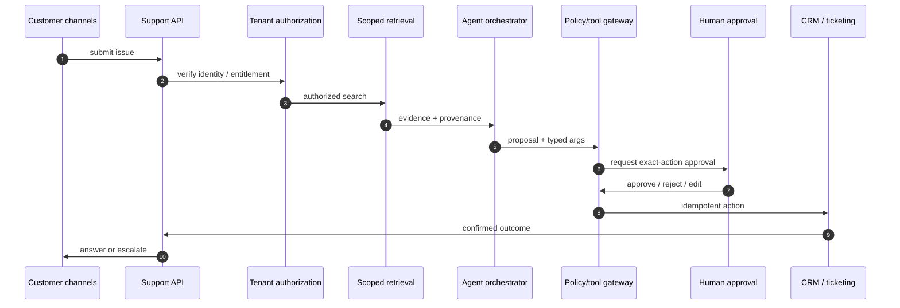
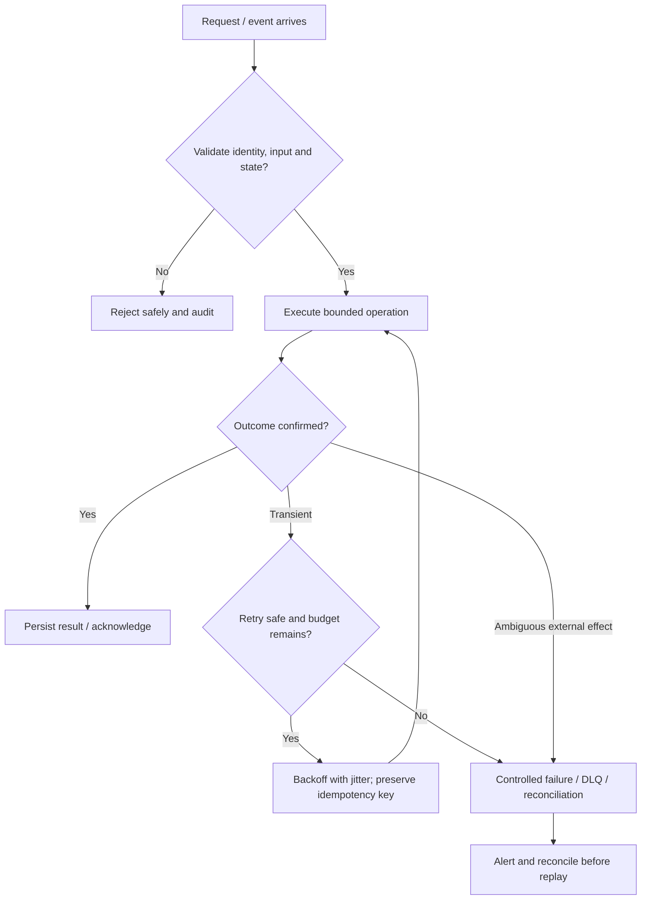

# Customer Support AI Agent — Visual Architecture Explainer

> Conceptual HLD based on this repository's design notes. Confirm workload assumptions, service semantics and deployment choices before implementation.

## 1. System architecture

Follow the primary request path first. Storage, policy, queue and telemetry are supporting boundaries; they are not interchangeable.

## 2. Critical interaction

## 3. Failure and recovery

## 4. Core invariants

- Authorization is server-side and tenant-scoped; model arguments never grant access.
- Sensitive effects require approval bound to exact action/payload and expiry.
- Tool calls are typed, idempotent, audited and reconciled after ambiguous outcomes.

## 5. Architecture decisions to defend

- Frame it as a governed support workflow, not an unrestricted chatbot: answer from authorized evidence, propose actions, execute only through typed tools.
- Define tenants, identity claims, entitlements, issue classes, resolution criteria and sensitive actions requiring approval.
- Walk scoped retrieval → evidence-linked response proposal → tool schema/policy validation → approval bound to exact action → idempotent CRM write → confirmation.

| Concern | AWS starting point | GCP starting point |
|---|---|---|
| Compute / API | API Gateway + ECS/Lambda as appropriate | API Gateway / Cloud Load Balancing + Cloud Run/GKE |
| Durable state | RDS/Aurora or DynamoDB based on access pattern | Cloud SQL/Spanner/Firestore based on access pattern |
| Async work | SQS/SNS/EventBridge/Kinesis as needed | Pub/Sub/Eventarc as needed |
| Operations | CloudWatch, X-Ray, IAM, Secrets Manager | Cloud Logging/Monitoring/Trace, Cloud IAM, Secret Manager |

These are starter mappings, not exact equivalents. Choose services from required consistency, ordering, retention, latency, regional scope and operational constraints.

## 6. Senior interview walkthrough (10 minutes)

### 0:00–1:00 — Frame the problem
Frame it as a governed support workflow, not an unrestricted chatbot: answer from authorized evidence, propose actions, execute only through typed tools.

### 1:00–2:00 — Requirements and invariants
Define tenants, identity claims, entitlements, issue classes, resolution criteria and sensitive actions requiring approval.

### 2:00–4:00 — Draw and narrate the architecture
Walk scoped retrieval → evidence-linked response proposal → tool schema/policy validation → approval bound to exact action → idempotent CRM write → confirmation.

### 4:00–6:00 — Walk the critical path
Separate model planning from deterministic authorization, tool execution, workflow state, audit and evaluation.

### 6:00–8:00 — Failure, recovery and operations
Failure cases: prompt injection in retrieved content, cross-tenant retrieval, ambiguous CRM timeout, approval expiry, stale knowledge and unsupported answer.

### 8:00–9:00 — Trade-offs and alternatives
Rollout: read-only retrieval → draft responses → low-risk tools → approval-gated writes → canary. Measure resolution accuracy, escalation, handling time and safety.

### 9:00–10:00 — Close with measurable signals
Name the SLOs and operational signals that demonstrate correctness and capacity: user-visible latency/error rate, saturation, queue age/lag where applicable, retry/duplicate rate, and domain success metrics. State what would trigger a redesign rather than claiming unlimited scale.

## 7. Follow-up questions to rehearse

- How do you prevent cross-tenant leakage?
- How is approval invalidated if payload changes?
- What if CRM writes but response times out?
- How do you evaluate unsafe deflection?

## Archify source

Editable Archify diagram IR: archify/customer-support-ai-agent.architecture.json. Generate the interactive HTML with the Archify skill/CLI from the repository root. The Mermaid diagrams above render directly on GitHub.
