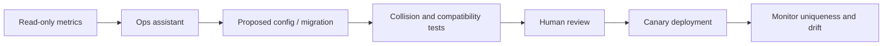

# AI / FDE Implementation

AI may analyze ID-generation metrics, explain clock anomalies and draft migration plans. It must not invent worker IDs or alter generator bit layouts without review.

Use typed read-only telemetry tools; config changes require approval, compatibility checks and rollback. Never use generated IDs as credentials or bearer tokens.
