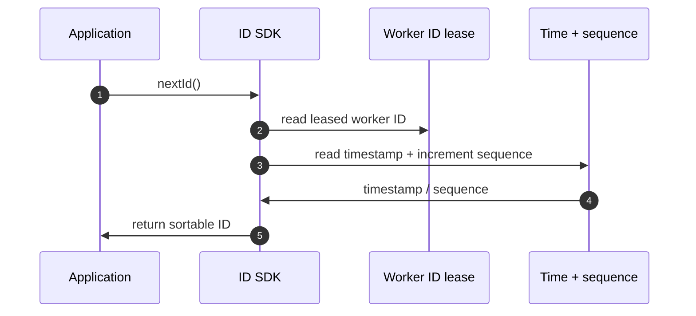
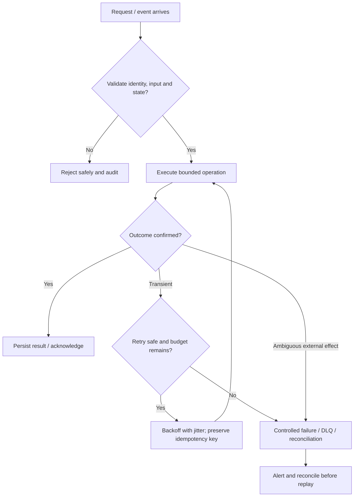

# Distributed ID Generator — Visual Architecture Explainer

> Conceptual HLD based on this repository's design notes. Confirm workload assumptions, service semantics and deployment choices before implementation.

## 1. System architecture

```mermaid
flowchart LR
  n0["Application"]
  n1["ID SDK"]
  n2["Time + sequence"]
  n3["Worker ID lease"]
  n4["Composed ID"]
  n5["Clock / collision metrics"]
  n0 -->|nextId()| n1
  n1 -->|read time + sequence| n2
  n1 -->|worker identity| n3
  n2 -->|compose unique ID| n4
  n1 -->|drift / exhaustion| n5
```

Follow the primary request path first. Storage, policy, queue and telemetry are supporting boundaries; they are not interchangeable.

## 2. Critical interaction



## 3. Failure and recovery



## 4. Core invariants

- (timestamp, workerId, sequence) tuple is unique within the configured epoch and worker lease.
- Worker identity is fenced against concurrent reuse.
- Clock rollback policy never reuses an emitted ID tuple.

## 5. Architecture decisions to defend

- Clarify uniqueness scope, approximate ordering, lexicographic sort, generation rate and acceptable clock assumptions.
- Compare UUIDv4, database sequences and Snowflake-style IDs; state the bit layout and epoch.
- Explain worker ID allocation with lease/fencing, timestamp bits, sequence bits and encoding.

| Concern | AWS starting point | GCP starting point |
|---|---|---|
| Compute / API | API Gateway + ECS/Lambda as appropriate | API Gateway / Cloud Load Balancing + Cloud Run/GKE |
| Durable state | RDS/Aurora or DynamoDB based on access pattern | Cloud SQL/Spanner/Firestore based on access pattern |
| Async work | SQS/SNS/EventBridge/Kinesis as needed | Pub/Sub/Eventarc as needed |
| Operations | CloudWatch, X-Ray, IAM, Secrets Manager | Cloud Logging/Monitoring/Trace, Cloud IAM, Secret Manager |

These are starter mappings, not exact equivalents. Choose services from required consistency, ordering, retention, latency, regional scope and operational constraints.

## 6. Senior interview walkthrough (10 minutes)

### 0:00–1:00 — Frame the problem
Clarify uniqueness scope, approximate ordering, lexicographic sort, generation rate and acceptable clock assumptions.

### 1:00–2:00 — Requirements and invariants
Compare UUIDv4, database sequences and Snowflake-style IDs; state the bit layout and epoch.

### 2:00–4:00 — Draw and narrate the architecture
Explain worker ID allocation with lease/fencing, timestamp bits, sequence bits and encoding.

### 4:00–6:00 — Walk the critical path
Walk clock rollback and sequence exhaustion: bounded wait/logical clock or fail closed; never silently reuse a tuple.

### 6:00–8:00 — Failure, recovery and operations
Failure cases: worker ID collision, lease expiry, clock skew, NTP rollback, restart and region duplication.

### 8:00–9:00 — Trade-offs and alternatives
Trade-offs: compact sortable IDs vs coordination; clock dependency vs random IDs; bit allocation vs lifetime/capacity.

### 9:00–10:00 — Close with measurable signals
Name the SLOs and operational signals that demonstrate correctness and capacity: user-visible latency/error rate, saturation, queue age/lag where applicable, retry/duplicate rate, and domain success metrics. State what would trigger a redesign rather than claiming unlimited scale.

## 7. Follow-up questions to rehearse

- How do you guarantee worker ID uniqueness?
- What if clock moves backward?
- How many IDs per millisecond?
- How do you support multiple regions?

## Archify source

Editable Archify diagram IR: archify/distributed-id-generator.architecture.json. Generate the interactive HTML with the Archify skill/CLI from the repository root. The Mermaid diagrams above render directly on GitHub.
