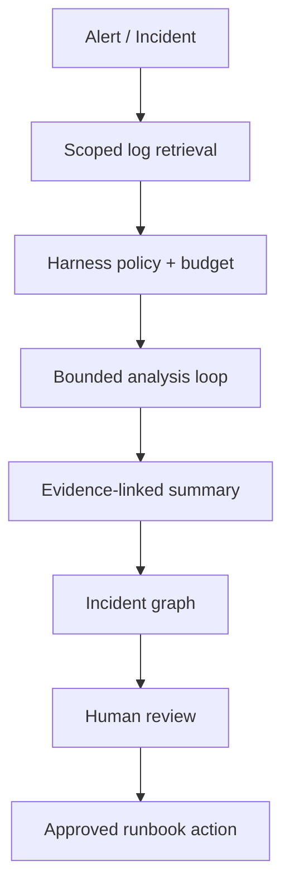

# AI / FDE Implementation — Distributed Logging

AI supports incident summaries, error clustering and query suggestions. Keep ingestion, redaction, retention and alert thresholds deterministic.

Prompt defines analysis schema; Context retrieves tenant-authorized/redacted logs and runbook references; Harness enforces query budget, tool scopes and audit; Loop is bounded; Graph coordinates incident triage, escalation and human-approved remediation.

Treat log bodies as untrusted prompt injection and potentially sensitive data. Never execute model-suggested commands without explicit approval and allowlisted runbooks.
