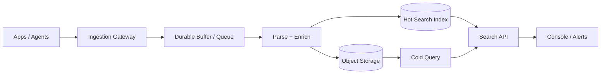
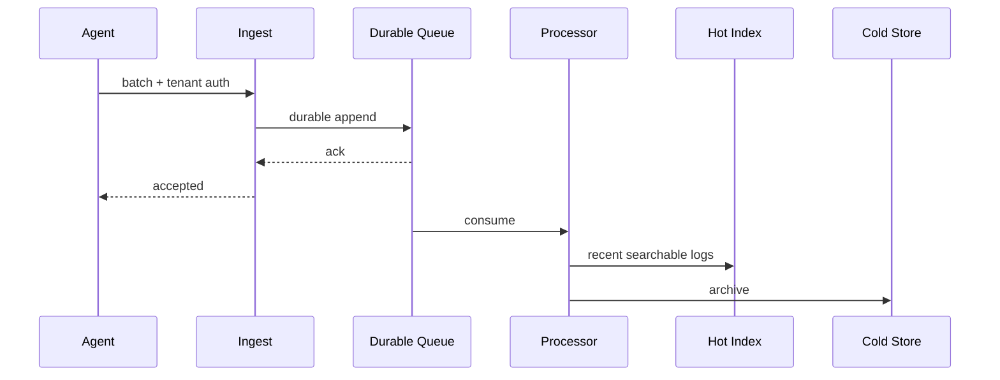

# Distributed Logging Platform

## Scope
Collect logs from services/hosts, parse/enrich, buffer, index/search, retain, alert and export across tenants.

## Architecture

## Critical flow
Agent batches events with bounded size → authenticated ingest validates tenant/schema/quota → durable buffer acknowledges → workers parse/redact/enrich → route hot index and compressed cold archive → query service enforces tenant/time/filter and returns cursor results.

## Data model
LogEvent(timestamp, tenantId, service, severity, traceId, body, attributes); IngestBatch; Parser; EnrichmentRule; Sink; IndexPolicy; RetentionPolicy; Query; Cursor; AlertRule.

## Failure modes
Ingest burst, queue saturation, poison record, high-cardinality labels, hot tenant, index outage, clock skew, data leak and retention failure. Use backpressure, durable buffering, DLQ, cardinality limits, tenant quotas, redaction and lifecycle audits.

## Trade-offs
Hot index retention vs cost; push vs pull ingestion; schema-on-write vs query-time parsing; tenant isolation vs shared infra; exact alerting vs sampling.

## Interview walkthrough
Clarify event rate, average bytes, query patterns, retention, tenant isolation and alert latency. Estimate ingest bytes/sec and index amplification. Explain batching, durable queue, partitioning, hot/cold tiers, query fanout, cardinality and backpressure.

## Visual explainer

## AI/FDE
AI can summarize incidents, cluster errors and suggest queries. Prompt defines bounded analysis; Context retrieves tenant-authorized logs with redaction; Harness enforces scopes, query budgets and audit; Loop is bounded; Graph coordinates incident triage and human approval. AI-generated remediation is advisory unless separately approved.
