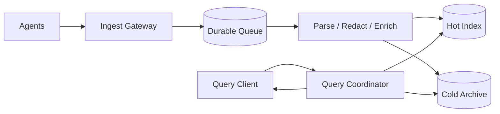

# Architecture — Distributed Logging

Agents batch and compress events; ingest gateway authenticates tenant, enforces quotas/schema and redacts sensitive fields; durable queue buffers bursts; processors parse/enrich and route to hot index plus cold object archive; query coordinator fans out bounded time partitions and merges cursor pages.

Partition by tenant/time or hash with tenant-aware quotas. Separate ingest and query capacity. Apply backpressure at agents, bounded queues, DLQ for malformed events and retention lifecycle across all tiers.
