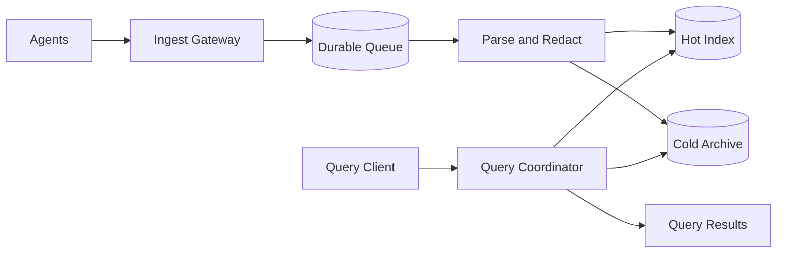
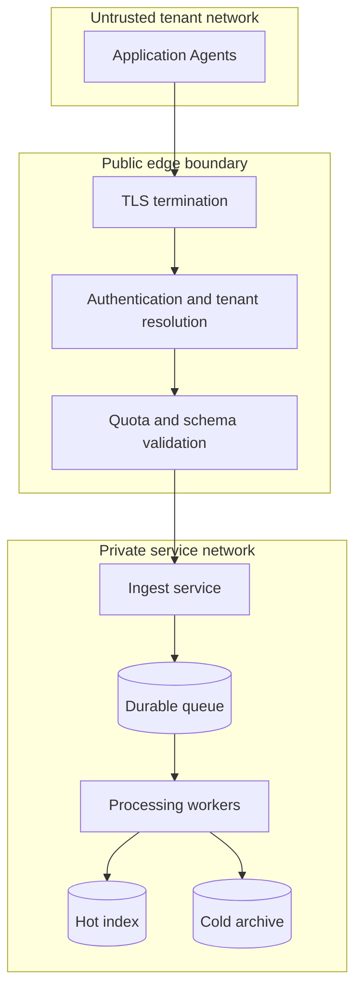

# Architecture — Distributed Logging

Agents batch and compress events. The ingest gateway authenticates the tenant, enforces quotas and schema, and redacts sensitive fields before durable buffering. Processors parse, enrich and route records to a hot search index and a cold object archive. A query coordinator fans out over bounded time partitions and merges cursor pages.

## Network and trust boundary

Agents and query clients are outside the private service network. Use TLS in transit, workload identity between services, tenant-scoped credentials, least-privilege storage policies and separate ingest/query roles. Do not trust tenant IDs supplied in event payloads: derive tenant identity from authenticated credentials and reject mismatches. Redact secrets and personal data before indexing or archiving; enforce tenant filters in every query path. Keep archive access private and audited.

## Scale progressively

1. **Single-node baseline:** one ingest API, relational metadata, a durable queue and object storage. Establish event schema, tenant identity, retention and idempotency first.
2. **Separate ingest from query:** move parsing/indexing to consumers; isolate query compute from ingestion so search spikes do not block event acceptance.
3. **Partition throughput:** partition queue by tenant and time or a stable hash; shard hot indexes by tenant/time; enforce per-tenant quotas to contain noisy neighbours.
4. **Tier storage:** keep recent searchable data in the hot index; compact older data into object archives with lifecycle and retention policies.
5. **Multi-region resilience:** use regional ingest cells and explicit replication/DR objectives. Define duplicate handling and query consistency across regions.
6. **Control cardinality and cost:** cap label dimensions, sample or aggregate high-volume events, apply retention tiers and expose per-tenant budgets.

Scale on measured queue age, ingest rejection rate, indexing lag, query p99, hot-shard skew and storage growth—not raw server count alone.

## Operations

Partition by tenant and time or hash with tenant-aware quotas. Separate ingest and query capacity. Apply backpressure at agents, bounded queues, a dead-letter queue for malformed events and retention lifecycle across all tiers. Acknowledge only after durable buffering. Monitor event loss, queue age, indexing delay, cardinality, query latency, archive retrieval time and tenant isolation failures.
