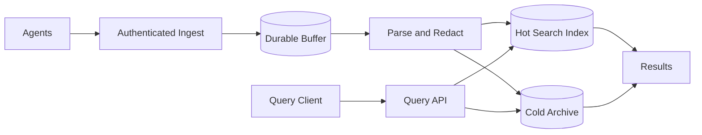
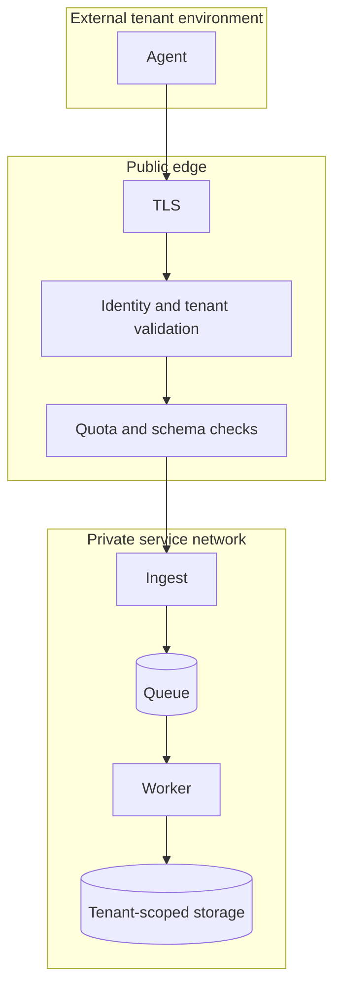
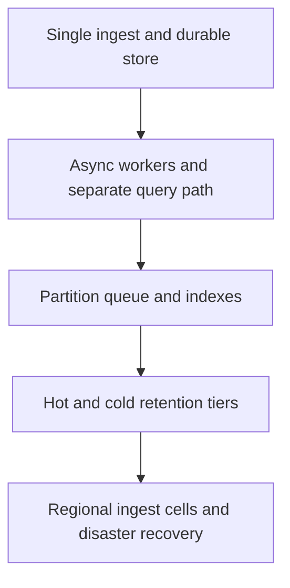

# Visual Explainer — Distributed Logging

## End-to-end data path

## Network and trust boundary

Authenticate before accepting events, derive tenant identity from credentials, and keep storage private. Apply tenant authorization to query and archive access as well as ingestion.

## Scale progressively

Add complexity only when a measured bottleneck requires it: queue age, indexing lag, query p99, hot-shard skew or storage cost. See [architecture](architecture.md) for the detailed rationale.
