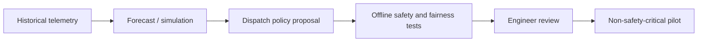

# AI / FDE Implementation

AI can forecast traffic, simulate dispatch policies and explain maintenance patterns using authorized telemetry.

Do not connect an LLM to motion, door or emergency control. Dispatch recommendations must remain constrained by deterministic eligibility and safety rules. Evaluate wait time, fairness, energy and constraint violations (zero tolerance).
