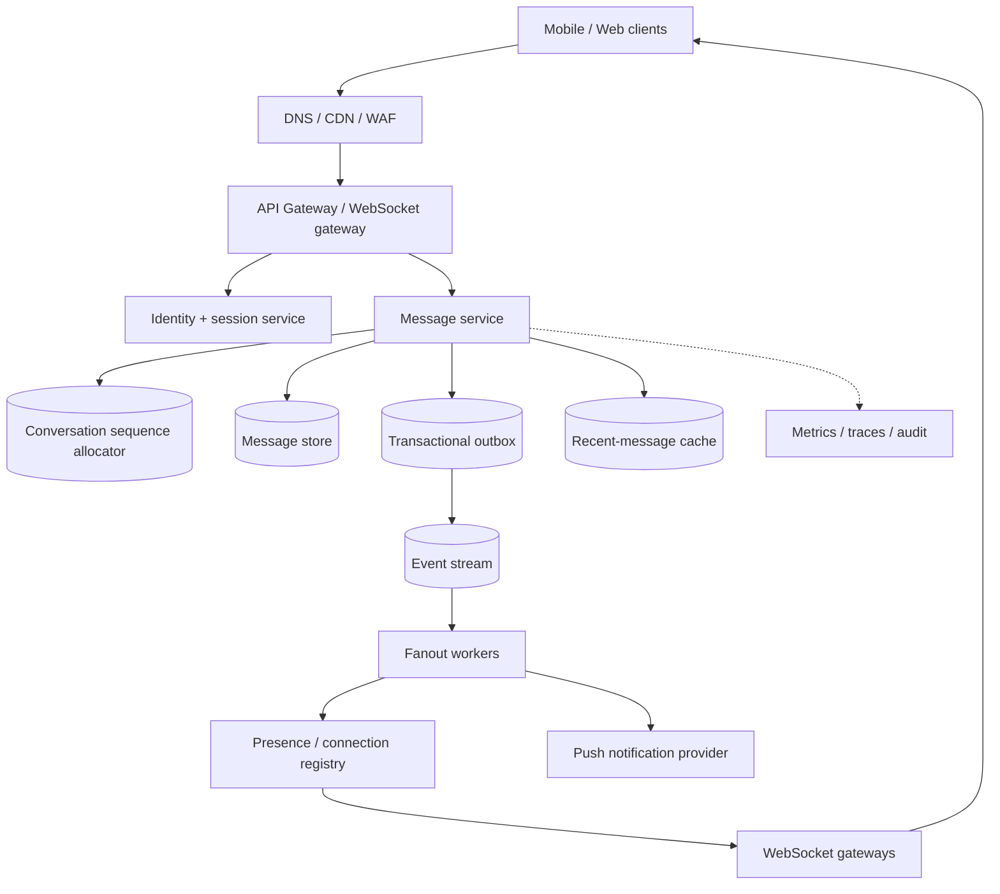
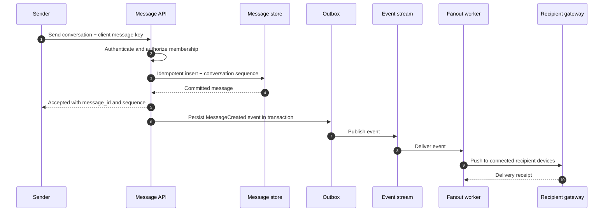

# Chat and Messaging System — HLD Case Study

Design one-to-one and group messaging with durable messages, online delivery, offline catch-up, read receipts and multi-device sessions.

## Requirements

Functional: send/receive messages, group membership, history, delivery/read state, online presence, offline notifications, block/report.

Non-functional: low send acknowledgement latency, durable accepted messages, per-conversation ordering, high availability, privacy and cost-controlled fanout.

## Architecture

## Send-message sequence

## Data model sketch

- Conversation(id, type, created_at)
- ConversationMember(conversation_id, user_id, role, joined_at, last_read_sequence)
- Message(conversation_id, sequence, message_id, sender_id, body_ref, created_at)
- DeviceSession(user_id, device_id, gateway_id, last_seen)
- DeliveryState(message_id, device_id, delivered_at, read_at)

## Invariants and trade-offs

- A message accepted by the API is durable before success is returned.
- A client-generated idempotency key deduplicates retries from mobile networks.
- Sequence numbers are monotonic within a conversation; global ordering is unnecessary.
- Membership and authorization are checked server-side before send/read.
- Fanout may be at-least-once; clients deduplicate by message ID.
- For very large groups, compare fanout-on-read and hybrid fanout rather than synchronously writing every inbox.
- Presence is ephemeral and approximate; history is durable.

## Failure handling

| Failure | Response |
|---|---|
| Recipient offline | Persist message; notify and catch up on reconnect |
| Gateway dies | Client reconnects; stale session expires |
| Event stream delayed | Message remains durable; monitor outbox age and fanout lag |
| Duplicate send | Idempotency key returns original message |
| Hot group | Partition by conversation, bound fanout, isolate large groups |
| Membership revoked | Recheck authorization at send/read, not only socket connect |

## Interview deep dives

Ordering, fanout strategy, multi-device state, encryption boundaries, attachment storage, retention/deletion, spam controls and unread-count materialization.