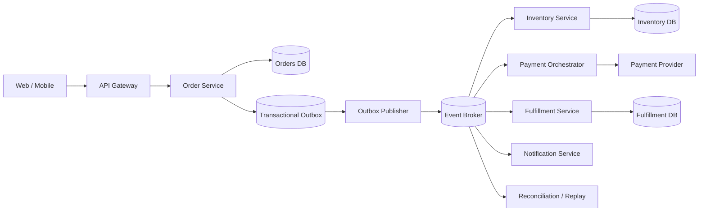
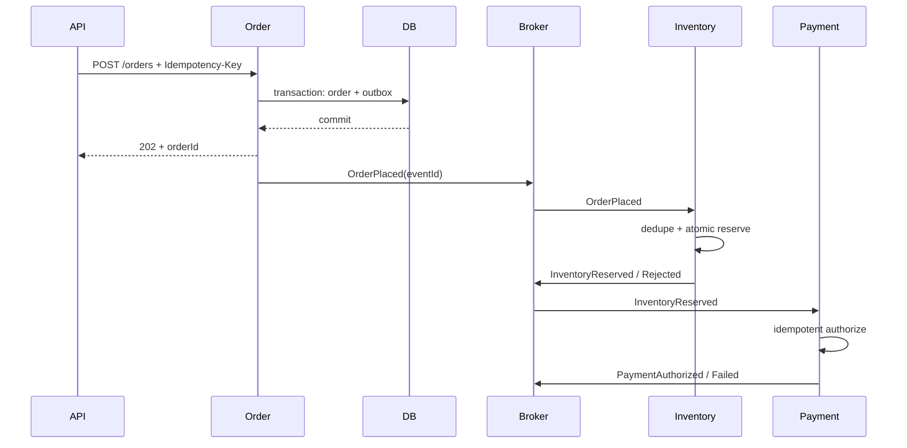

# Event-Driven Order Platform — HLD Case Study

> Senior interview focus: transaction boundaries, asynchronous workflows, inventory correctness, payment idempotency and operational recovery.

## 1. Problem and scope

Design a commerce order platform. Customers create orders, reserve inventory, authorize payment, trigger fulfillment and track status. Services own their state and communicate through commands/events. Scope includes order lifecycle, inventory reservation, payment orchestration, event publication, idempotent consumers, outbox/inbox, retries, DLQ and reconciliation.

## 2. Requirements

**Functional:** create orders with an idempotency key; snapshot price and quantity; reserve inventory; authorize payment; support cancellation, expiry, refunds and partial fulfillment; expose status timeline; reconcile stuck workflows.

**Non-functional (illustrative):** 99.95% monthly order API availability; p95 acceptance under 300 ms excluding downstream completion; durable accepted orders; no overselling beyond the stated reservation policy; eventual completion or explicit compensation; tenant/customer isolation.

## 3. Workload assumptions

Example only: 2 million orders/day (~23/s average), 20x peak (~460/s), 8 events/order (~16 million events/day), 3 KB order payload and 1 KB event envelope. Recalculate for burst duration, hot SKUs, fanout, retention, replication and regional topology.

## 4. Architecture



**Ownership:** Order owns order aggregate and status; Inventory owns available/reserved quantity and reservation TTL; Payment owns payment intent and provider idempotency; Fulfillment owns shipment; broker provides durable delivery and per-key partition order; publisher moves committed outbox records to the broker.

## 5. Critical workflows

1. Validate request and client idempotency key.
2. Commit order in `PENDING_RESERVATION` and outbox event in one database transaction.
3. Return accepted order ID; this does not claim payment or fulfillment is complete.
4. Publisher leases unpublished records, publishes stable event IDs, then marks published.
5. Inventory consumer deduplicates and atomically reserves stock.
6. `InventoryReserved` advances the saga; rejection cancels the order.
7. Payment uses a stable provider idempotency key. Unknown provider outcomes are queried/reconciled before retry.
8. On payment failure, release inventory. If fulfillment fails after authorization, void or refund according to payment state.



## 6. Contracts and data

APIs: `POST /v1/orders`, `GET /v1/orders/{id}`, `POST /v1/orders/{id}/cancel`, `GET /v1/orders/{id}/timeline`.

Event envelope:

```json
{
  "eventId": "uuid",
  "eventType": "InventoryReserved",
  "schemaVersion": 1,
  "aggregateType": "Order",
  "aggregateId": "order_123",
  "aggregateVersion": 4,
  "occurredAt": "2026-01-01T10:00:00Z",
  "correlationId": "request_abc",
  "causationId": "event_previous",
  "tenantId": "tenant_1",
  "payload": { "reservationId": "reservation_9" }
}
```

Core records: `orders(id, customer_id, status, version, currency, subtotal, created_at)`, `order_items(order_id, sku, quantity, unit_price_snapshot)`, `outbox(event_id, aggregate_id, aggregate_version, type, payload, published_at, lease_until)`, `consumer_inbox(consumer_name, event_id, processed_at)`, `inventory_reservations(id, order_id, sku, quantity, status, expires_at)`, `payment_intents(id, order_id, provider_reference, idempotency_key, status, amount)`, and append-only `order_transitions`.

## 7. Consistency and correctness

- ACID protects order + outbox; broker publication is outside that transaction.
- Delivery is at-least-once. Consumers need inbox dedupe and idempotent effects; do not claim end-to-end exactly-once.
- Partition by `aggregateId` for per-order order; no global ordering requirement.
- Use aggregate versions and conditional writes to reject stale transitions.
- Inventory reservation must be atomic per SKU; define multi-SKU partial reservation semantics.
- Payment provider idempotency prevents duplicate charges; reconcile unknown outcomes before retry.
- Saga compensation is a new business action, not rollback of distributed history.

## 8. Failure modes

| Failure | Detection | Recovery |
|---|---|---|
| DB commits, publisher crashes | Old unpublished outbox rows | Lease retry with stable event ID |
| Broker redelivers | Inbox unique constraint | Acknowledge duplicate safely |
| Consumer crashes after side effect | Incomplete processing record | Idempotent side effect or transaction with inbox |
| Payment timeout | Provider/local mismatch | Query provider before retry |
| Reservation expires during payment | Version/state conflict | Reject stale path; void/refund if needed |
| Poison event | Retry threshold / DLQ | Quarantine, repair and controlled replay |
| Consumer lag | Oldest event age | Scale, partition, apply backpressure |
| Workflow stuck | State-age SLO | Reconciliation emits repair command |

## 9. Scaling and deployment

Partition broker topics by order ID; isolate hot tenants/SKUs if needed; use projections for history; autoscale consumers on lag and processing latency; bound retries with jitter; retain DLQ and replay audit. Start multi-region with home-region ownership per order; active-active inventory writes require explicit conflict semantics.

## 10. Security and operations

Authenticate tenant/customer and re-check ownership in the service. Never place PAN/CVV in events. Sign internal calls, validate schemas and producer identity, audit cancellation/refund/replay overrides. Trace correlation IDs across API, outbox and broker. Monitor queue age, saga age, duplicate rate, payment uncertainty, reservation expiry and DLQ growth.

## 11. Trade-offs

| Decision | Chosen | Alternative |
|---|---|---|
| Cross-service consistency | Saga + outbox/inbox | Distributed transaction couples availability and operations |
| Delivery | At-least-once + idempotency | Exactly-once claims hide boundary limits |
| Reads | Materialized projection | Direct aggregate reads cost more and couple queries |
| Reservation | TTL hold | Immediate decrement can strand stock |
| Region | Home-region ownership | Active-active lowers latency but complicates stock conflicts |

## 12. Interview walkthrough

Open with the invariant: **an accepted order is durable, and every downstream side effect is idempotent, observable and recoverable.** Clarify what accepted means, estimate peak throughput, draw the outbox/broker flow, walk success and timeout paths, explain why outbox does not eliminate consumer idempotency, then discuss hot SKU behavior, payment reconciliation and region strategy.

Follow-ups: prevent two buyers reserving the last unit; provider success with response timeout; schema evolution; partial shipment/cancellation; replay without duplicate notifications.

Pair this HLD with workflow orchestration and webhook delivery LLD examples in the companion [LLD_patterns repository](https://github.com/luckyhegde6/LLD_patterns).
